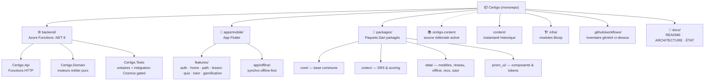
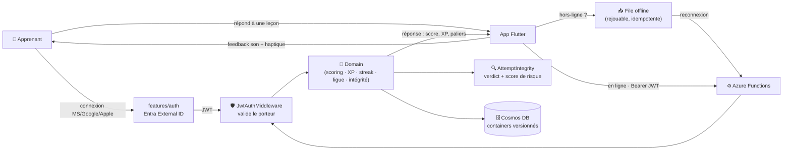
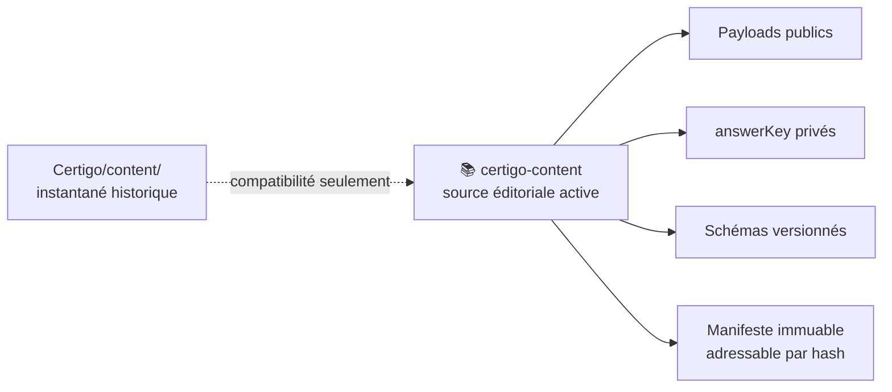
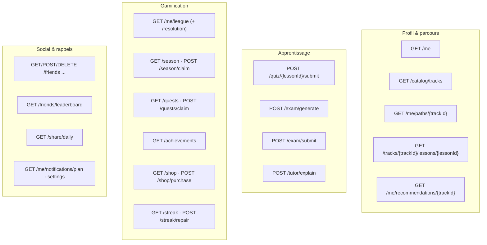
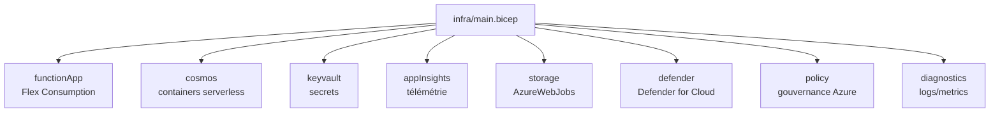

<div align="center">

# 🟢 Certigo — État vivant du projet

**Le « Duolingo des certifications Microsoft » — apprendre Azure / IA / sécurité par micro‑leçons gamifiées.**

Les statuts fonctionnels ci-dessous sont narratifs et doivent être lus avec leurs preuves
(workflow, test, runbook ou audit daté). Sans preuve citée, ils sont **non vérifiés / manuels**.

</div>

> [!NOTE]
> **Ce document combine des faits générés et une lecture narrative.** Trois documents complémentaires :
> - **`README.md`** → la **vision** et le pitch produit.
> - **`docs/ARCHITECTURE.md`** → le **design de référence / la cible** technique.
> - **`docs/ETAT_DU_PROJET.md`** (ce fichier) → faits observables générés, puis contexte narratif.
>
> Le bloc suivant est la seule source documentaire des compteurs techniques majeurs. Sa référence
> (`docs/project-state-reference.json`) conserve le commit/date capturés et le SHA-256 déterministe
> des noms de chemins triés et des octets observés. Le bloc généré et la référence sont committés
> séparément pour éviter tout cycle d'auto-référence.

<!-- GENERATED:PROJECT-STATE:START -->

## État technique généré

> Ne pas modifier ce bloc à la main. Sources et commande sont documentées juste après.

| Fait observable | Valeur générée |
|---|---|
| Date de référence analysée | **2026-09-02** |
| Commit de référence analysé | `80a91f259b760792f11f054f75b00028f605816b` |
| Flutter | **3.44.4** — aligné entre `ci-mobile` (app et goldens), Android et les deux workflows iOS Codemagic |
| .NET CI | **8.0.x** |
| Node.js outillage | **>=20** (`package.json#engines`) |
| Contenu actif | `gchambaud_microsoft/certigo-content@main` — révision `55a512821dabbea8b65d3403f9c83571b4a33ed8` du **2026-08-14** |
| Package public actif | **146 fichiers** — `sha256:335fb7c1538739cf2a1f2ac9629ed3d355dca851215fed61d60a28c166807dff` |
| Package privé actif (`answerKey`) | **146 fichiers** — `sha256:6e0ce2ef6ac799e3298e7e78ce23ad181a94961c979bef305e384898196f023b` |
| Workflows GitHub Actions | **27** fichiers : `cd-backend.yml`, `ci-backend.yml`, `ci-content.yml`, `ci-cortex-parity.yml`, `ci-infra.yml`, `ci-migration-registry.yml`, `ci-mobile.yml`, `ci-preflight.yml`, `ci-project-state.yml`, `codeql.yml`, `content-infra-what-if.yml`, `dependency-vuln-scan.yml`, `deploy-privacy-policy.yml`, `fork-pr-policy.yml`, `governance-bootstrap-phase-a-what-if.yml`, `governance-bootstrap-phase-b-what-if.yml`, `lint-workflows.yml`, `pr-head-freshness.yml`, `promote-backend-staging-prod.yml`, `publish-verified-public-pages.yml`, `release-android.yml`, `release-ios.yml`, `runner-health.yml`, `runner-resilience-drill.yml`, `security-gate.yml`, `security-scan.yml`, `sync-ios-certs.yml` |
| Tests découverts | **198 fichiers** — .NET : 4 projets / 92 fichiers ; Flutter/Dart : 6 racines / 99 fichiers ; Python : 1 racine / 7 fichier |
| Corpus **historique** local | **91 pistes**, **146 leçons** sous `content/` — instantané de compatibilité, non actif |
| Types pédagogiques canoniques | **8** : `mcq`, `multi`, `scenario`, `cloze`, `ordering`, `matchPairs`, `spotTheIssue`, `applied` (schéma JSON et `ItemType` C# alignés) |

<!-- GENERATED:PROJECT-STATE:END -->

### Régénération et politique de preuve

```bash
# Après avoir commité les sources observables :
python tools/project_state.py --refresh-reference
python tools/project_state.py --check
python -m unittest discover -s tools/tests -p "test_*.py" -v
```

Sources canoniques : pins des workflows GitHub/Codemagic, `package.json`, arborescences de
workflows/tests/corpus, `lesson.schema.json`, `ContentModels.cs`,
`docs/active-content-reference.json` et `docs/project-state-reference.json`. La gate
`ci-project-state.yml` teste le générateur, impose **generated == committed**, reconstruit les
packages du `main` courant de `certigo-content`, puis vérifie la révision, la date et les deux
manifestes. Elle tourne sur chaque PR et quotidiennement : toute dérive amont rend l'état obsolète
et échoue explicitement. Les sections restantes expliquent le contexte ; « opérationnel » exige une
preuve automatisée ou une référence explicite, sinon l'affirmation est **non vérifiée / manuelle**.

Le commit et la date de référence sont capturés au premier commit. La correspondance des sources
est ensuite vérifiée par SHA-256 sur les noms de chemins UTF-8 triés et les octets exacts, avec
longueurs encadrées sans ambiguïté ; `docs/project-state-reference.json` est exclu. Le contrôle ne
dépend ni de l'objet Git capturé ni de son ascendance et reste donc valide après un squash/root
équivalent. Une source modifiée ou non committée change l'empreinte et bloque la génération.

---

## 1 · Vue d'ensemble — où en est chaque brique

| Brique | Statut | Où | En clair |
|---|:---:|---|---|
| **API backend** | 🟢 | `backend/src/Certigo.Api` | Azure Functions .NET 8 isolé ; couvert par `ci-backend.yml`. |
| **Moteurs métier** | 🟢 | `backend/src/Certigo.Domain` | Logique **pure & testée** : contenu, progression, gamification, examen, tuteur, reco, notifications, intégrité. |
| **Contenu pédagogique** | 🟢 | [`certigo-content`](https://github.com/gchambaud_microsoft/certigo-content) | Source éditoriale active du corpus migré : contenu public, `answerKey`, schémas et manifeste immuable. `content/` est un instantané historique. |
| **Gamification** | 🟢 | Domain `Gamification/` | XP, streak (+réparation), ligues hebdo, **saisons**, quêtes, succès, boutique, amis. |
| **Tuteur IA** | 🟡 | Domain `Tutor/` + mobile `features/tutor` | Explications ancrées sur le contenu — **branché côté serveur ET mobile** (`tutor_sheet`). LLM réel **Azure OpenAI / Microsoft Foundry** (`AzureOpenAiTutorCompletion`, déploiement `gpt-5.4-mini`, surface API **v1**, auth **Entra ID** clé désactivée) derrière `ITutorCompletion`, activé par `TUTOR_LLM_ENABLED=true` (sinon repli déterministe `NullTutorCompletion`) ; **code prêt, compilé, couvert par `TutorCompletionTests`**. **RBAC à accorder en `dev`** (rôle _Cognitive Services OpenAI User_ sur `certigo-openai`, identité managée de `func-certigo-dev`) et **activé en `dev`** via `infra/params/dev.bicepparam` ; reste à valider **un appel réel** (`POST /tutor/explain` → 200 + explication LLM authentique) avant de basculer en 🟢. Voir H19. |
| **Recommandation + coach** | 🟢 | Domain `Recommendation/` + `home/coach_section` | Moteur « next best » + coach IA sur l'accueil. |
| **Notifications** | 🟢 | Domain `Notifications/` | Planification **serveur‑autoritaire**, estimation de la meilleure heure d'envoi. |
| **Anti‑triche / intégrité** | 🟢 (shadow) | Domain `Integrity/` | Évaluateur déterministe des tentatives — **mode détection** (signale, ne sanctionne pas encore). |
| **Offline‑first** | 🟢 | `packages/data` (sync) + `app/offline` | File de synchro idempotente, backoff, rejouable — **câblée dans l'app**. *(Seule la leçon en cours est disponible hors‑ligne pour l'instant ; la synchronisation complète du catalogue est planifiée — P3.)* |
| **Authentification** | 🟢 | API `Middleware/` + mobile `features/auth` | **Microsoft / Google / Apple** fédérés derrière **Entra External ID**, JWT validé serveur. |
| **Person / LinkedIdentity** | 🟡 (shadow) | Domain `Identity/` + Application/Infrastructure | Runtime additif `off|shadow`, `off` dans tous les environnements. `shadow` conserve `personId == userId` et le resolver legacy autoritaire ; aucun endpoint/UI de liaison. |
| **Organization / Membership** | 🟡 (dormant) | Domain `Organizations/` + Application/Infrastructure | Isolation tenant et policies anti-IDOR par opération, Membership active/CAS, `404` cross-tenant ; feature strictement `off`, aucun endpoint live. |
| **Métriques d'apprentissage entreprise** | 🟡 (dormant) | Domain `Organizations/` + contrat `enterprise-learning-metrics/v1` | Sessions/heartbeats idempotents, agrégats Organization-scoped, CAS/offboarding/TTL et minimisation PII ; feature strictement `off`, aucun endpoint live. |
| **Design system (Prism)** | 🟢 | `packages/prism_ui` | Composants + tokens + thèmes ; tests/goldens dans `ci-mobile.yml`. |
| **App mobile (Flutter)** | 🟢 | `apps/mobile` | Les moteurs de gamification sont branchés en écran + tests widget (`ci-mobile.yml`). Validation E2E appareil : **non vérifiée / manuelle**. |
| **Cortex (algos partagés)** | 🟢 | `packages/cortex` | SRS, scoring, fil pédagogique — partagé client/serveur. |
| **Infrastructure (Bicep)** | 🟢 | `infra/` | Modules Functions, Cosmos, Key Vault, App Insights, Defender, Policy, Diagnostics et Storage ; réseau privé complet prêt (VNet/subnets FC1, private endpoints et DNS Storage/KV/Cosmos), non déployé par la PR ; état live référencé par `AUDIT_Certigo.md`. |
| **CI / qualité** | 🟢 | `.github/workflows` | Inventaire généré ci-dessus ; gates référencées dans les workflows versionnés. |

**Légende narrative :** 🟢 implémenté avec référence indiquée · 🟡 partiel / en cours · 🔴 absent.
Un statut sans référence vérifiable reste **non vérifié / manuel**.

---

## 2 · Carte du monorepo



---

## 3 · Architecture — le flux d'un quiz



> L'app fonctionne **hors‑ligne** : les réponses sont mises en file puis **rejouées à la reconnexion**.
> Chaque tentative passe par l'évaluateur d'**intégrité** (anti‑triche) en mode détection.

---

## 4 · Fonctionnalités livrées (inventaire détaillé)

| Domaine | Backend | Mobile | Détail |
|---|:---:|:---:|---|
| **Profil & progression** | 🟢 | 🟢 | `GET /me`, parcours par certif, leçons paginées. |
| **Catalogue de certifs** | 🟢 | 🟢 | `GET /catalog/tracks` + **sélecteur de certification** (`cert_picker_sheet`). |
| **Leçons & exercices** | 🟢 | 🟢 | Leçon paginée façon Duolingo : QCM, multi‑réponses, scénario, texte à trous, **appariement**, **remise en ordre**, spot‑the‑issue. Son + haptique. |
| **Quiz & scoring** | 🟢 | 🟢 | `POST /quiz/{lessonId}/submit` → score, XP, paliers, feedback. |
| **Parcours « skill‑path »** | 🟢 | 🟢 | Écran vivant façon Duolingo, règles de progression pures. |
| **Streak (série)** | 🟢 | 🟡 | `GET /streak` + `POST /streak/repair` (réparation). |
| **Ligues hebdo** | 🟢 | 🟡 | Tournoi XP hebdomadaire serveur‑autoritaire + `GET /me/league/resolution`. |
| **Saisons** | 🟢 | 🟢 | Défi mensuel thématisé : `GET /season`, `POST /season/claim` — écran `seasons` (thème, paliers, réclamation). |
| **Quêtes & succès** | 🟢 | 🟢 | `GET /quests` + `claim`, `GET /achievements` — écrans `quests` & `achievements`. |
| **Boutique** | 🟢 | 🟢 | `GET /shop` + `POST /shop/purchase` (économie de gemmes) — écran `shop`. |
| **Amis & classement** | 🟢 | 🟢 | Ajouter/retirer un ami, `GET /friends/leaderboard` — écran `friends`. |
| **Partage quotidien** | 🟢 | 🟢 | `GET /share/daily` (carte de partage encodée) — écran `share-daily` (carte du jour + partage natif iOS/Android). |
| **Examens blancs** | 🟢 | 🟢 | Moteur adaptatif : `POST /exam/generate` + `submit` — écran `exam` (génération, soumission, score). |
| **Tuteur IA** | 🟢 | 🟢 | `POST /tutor/explain` — branché dans l'app via `tutor_sheet`. |
| **Recommandation + coach** | 🟢 | 🟢 | `GET /me/recommendations/{trackId}` + coach IA sur l'accueil. |
| **Notifications intelligentes** | 🟢 | 🟡 | `GET /me/notifications/plan` + réglages ; meilleure heure d'envoi estimée. |
| **Anti‑triche / intégrité** | 🟢 | — | Évaluateur déterministe (mode détection, événement `attempt.flagged`). **Fenêtre de cadence** (XP/tentatives sur 1 h, conteneur `attempts`) câblée pour **quiz et examens** → détecteurs de débit actifs. |
| **Offline‑first** | 🟢 | 🟢 | Synchro idempotente rejouable, backoff. |
| **Authentification** | 🟢 | 🟢 | Microsoft / Google / Apple via Entra External ID (Android + iOS natifs câblés). |
| **Person / LinkedIdentity** | 🟡 (`off|shadow`) | — | Overlay Person et miroirs locaux/Entra idempotents, collisions fail-closed, télémétrie sans PII et tombstones de suppression ; aucune résolution autoritaire ni liaison utilisateur. |
| **Organization / Membership** | 🟡 (`off`) | — | Contexte tenant explicite, résolution Person/Membership active, matrice owner/admin/manager/learner, anti-IDOR invitations/teams/offboarding et policies réservées aux futures assignations ; aucun endpoint live. |

> **Lecture clé :** l'écart backend ↔ UI est désormais **comblé pour la gamification** : saisons, quêtes,
> succès, boutique, amis et examens disposent d'un **écran mobile + test widget**. Restent à exposer le
> **partage quotidien** et la **validation E2E sur appareil**.

---

## 5 · Contenu pédagogique



Les PR éditoriales, la validation des schémas et la publication du manifeste sont réalisées dans
`gchambaud_microsoft/certigo-content`. Le dossier `content/` de ce monorepo ne doit plus être
présenté ni utilisé comme source éditoriale active.

Référence active vérifiée : `certigo-content@main`
`470acdbf100e7f7faf9911015662bee6118b8bf5`, commit du
`2026-08-06T09:57:19Z`.

| Canal / artefact actif | Nombre de fichiers | Manifest ID |
|---|---:|---|
| `public/public` | **146** | `sha256:335fb7c1538739cf2a1f2ac9629ed3d355dca851215fed61d60a28c166807dff` |
| `answerKey/private` | **146** | `sha256:6e0ce2ef6ac799e3298e7e78ce23ad181a94961c979bef305e384898196f023b` |

Le contrat `certigo.content.package-manifest/v1` utilise `sha256` et la sérialisation
`json-sorted-keys-compact-utf8-lf`. Le corps canonique contient uniquement `schema`, `channel`,
`artifact`, `algorithm`, `serialization`, `fileCount` et `files` ; `manifestId` et `rootHash` sont
exclus du calcul. Les **91 pistes / 146 leçons** sous `content/` restent des métriques
**historiques** et ne décrivent pas la source active.

---

## 6 · Surface API (inventaire narratif)



Pile : **Azure Functions .NET 8 (worker isolé)**, déclencheurs HTTP, middleware JWT global avec liste
d'exemptions (endpoints anonymes), accès Cosmos via le SDK officiel.

---

## 7 · Cortex — les algorithmes partagés

`packages/cortex` héberge la logique pédagogique **réutilisée côté client et serveur** :

- **SRS (répétition espacée)** — planification des révisions.
- **Scoring & maîtrise** — calcul du niveau de maîtrise par compétence.
- **Fil pédagogique** — ordonnancement « quoi montrer ensuite ».

Doublé d'équivalents côté Domain (`Progress/ReviewScheduler`, `Readiness/ReadinessCalculator`) pour
les décisions serveur‑autoritaires.

---

## 8 · Sécurité & intégrité

| Mécanisme | Où | Comportement |
|---|---|---|
| **Auth multi‑fournisseurs** | mobile `features/auth` | Microsoft · Google · Apple, fédérés derrière **Entra External ID** via `flutter_appauth` ; session persistante (`session_store`). |
| **Validation JWT** | `Api/Middleware/JwtAuthMiddleware` | Vérifie le porteur `Bearer` sur chaque requête, sauf endpoints explicitement anonymes. |
| **Config native Android** | `apps/mobile/android` | Schéma de redirection `certigo://auth` + permission `INTERNET` (#46). |
| **Config native iOS** | `apps/mobile/ios` | URL Scheme `certigo` déclaré dans `Info.plist` pour le callback OIDC `certigo://auth`. |
| **Anti‑triche** | `Domain/Integrity/AttemptIntegrity` | Évaluateur **déterministe & pur** → verdict `Allow / Flag / Reject` + score de risque [0..1] + drapeaux nommés (vitesse surhumaine, soumission avant départ, débit XP excessif…). **Mode détection** d'abord (signale, ne touche pas aux récompenses). **Fenêtre de cadence** (XP + nombre de tentatives sur 1 h, lue du conteneur `attempts`, sans Redis) alimentée côté **`QuizService` et `ExamService`** → détecteurs `XpRateExceeded`/`AttemptRateExceeded` actifs. |
| **Baseline sécurité CI** | `.github/workflows` | **CodeQL** + **security‑scan** + Bicep `Defender` / `Policy` / `Diagnostics`. |

---

## 9 · Données — Cosmos DB

| Container | Clé de partition | Contenu |
|---|---|---|
| `users` | `/id` | Profils & préférences. |
| `content` | `/trackId` | Certifs & leçons publiées. |
| `progress` | `/userId` | Progression, maîtrise, streak. |
| `attempts` | `/userId` | Tentatives de quiz/examen (+ intégrité). |
| `events` | `/userId` | Journal d'événements (`attempt.flagged`, etc.). |
| `leaderboard` | `/periodLeagueId` | Classements ligues / saisons. |
| `economy` | `/userId` | Gemmes, achats boutique. |
| `friends` | `/userId` | Graphe social. |

> Mode **serverless** : on paie à la requête, idéal tant que la charge est faible.

> Les dépôts Cosmos (`users`, `attempts`, `friends`) sont couverts par un **projet de tests
> d'intégration** (`backend/tests/Certigo.Infrastructure.Tests`, 6 cas) exécuté contre l'**émulateur
> Cosmos** — gated par `CERTIGO_COSMOS_TESTS=1`, **skippé proprement** sans émulateur (runtime réel
> non exécuté dans cet environnement).

---

## 10 · Infrastructure (Bicep) — état live référencé par l'audit



La présence des modules et paramètres est observable dans `infra/` et contrôlée par
`ci-infra.yml`. L'état des environnements Azure est une observation externe, datée et référencée
dans l'audit ci-dessous ; il n'est pas déduit du seul code.

> ℹ️ État d'infra vérifié le **2026-07-04** — voir [`AUDIT_Certigo.md`](../AUDIT_Certigo.md) (source de vérité de l'état d'infra).

---

## 11 · Qualité & CI

L'inventaire exhaustif des workflows est généré dans **État technique généré**. Les preuves
automatisées principales sont `ci-backend.yml`, `ci-mobile.yml`, `ci-content.yml`,
`ci-cortex-parity.yml`, `ci-infra.yml`, `ci-migration-registry.yml` et
`ci-project-state.yml`. Les deux références iOS GitHub historiques restent opt-in ; la chaîne iOS
déclarée est dans `codemagic.yaml`.

> ⚠️ CI exécutée **uniquement sur les runners self‑hosted Azure** (`certigo-pr` sans
> identité pour les sources PR, `certigo-trusted` pour gates/opérations) — les runners
> GitHub‑hébergés sont désactivés par la politique d'entreprise. Egress via NAT Gateway `nat-certigo` (RG `rg-certigo-ci`).

> 🛟 **Résilience CI backend** — le job `build-test` cible exclusivement le pool Azure
> `[self-hosted, Linux, X64, certigo-pr|certigo-trusted]`. Les classes sont isolées et
> sans fallback croisé ;
> VMs portant ces labels ; aucun fallback hébergé ou piloté par variable n'est supporté.

---

## 12 · Journal d'évolution

> Du plus récent au plus ancien. Mis à jour à chaque session de travail sur le projet.
> Les nombres de ce journal sont des observations historiques datées, pas les compteurs courants ;
> les compteurs courants existent uniquement dans le bloc généré.

| Date | Évolution |
|---|---|
| 2026‑08‑21 | 📬 **Fermeture des races métriques/offboarding** : outbox transactionnel avec processing lease CAS, TimerTrigger strictement inerte en `off`, replay historique avant facts, retry purge autorisé, 30 partitions receipt directes et cohorte privacy stable inter-cycles. |
| 2026‑08‑21 | 🧱 **Refonte structurelle métriques entreprise** : lease serveur unique par sujet/cycle, faits exclusivement serveur, receipts isolés dans un conteneur jour×128 shards, buckets quotidiens non différenciables, activité préagrégée, worker/retry de purge et rejoins versionnés. Feature toujours strictement `off`. |
| 2026‑08‑21 | 🛡️ **Hardening métriques entreprise** : watermark monotone par session, receipts immuables, 128 shards/jour, consolidation bornée/backoff, TTL depuis le jour métrique, seuil fail-closed de cinq contributeurs et offboarding revoke-first avec tombstone/purge paginée reprenable. Feature toujours strictement `off`. |
| 2026‑08‑21 | 📊 **Métriques d'apprentissage entreprise dormantes** : heartbeats offline idempotents, sessions actives, agrégats temps/progression/completion/readiness sans PII ni acquis portable, partition Organization, CAS Membership, purge offboarding, TTL et contrats/volumétrie. `ENTERPRISE_LEARNING_METRICS_V1=off` est la seule valeur acceptée ; aucun endpoint live. |
| 2026‑08‑20 | 🏢 **Isolation tenant Organization/Membership** : contexte d'Organization explicite, résolution fail-closed de Person et Membership active, handlers par opération, contrôles route/body/resource, `404` cross-tenant/feature-off, matrice documentée et tests anti-IDOR/offboarding/escalade/confused-deputy. `ORGANIZATION_MEMBERSHIP_V1=off` reste la seule valeur acceptée ; legacy autoritaire, aucun endpoint live. |
| 2026‑08‑20 | 🪪 **Premier runtime Person / LinkedIdentity** : modèles/ports, persistence Cosmos additive dans `users` sans changement de PK, lazy migration `personId == userId`, miroir local/Entra idempotent en `shadow`, collisions visibles sans bloquer le legacy, télémétrie sans PII et nettoyage #296. `PERSON_LINKED_IDENTITY_V1=off` reste explicite en dev/staging/prod ; aucun endpoint/UI de liaison, déploiement ou activation. |
| 2026‑08‑06 | 🤖 **État observable généré (#247)** : versions, workflows, tests, corpus historique, types pédagogiques et référence analysée sont désormais produits par `tools/project_state.py` et gardés par `ci-project-state.yml`. `wp-p2-01` est clôturé après fusion de la PR #251 ; `wp-p2-08` est en revue dans la PR #254. |
| 2026‑08‑06 | 📦 **Phase 2 avancée** : `wp-p2-02` et `wp-p2-03` sont `done` après fusion des PR `certigo-content` #7/#8 ; `wp-p2-04`, `wp-p2-07` et `wp-p2-09` sont en cours dans leurs sessions dédiées. |
| 2026‑08‑05 | 📚 **Registre de migration réconcilié** : seuls les lots Phase 1 dont la DoD complète est satisfaite sont alignés à `done` dans le manifeste, les états JSON et la vue humaine ; les lots incomplets restent ouverts même si une PR associée a été fusionnée. Démarrage de `wp-p2-01` documentaire ; `wp-p2-02..09` ont alors été enregistrés à `todo`, avant leur exécution dans des sessions distinctes. |
| 2026‑06‑29 | 🧪 **Tests Cosmos exécutés sur émulateur réel** : 6 cas `Certigo.Infrastructure.Tests` lancés (0 ignoré) sur l'émulateur Docker `vnext-preview` (ARM64, HTTPS) → **5/6 verts** ; le 6e (agrégat `GetRecentActivityAsync`) bute sur une limite _vnext-preview_ (`RewrittenAggregateProjections`), pas un bug prod (classic amd64 inutilisable sur ARM64 : `exec format error` / segfault QEMU). ✅ **Couverture HTTP des 15 Functions** restantes ajoutée (faux services + harness) → suite globale **496** verte. |
| 2026‑06‑28 | 🛟 **Ancienne expérimentation de repli CI backend** : un fallback hébergé avait été pré-câblé ; cette voie a depuis été entièrement supprimée au profit du pool Azure redondé (cf. §11). |
| 2026‑06‑24 | 📱 **Écrans gamification mobile** : saisons · quêtes · succès · boutique · amis · examens blancs branchés (couche data + providers + router) → 6 écrans + 6 tests widget ; suite Dart **185** verte. 🧪 **Tests d'intégration Cosmos** (`Certigo.Infrastructure.Tests`, 6 cas émulateur‑gated, skippés proprement hors émulateur). |
| 2026‑06‑24 | 🔐 **Connexion sociale iOS** : ajout du callback natif `certigo://auth` dans `Info.plist` + messages d'erreur login plus explicites (redirect/client/provider) côté mobile. |
| 2026‑06‑24 | 🛡️ **Anti‑triche examen** : fenêtre de cadence (XP/tentatives sur 1 h, conteneur `attempts`) câblée dans `ExamService` — miroir de `QuizService` → détecteurs de débit actifs aussi pour les examens blancs ; test dédié `SubmitAsync_flags_submission_spam_via_the_rate_window`. Backend **325** tests verts. |
| 2026‑06‑23 | 🛡️ **Remédiation post‑audit** : intégrité économie (ETag + idempotence atomique), garde auth dev en prod, parité Cortex (golden tests), `/health` + correlation id, 400/409, hardening infra par env + params staging/prod, SBOM + gate de release, validateur de contenu renforcé — voir `AUDIT_CERTIGO.md` §M |
| 2026‑06‑23 | 🔐 **Config Android native** activant la connexion Entra (`certigo://auth` + INTERNET) — #46 |
| 2026‑06‑23 | 🔍 **Anti‑triche** : moteur d'intégrité de tentative + détection « shadow » (quiz/examen) — #43 |
| 2026‑06‑23 | 🪪 **Auth multi‑fournisseurs** Microsoft / Google / Apple + session persistante — #41 |
| 2026‑06‑23 | 🗓️ **Saisons** : moteur de défi mensuel thématisé serveur‑autoritaire — #42 |
| 2026‑06‑23 | 🔔 **Notifications** : planification intelligente serveur‑autoritaire — #40 |
| 2026‑06‑23 | 🎚️ **Sélecteur de certifs** + bandeau de parcours figé + texte enrichi propre — #38 |
| 2026‑06‑23 | 📥 **Offline‑first** : synchro idempotente + câblage app — #39 |
| 2026‑06‑23 | 🏆 **Ligues** : tournoi XP hebdomadaire serveur‑autoritaire — #27 |
| 2026‑06‑23 | 🛠️ **Infra** : alignement réglages Function App ↔ code, RBAC Cosmos, baseline sécurité CI — #8 |
| 2026‑06‑23 | 🎮 **5 types d'exercices** façon Duolingo + son/haptique (iOS + Android) — #15 |
| 2026‑06‑23 | 🧗 **Skill‑path** : écran de parcours vivant + règles de progression pures — #14 |
| 2026‑06‑23 | 🧭 **Reco « next best »** + coach IA sur l'accueil — #13 |
| 2026‑06‑23 | 🤝 **Tuteur IA branché** dans le client Flutter (iOS + Android) — #12 |
| 2026‑06‑23 | 🧠 **Tuteur IA backend** ancré sur le contenu, apprentissage continu — #11 |
| 2026‑06‑22 | 📝 **Examen blanc adaptatif** (génération + scoring) — #10 |
| 2026‑06‑22 | 🏗️ Bascule sur **runner self‑hosted Azure** + egress NAT — #9 |
| 2026‑06‑23 | 📄 **Ce tableau de bord vivant** créé puis tenu à jour. |

---

## 13 · Prochaines étapes & écarts

**Écarts backend ↔ mobile (à brancher en UI) :**
- 🟢 Saisons, quêtes, succès, boutique, amis, examens blancs, partage quotidien : **écrans livrés** (+ tests widget) — reste la **validation E2E sur appareil**.
- 🟡 Streak‑repair, ligues, notifications : partiellement exposés.

**Chantiers techniques :**
- 🏗️ **Provisionner `staging`** par Bicep et valider `/health` ; `dev`, `prod` et CI sont déjà déployés.
- 🔐 **Valider l'auth de bout en bout** sur un vrai tenant Entra External ID (E2E).
- 🪪 **Person / LinkedIdentity — prochain lot** : observer le mode `shadow`, traiter toute collision,
  puis livrer séparément le resolver autoritaire `resolve`. Les endpoints/UI `link` restent hors
  périmètre jusqu'à validation des cohortes et de la suppression multi-identités.
- 🔍 **Faire passer l'anti‑triche** du mode détection au mode application des sanctions (lot suivant) — la **fenêtre de cadence** (débit XP/tentatives sur 1 h) est désormais câblée pour **quiz et examens** ; reste la calibration puis la bascule en mode sanction.
- ✅ **Tests d'intégration Cosmos exécutés sur émulateur réel** (le projet `Certigo.Infrastructure.Tests` est gated `CERTIGO_COSMOS_TESTS=1`). Les **6 cas ont tourné** (0 ignoré) contre l'émulateur Docker `mcr.microsoft.com/cosmosdb/linux/azure-cosmos-emulator:vnext-preview` (ARM64, HTTPS) : **5/6 verts**. Le 6e — `Attempt_recent_activity_aggregates_count_and_xp_within_window` (`CosmosAttemptRepository.GetRecentActivityAsync`, agrégat `COUNT(1)`/`SUM` projeté en objet `VALUE { … }`) — échoue **uniquement** sur l'émulateur _vnext-preview_ (back‑end PostgreSQL) avec `RewrittenAggregateProjections was not an array for a value aggregate query`. **Ce n'est pas un bug de production** : la requête est valide contre Cosmos réel et l'émulateur classic ; on **ne réécrit pas** la requête pour contourner une limite de l'émulateur preview. L'émulateur **classic amd64** est **inutilisable sur cet hôte ARM64** (`exec format error` sans QEMU ; `segfault signal 11` même avec QEMU x86_64 binfmt installé), d'où la cible 6/6 hors de portée localement — à confirmer en CI/Cosmos réel.
  - _Relancer la suite_ : `docker run -d --name cosmos-emulator -p 8081:8081 -p 1234:1234 -e PROTOCOL=https mcr.microsoft.com/cosmosdb/linux/azure-cosmos-emulator:vnext-preview` (attendre `PostgreSQL=OK, Gateway=OK, Explorer=OK` dans `docker logs`), puis exporter `CERTIGO_COSMOS_TESTS=1`, `COSMOS_EMULATOR_ENDPOINT=https://localhost:8081`, `COSMOS_EMULATOR_KEY=<clé publique émulateur>` et lancer `dotnet test backend\tests\Certigo.Infrastructure.Tests`.
- ✅ **Couverture HTTP/middleware Functions complétée** : tests ajoutés pour les **15 Functions** jusque‑là non couvertes (User, Tutor, Streak, Shop, ShareCard, Season, Recommendation, Quest, Path, Notification, Lesson, Leaderboard, Friend, Exam, Achievement) via le harness maison (`FunctionTestHost` + faux services dans `Fakes.Functions.cs`) — happy‑path authentifié (200 + service appelé 1×) et garde non‑authentifié. **Suite globale `dotnet test backend\Certigo.sln` : 496 verts, 0 échec** (6 cas Cosmos `Skipped` proprement quand le gate est off).
- 🤖 **Tuteur IA — valider l'appel LLM réel** : le provider Azure OpenAI / Foundry (`gpt-5.4-mini`, surface **v1**, auth **Entra ID**) est **câblé, compilé et couvert par tests unitaires**. **RBAC à accorder en `dev`** (rôle _Cognitive Services OpenAI User_ sur `certigo-openai` pour l'identité managée de `func-certigo-dev`) et **activé en `dev`** (`infra/params/dev.bicepparam` → app settings `TUTOR_LLM_*`, déployés par `cd-backend`). Reste **un appel réel de validation** (register/login → JWT → `POST /api/tutor/explain` → 200 + explication LLM authentique) pour confirmer le chemin live et basculer le statut en 🟢 ; tant que cet appel n'est pas validé, le tuteur garde le repli déterministe en filet.

---

<div align="center">

### 🔄 Comment ce document reste à jour

Après avoir commité une modification de source observable, exécuter
`python tools/project_state.py --refresh-reference`, puis committer la référence et le document.
La gate `ci-project-state.yml` rejoue les tests unitaires et `--check`; une version, un fichier de
corpus, un type, un workflow ou un test ajouté sans régénération fait échouer la vérification. Le
journal et les statuts fonctionnels restent narratifs et doivent citer leur preuve.

</div>
