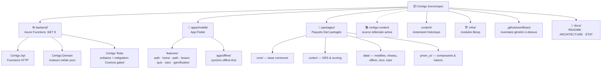
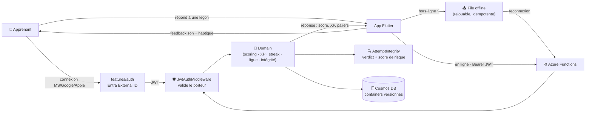
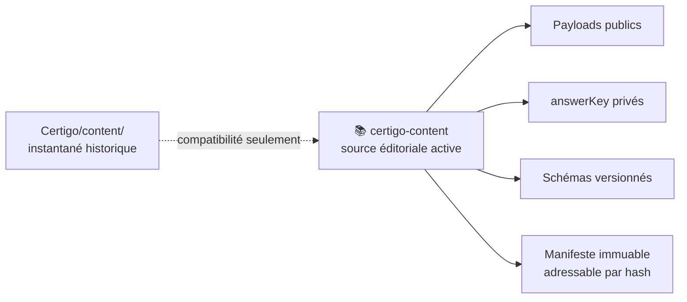
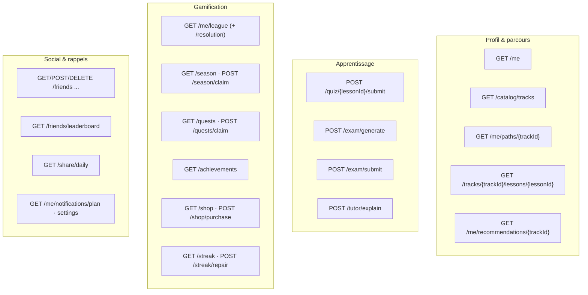
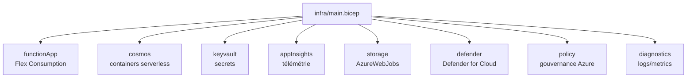

<div align="center">

# 🟢 Certigo — État vivant du projet

**Le « Duolingo des certifications Microsoft » — apprendre Azure / IA / sécurité par micro‑leçons gamifiées.**

Les statuts fonctionnels ci-dessous sont narratifs et doivent être lus avec leurs preuves
(workflow, test, runbook ou audit daté). Sans preuve citée, ils sont **non vérifiés / manuels**.

</div>

> [!NOTE]
> **Ce document combine des faits générés et une lecture narrative — c'est aussi, depuis le
> 2026-09-03, le registre canonique unique de l'audit (risques/findings) et du plan (lots de
> migration restants) de Certigo.** Quatre documents complémentaires :
> - **`README.md`** → la **vision** et le pitch produit.
> - **`docs/ARCHITECTURE.md`** → le **design de référence / la cible** technique.
> - **`docs/ETAT_DU_PROJET.md`** (ce fichier) → faits observables générés, risques/findings
>   (§14), plan de migration (§15), puis contexte narratif.
> - **`docs/migration/STATE.md`** → détail machine-vérifié (gardé par
>   `ci-migration-registry.yml`) de chaque lot de migration ; §15 en donne le résumé et y renvoie
>   plutôt que de le dupliquer.
>
> Les anciens `AUDIT_Certigo.md` et `AUDIT_Certigo_annexe_9c488c6.md` sont **archivés** sous
> [`docs/archive/`](./archive/) : leur contenu encore pertinent a été migré au §14.
>
> Le bloc suivant est la seule source documentaire des compteurs techniques majeurs. Sa référence
> (`docs/project-state-reference.json`) conserve le commit/date capturés et le SHA-256 déterministe
> des noms de chemins triés et des octets observés. Le bloc généré et la référence sont committés
> séparément pour éviter tout cycle d'auto-référence.

<!-- GENERATED:PROJECT-STATE:START -->

## État technique généré

> Ne pas modifier ce bloc à la main. Sources et commande sont documentées juste après.

| Fait observable | Valeur générée |
|---|---|
| Date de référence analysée | **2026-10-27** |
| Commit de référence analysé | `c8ab78c5aeaec5d64bb30425038bf7b6305a3c24` |
| Flutter | **3.44.4** — aligné entre `ci-mobile` (app et goldens), Android et les deux workflows iOS Codemagic |
| .NET CI | **8.0.x** |
| Node.js outillage | **>=20** (`package.json#engines`) |
| Contenu actif | `gchambaud_microsoft/certigo-content@main` — révision `a433518a649a74a33ecdc8874a99685fc125b9ea` du **2026-09-23** |
| Package public actif | **1622 fichiers** — `sha256:11b297c76d95fedf1e83284acbcb3398333761fe23cad14520b4f8eada9393bb` |
| Package privé actif (`answerKey`) | **714 fichiers** — `sha256:7781a6d36add31223ea234c60808ded367d283c0d1f4a9a042cb1cdad71f9055` |
| Workflows GitHub Actions | **31** fichiers : `cd-backend.yml`, `ci-backend.yml`, `ci-content-drift.yml`, `ci-content.yml`, `ci-cortex-parity.yml`, `ci-infra.yml`, `ci-migration-registry.yml`, `ci-mobile.yml`, `ci-preflight.yml`, `ci-project-state.yml`, `ciam-posture-monitor.yml`, `codeql.yml`, `content-infra-apply.yml`, `content-infra-what-if.yml`, `dependency-vuln-scan.yml`, `deploy-privacy-policy.yml`, `fork-pr-policy.yml`, `governance-bootstrap-phase-a-what-if.yml`, `governance-bootstrap-phase-b-what-if.yml`, `lint-workflows.yml`, `post-merge-cosmos-account-deletion.yml`, `pr-head-freshness.yml`, `promote-backend-staging-prod.yml`, `publish-verified-public-pages.yml`, `release-android.yml`, `release-ios.yml`, `runner-health.yml`, `runner-resilience-drill.yml`, `security-gate.yml`, `security-scan.yml`, `sync-ios-certs.yml` |
| Tests découverts | **344 fichiers** — .NET : 4 projets / 132 fichiers ; Flutter/Dart : 6 racines / 180 fichiers ; Python : 1 racine / 32 fichier |
| Corpus **historique** local | **91 pistes**, **147 leçons** sous `content/` — instantané de compatibilité, non actif |
| Types pédagogiques canoniques | **8** : `mcq`, `multi`, `scenario`, `cloze`, `ordering`, `matchPairs`, `spotTheIssue`, `applied` (schéma JSON et `ItemType` C# alignés) |

<!-- GENERATED:PROJECT-STATE:END -->

### Régénération et politique de preuve

```bash
# Après avoir commité les sources observables :
python tools/project_state.py --refresh-reference
python tools/project_state.py --check
python -m unittest discover -s tools/tests -p "test_*.py" -v
```

Sources canoniques : pins des workflows GitHub/Codemagic, `package.json`, arborescences de
workflows/tests/corpus, `lesson.schema.json`, `ContentModels.cs`,
`docs/active-content-reference.json` et `docs/project-state-reference.json`. La gate
`ci-project-state.yml` teste le générateur, impose **generated == committed** et valide la
*structure* de la référence de contenu committée. Elle ne reconstruit **pas** les packages du
`main` courant de `certigo-content` et ne compare **pas** la révision amont : elle est
délibérément sans secret et n'atteint aucun dépôt externe (`docs/GOVERNANCE.md`), et
`.github/scripts/validate-workflow-security.mjs` interdit explicitement `--validate-active-content`,
`secrets.` et tout checkout cross-repository dans ce fichier. Une dérive amont **ne la fait donc
pas échouer** — c'est précisément ainsi que le pin a pu prendre 20 jours de retard sans qu'aucun
signal ne se déclenche. La détection de dérive est portée par le workflow séparé
`ci-content-drift.yml` (jamais sur PR, `certigo-trusted`), qui compare le pin à la *release
publiée* et non à une branche Git. Les sections restantes expliquent le contexte ;
« opérationnel » exige une preuve automatisée ou une référence explicite, sinon l'affirmation est
**non vérifiée / manuelle**.

#### Convention : un fait volatil s'écrit une fois, daté et borné

**À quoi sert cette convention.** Elle ne *préserve* pas la vérité du document : rien ne peut le
faire, puisque le monde bouge et que le document ne bouge pas avec lui. Ce qu'elle fait, c'est
**convertir une fausseté silencieuse en contradiction visible**. Une affirmation datée et bornée
se périme *bruyamment* — le lecteur peut confronter la condition énoncée à la réalité et voir
qu'elle ne tient plus. Une affirmation nue se périme sans bruit et continue d'être lue comme
vraie. C'est un mécanisme de **détection de pourriture**, pas de conservation — le seul type qui
puisse fonctionner, l'alternative exigeant que le document se mette à jour tout seul.

Ce document est dense en faits **volatils** — décomptes, états de déploiement, « pas encore
fait ». Deux règles s'appliquent à chacun d'eux, et elles ne sont pas interchangeables.

1. **Dater et borner.** Un relevé se consigne avec son horodatage, sa source citable (run ID,
   commit, commande) et, s'il y a lieu, **la mention d'une opération en cours susceptible de
   l'invalider**. Un relevé daté et borné reste vrai indéfiniment ; un relevé nu se périme en
   silence. L'horodatage seul ne suffit pas : c'est la mention « une écriture était en vol » qui
   dit au lecteur que la valeur était déjà en train d'être invalidée quand elle a été écrite.

   **Et la condition d'invalidation doit être la bonne.** C'est le piège le plus discret de toute
   cette convention : il est naturel d'écrire « *si* l'opération aboutit, ces chiffres sont
   périmés », alors que l'événement invalidant est presque toujours **l'effet partiel, pas le
   succès**. Une écriture interrompue laisse ses effets derrière elle ; un run échoué à
   mi-parcours invalide un compteur exactement autant qu'un run réussi. Formuler la condition en
   « si ça marche » exclut par construction le cas le plus probable — l'échec — et rend la mise en
   garde inopérante précisément quand elle servirait. Demander « **qu'est-ce qui rendrait ceci
   faux ?** » plutôt que « est-ce que ça va réussir ? ».
2. **N'écrire le fait qu'une seule fois.** Toute autre mention doit être un **renvoi** vers cet
   endroit unique, jamais une reformulation. C'est la règle structurante : dater rend une
   affirmation honnête à l'instant où on l'écrit, mais **seul le point unique garde le document
   honnête dans la durée**. Un fait répété à trois endroits sera mis à jour à un seul : les deux
   autres deviennent faux **silencieusement** — pas de diff, pas de gate, pas de test rouge, juste
   deux paragraphes qui se contredisent.

Le second point supprime la *possibilité* du défaut, pas seulement son instance courante. Une
affirmation gagne en crédibilité par simple répétition entre gens prudents, et rien dans le
processus ne distingue la répétition de la vérification.

Corollaire pratique : **renvoyer par titre, jamais par numéro de section**. Une numérotation est
elle-même un fait volatil — insérer une section renumérote tout ce qui suit, et le renvoi devient
faux en silence, exactement comme le fait qu'il était censé protéger.

##### Checklist — trois questions avant de consigner un fait volatil

Un principe dit au lecteur ce à quoi il doit faire attention ; une checklist survit au lecteur
fatigué. Les trois questions ci-dessous auraient chacune intercepté un défaut réel commis **dans
les textes rédigés pour énoncer cette convention** :

- [ ] **Est-ce daté ?** Horodatage + source citable (run ID, commit, commande).
- [ ] **La condition d'invalidation est-elle la vraie, ou une version plus étroite qui en a
      l'air ?** Se demander « qu'est-ce qui rendrait ceci faux ? », jamais « est-ce que ça va
      réussir ? ». Les effets partiels comptent : un run échoué invalide autant qu'un run réussi.
- [ ] **Chaque renvoi résout-il, et par titre plutôt que par numéro ?** Vérifier le titre cité,
      littéralement, pas de mémoire.

> Ces trois défauts ont été commis puis rattrapés au cours de la même journée : une affirmation
> au présent sans borne, deux renvois vers des sections inexistantes, et une condition
> d'invalidation formulée en « si ça réussit » alors que l'écriture partielle suffisait.
> **Aucun n'a été détecté par une gate** — tous par une relecture délibérée. C'est ce qui
> justifie une checklist plutôt qu'un simple principe.

##### Un critère annoncé à l'avance est un instrument, pas une vérité

Annoncer un critère de falsification **avant** la mesure protège contre la rationalisation du
résultat. Il ne protège **pas** contre le fait que le critère soit lui-même faux — et il rend
cette erreur *plus difficile à voir*, parce que le critère arrive adoubé par son antériorité :
c'est alors la mesure qui a l'air d'être le défaut.

> **Quand une mesure contredit une attente annoncée à l'avance, re-dériver l'attente depuis les
> principes premiers avant de conclure que la mesure est fausse. Les deux sont des affirmations ;
> une seule a été vérifiée.**

Exemple vécu, le 2026-09-05 : un critère annoncé posait qu'un décompte supérieur à `812` blobs
privés signalerait un manifeste non déterministe — un défaut sérieux. La mesure a rendu **813**.
Le critère était faux, pas la mesure : `manifest.json` est publié **à côté** des fichiers qu'il
énumère et ne se référence pas lui-même, donc le nombre de blobs d'un préfixe vaut toujours
`fileCount + 1`. Une lecture stricte du critère aurait signalé comme défectueux un artefact
parfaitement correct.

La protection et la vulnérabilité sont **la même propriété** : l'annonce préalable fonctionne
précisément en retirant le droit d'ajuster le critère après coup, et c'est ce même verrou qui
empêche de le corriger lorsqu'il est réellement faux. Le remède n'est donc pas de tenir les
critères plus mollement — cela détruirait la technique — mais de **re-dériver indépendamment et
comparer deux dérivations**.

Le mécanisme sous-jacent dépasse l'annonce préalable : **une valeur chiffrée emprunte une autorité
que la croyance qu'elle remplace ne revendiquait pas.** Second exemple vécu le même jour — une
intuition explicitement présentée comme telle a été remplacée par un « taux de base mesuré »
(4 sur 4 contre 0 sur 4) dont les cas avaient en réalité été *sélectionnés pour* la propriété
mesurée. Substituer une statistique confondue à une supposition assumée est **pire que de garder
la supposition**, puisque celle-ci s'annonçait comme telle et invitait à la vérification. Vérifier
d'abord d'où vient l'échantillon, avant de citer ce qu'on en tire.

> Ce n'est pas théorique. Voir la correction consignée plus bas sous « État des conteneurs mesuré
> au 2026-09-05 après publication » : la même affirmation non vérifiée a traversé quatre passes
> successives — dont deux dont l'objet explicite était d'éviter ce type d'erreur, la dernière
> étant la correction elle-même, qui a d'abord réintroduit le défaut trois paragraphes plus haut
> avant d'être reprise. Quatre passes attentives, chacune consciente du problème, et il a quand
> même récidivé. La discipline individuelle ne suffit pas ; la structure, si.

**État du pin au 2026-09-05.** Le pin est **à jour** : `docs/active-content-reference.json`
épingle `78bfa72c62371cd206d1f2c2cfa8e0a38fa22540`, committé `2026-09-05T08:54:33Z`, soit la tête
de `certigo-content@main`. Reconstruire ce `main` (`npm ci` puis `npm run package`) produit
`publicManifestId` `sha256:0a7f04486ddce1983bdc3bdd8580befbbc867b6c25a5da7f55a68c63cbbe6c7f`
(1 735 fichiers) et `privateManifestId`
`sha256:65b1914f4cbeb87d7be9cd939a7cd3d03deb344b408b6ef6de91e0346410f793` (812 fichiers) — les
valeurs effectivement épinglées. `python tools/project_state.py --validate-active-content
<clone packagé>` répond `Active content reference is current.` et sort en 0.

**Pin rafraîchi le 2026-09-24** sur la release R2 publiée par le run `publish-content-azure`
`36018994442` de `certigo-content`. Les valeurs courantes du pin ne sont écrites qu'à un seul
endroit : le tableau « État technique généré » en tête de ce document.

Ce pin avait pris du retard depuis le 2026-08-14 (`55a5128`, 146 fichiers) et n'a pu être
rafraîchi qu'après la montée du contrat consommateur : le paquet amont déclare
`certigo.content.package-manifest/v3` alors que le dépôt épinglait `v1`, et
`--validate-active-content` échouait au contrôle de schéma avant même de comparer les empreintes.
Reporter les valeurs sans faire évoluer le contrat aurait remplacé une référence périmée par une
référence fausse ; la montée v1 → v3 a donc été traitée comme un changement de contrat distinct,
réalisé en trois étapes (expand / migrate / contract) pour la raison structurelle documentée dans
`docs/GOVERNANCE.md`.

**Attention à ne pas surinterpréter.** Le pin est courant et le contrat est en v3, mais cela ne
dit **rien** de la disponibilité du contenu côté consommateur : ce qui est acquis ici, c'est que
le dépôt est **capable en principe** de détecter une dérive amont, pas qu'il la détecte
aujourd'hui ni qu'il consomme le contenu.

Deux obstacles **indépendants**, à ne pas confondre :

1. **Aucune release publiée** — `ci-content-drift.yml` n'aurait de toute façon rien à comparer.
   L'état de publication est daté et borné plus bas, sous « État des conteneurs mesuré au
   2026-09-05 après publication », et doit être relu là-bas plutôt que déduit d'ici.
2. **La gate n'avait jamais réussi une seule fois depuis sa création** — elle échouait dans une
   branche *impossible de lister le conteneur* et **n'atteignait jamais** le contrôle du
   descripteur, parce qu'elle s'authentifiait sous une identité ne portant aucun rôle data-plane
   sur ce conteneur. Elle était donc aveugle **indépendamment** de toute publication. **Corrigé
   par #385**, qui la repointe sur `id-certigo-content-reader`
   (`vars.AZURE_CONTENT_READER_CLIENT_ID`) plutôt que sur l'identité de déploiement partagée.

Le second point est le plus important et il a été identifié tardivement : corriger la publication
seule n'aurait pas rendu la gate signifiante, et le repointage seul ne suffit pas davantage — les
deux obstacles sont distincts.

**Depuis #385 la gate lit réellement le conteneur.** Premier passage au vert le 2026-09-05 à
11:31:37Z (run `33963551889`, workflow *Detect content drift*), rapportant « conteneur lisible,
aucun descripteur de release ». Ce vert est **borné et voulu** : il n'est valide que tant que
`EXPECT_PUBLISHED_RELEASE=false`, c'est-à-dire tant que l'absence de descripteur est l'état
attendu. Il atteste que l'accès et l'infrastructure fonctionnent, **pas** que du contenu est
publié — l'obstacle 1 subsiste entièrement.

> Distinction à retenir, parce que les deux se ressemblent dans la liste des checks : **une gate
> qui échoue pour la raison prévue fonctionne ; une gate qui échoue avant d'atteindre son
> contrôle, non.** Les rouges antérieurs à #385 relevaient du second cas et masquaient
> complètement le premier.

**État mesuré du stockage immuable au 2026-09-04.** Le stack `infra/content/main.bicep` est
désormais **déployé** dans `rg-certigo-content` (déploiement nommé
`certigo-content-bootstrap-20260904`, `Succeeded`). Relu depuis Azure : compte
`stcertigocntz3wqbdww` en `publicNetworkAccess: Disabled`, `allowSharedKeyAccess: false`,
versioning actif et soft-delete blob/conteneur à 30 jours ; les trois conteneurs
`content-release-descriptors`, `content-public-releases` et `content-private-releases` existent
avec `immutableStorageWithVersioning` et `publicAccess: None` ; les policies WORM sont
**`Unlocked`** à 90/30/90 jours, sans append protégé ; le Private Endpoint Blob est `Approved`
dans `rg-certigo-ci/vnet-certigo-ci/snet-runners` avec l'enregistrement A
`stcertigocntz3wqbdww → 10.42.1.5` ; six attributions de rôle au scope conteneur ; lifecycle de
tiering sans action de suppression.

Ce déploiement ne publie **aucune release** : le conteneur `content-release-descriptors` est
mesuré **vide** et `ci-content-drift.yml` échoue donc légitimement tant qu'aucun descripteur
n'existe. La publication reste bloquée en amont, et l'identité `id-certigo-content-reader` possède
désormais ses trois attributions `Storage Blob Data Reader` mais **pas encore de credential
fédéré**, donc la gate ne peut pas encore s'authentifier. Aucune policy n'a été verrouillée : le
verrouillage WORM est irréversible et reste une action opérateur distincte.

**État des conteneurs mesuré au 2026-09-05 après publication**, par le workflow d'inspection en
lecture seule. Chaque appel `az` a retourné un code de sortie `0` explicite : ce sont donc des
**mesures**, pas des absences de réponse.

| Conteneur | Blobs | `fileCount` du manifeste |
|---|---:|---:|
| `content-public-releases` | **1 736** | 1 735 |
| `content-private-releases` | **813** | 812 |
| `content-release-descriptors` | **1** | — |

> 📌 **Les deux colonnes diffèrent de 1, et les deux sont correctes.** `manifest.json` est publié
> **à côté** des fichiers qu'il énumère et **ne se référence pas lui-même** : le nombre de blobs
> d'un préfixe `manifests/<manifestId>/` vaut donc toujours `fileCount + 1`. Un lecteur qui
> compare 1 736 blobs à un `fileCount` de 1 735 lira une dérive là où il n'y en a pas.
>
> Deux dérivations indépendantes l'établissent : le comptage direct des fichiers de `dist/private`
> (813), et la forme du manifeste lui-même — ses entrées `files[]` portent exactement les préfixes
> `{solutions: 812}` sans entrée pour `manifest.json`, tandis que le blob orphelin relevé plus tôt
> était précisément `manifests/sha256:65b1914f…/manifest.json`.
>
> **Ce qui périmerait ces chiffres :** toute publication ultérieure, qu'elle aboutisse ou échoue.
> Le stockage est immuable et en création seule, donc les décomptes ne peuvent que **croître** et
> tout blob écrit avant la fin d'un run y reste. Un `releaseId` différent de celui cité ci-dessous
> indique qu'une publication a eu lieu depuis et que ce relevé doit être refait.

Identité auto-vérifiante du publieur, recomputée à la main : `1 202 + 534 = 1 736`,
`540 + 273 = 813`, `0 + 1 = 1`. La sortie `69` (rupture d'identité) n'a jamais été levée.
`releaseId` `sha256:7675aee4c6ea0bb3200925bc1c7b8f2d600f9ede8202138cc1b58281c1693035`, relu
depuis le blob distant et **identique octet pour octet** au descripteur construit localement
(`contentMd5` et taille de 410 octets concordants). **0 retry** sur ~9 750 appels : l'échec de la
tentative 4 n'était donc pas transitoire.

**État des conteneurs mesuré au 2026-09-24 après publication de R2**, par le workflow
d'inspection en lecture seule de `certigo-content` (run `36028240566`, 16:33:48Z), après le run
de publication `36018994442` (15:16:46Z → 16:32:18Z, quatre jobs en succès). Pour l'état
courant, ce relevé remplace celui du 2026-09-05 ci-dessus, qui reste exact à sa date. Chaque
appel `az` a retourné un code de sortie `0` explicite.

| Conteneur | Blobs | dont R1 (`sha256:7675aee4…`) | dont R2 (`sha256:95c69c30…`) |
|---|---:|---:|---:|
| `content-public-releases` | **3 359** | 1 736 | 1 623 |
| `content-private-releases` | **1 528** | 813 | 715 |
| `content-release-descriptors` | **2** | 1 | 1 |

Identité auto-vérifiante du publieur pour R2 : `0 + 1 623 = 1 623`, `0 + 715 = 715`,
`0 + 1 = 1`, avec **0 retry**. Chaque blob a été relu et comparé en SHA-256, et le descripteur a
été écrit **en dernier** : `publish-release` a démarré à 16:31:47Z, après la fin de
`publish-public` à 16:31:44Z. Le descripteur R2 relu fait 410 octets, avec rétention WORM
jusqu'au 2026-12-23T16:32:10Z.

> **Ce qui périmerait ces chiffres :** toute publication ultérieure, qu'elle aboutisse ou
> échoue ; le stockage est en création seule, donc les décomptes ne peuvent que croître.
> **Publier n'est pas activer** : ce run n'a rien importé ni promu, et `CONTENT_REPOSITORY_MODE`
> valait `legacy` en staging et en prod au 2026-09-24T15:50:46Z
> (`az functionapp config appsettings list`).

**La publication fonctionne — et ce que ce succès ne prouve pas.** Le run `33965259786`
(12:09:47Z → 13:11:01Z) a terminé ses quatre jobs en succès, `publish-release` compris pour la
première fois : `publish-public` s'est achevé à 13:10:33Z et `publish-release` a démarré à
13:10:37Z, première observation *sous succès* de l'ordre « descripteur en dernier ». Mais ce run
s'est déroulé sous **deux protections simultanées** contre le mécanisme de contention décrit
ci-dessous — le gel des fusions et l'isolation `AZURE_CONFIG_DIR` — et **aucune des deux n'a été
isolée**. Aucune gate de dérive n'a tourné pendant l'écriture : l'agresseur n'a jamais attaqué.
Une victime qui survit à une attaque qui n'a pas eu lieu n'apprend rien sur son armure.
**L'isolation reste donc non testée en conditions réelles**, et cette expérience n'est plus
disponible : les deux côtés sont désormais corrigés.

**Contention inter-dépôts, diagnostiquée le 2026-09-05.** Les tentatives 3 et 4 ont été tuées par
des fusions sur `main` de ce dépôt. Les deux dépôts enregistrent leurs runners sur les **mêmes
machines physiques sous le même utilisateur système**, donc partagent `~/.azure` ;
`ci-content-drift.yml` se déclenche sur push et exécute `azure/login` avec
`AZURE_LOGIN_PRE_CLEANUP`, qui purge et réécrit ce profil partagé. Le job de publication en vol
perd son jeton et meurt. Chaîne mesurée, constante sur toute la journée :

| Intervalle | Valeur | n |
|---|---|---:|
| commit de fusion → démarrage de la gate | **3 s, variance nulle** | 10 |
| démarrage de la gate → mort de la victime | **18 s** | 2 |

> ⚠️ **Le danger est l'étape `azure/login`, pas le résultat de la gate.** Elle réécrit le profil
> partagé **avant** que la gate ait une conclusion, donc une gate **verte** est exactement aussi
> destructrice qu'une rouge et rien dans la liste des checks ne peut en avertir. Le déclenchement
> planifié quotidien s'exécute sans surveillance et présente le même risque.

**Première comparaison réelle de la gate de dérive**, run `33969562794` du 2026-09-05 à 13:40:07Z.
L'étape *« Compare the newest published release with the pinned reference »* était `skipped` à
**tous** les runs depuis la création de la gate ; elle s'est exécutée pour la première fois ici et
rapporte **aucune dérive** (`0a7f0448…` épinglé = `0a7f0448…` publié). Le contrôle est net : même
workflow, mêmes étapes, seule la présence d'un descripteur ayant changé. Cela prouve en outre que
l'identité lectrice **voit** effectivement le descripteur, ce que la seule existence du blob
n'établissait pas.

> La borne `EXPECT_PUBLISHED_RELEASE` décide si « conteneur lisible, aucun descripteur » est un
> état attendu ou un incident. Sa valeur fait foi dans `.github/workflows/ci-content-drift.yml` et
> **n'est pas recopiée ici** : la redire à cet endroit créerait un second point d'énonciation, que
> la convention ci-dessus interdit précisément parce que l'un des deux finirait par mentir.
> Maintenant qu'une release est publiée, l'absence de descripteur ne peut plus signifier « la
> publication n'a pas encore tourné ».

> **Correction.** Une version antérieure de ce document affirmait que les trois conteneurs étaient
> **vides**. C'était faux, et la chaîne de propagation est plus instructive que le correctif :
> #377 l'a affirmé à partir d'appels `az` qui échouaient et dont l'échec se rendait en `0` ; la
> valeur a ensuite été relayée comme fait établi ; puis reprise ici par #382, dans un paragraphe
> dont l'intention était précisément d'éviter de surestimer l'état de la chaîne. Enfin — et c'est
> la partie la plus révélatrice — **la correction elle-même a d'abord réintroduit le défaut** :
> sa première rédaction affirmait à nouveau, au présent et sans borne, « aucune release n'est
> publiée », à propos d'un conteneur en cours d'écriture. Quatre passes successives, toutes de
> bonne foi, deux d'entre elles ayant explicitement pour objet d'éviter cette erreur.
>
> La leçon n'est donc pas qu'une étape a été négligente : c'est qu'**une affirmation gagne en
> crédibilité par simple répétition entre gens prudents**, et que rien dans le processus ne
> distinguait la répétition de la vérification. Un échec qui se rend en valeur plausible — `0` est
> une réponse parfaitement crédible à « combien de blobs ? » — ne déclenche aucune alarme,
> contrairement à une exception.
>
> Le défaut de fond n'était pas la fausseté mais **l'absence des conditions de validité** :
> « les conteneurs sont vides » était probablement vrai à l'instant où la phrase a été écrite. Ce
> qui l'a rendue toxique, c'est d'avoir été consignée sans son horodatage ni son périmètre, donc
> de continuer à être lue comme un état courant longtemps après avoir cessé de l'être. Et si les
> lignes concernées ont divergé, c'est que **le même fait volatil était énoncé à deux endroits** :
> l'une des deux devait fatalement rotir la première. D'où la convention énoncée plus haut,
> « un fait volatil s'écrit une fois, daté et borné » : ce relevé est désormais l'unique point
> d'énonciation, tout le reste y renvoie.
>
> La rétractation portait par ailleurs sur une lecture **data-plane**. Les faits **control-plane**
> issus des logs de run n'étaient pas en cause et restent valides : sur-corriger en déclarant tout
> inconnu aurait été l'erreur symétrique. Les chiffres ci-dessus proviennent des runs cités, non
> d'une mesure effectuée depuis ce dépôt.

Le commit et la date de référence sont capturés au premier commit. La correspondance des sources
est ensuite vérifiée par SHA-256 sur les noms de chemins UTF-8 triés et les octets exacts, avec
longueurs encadrées sans ambiguïté ; `docs/project-state-reference.json` est exclu. Le contrôle ne
dépend ni de l'objet Git capturé ni de son ascendance et reste donc valide après un squash/root
équivalent. Une source modifiée ou non committée change l'empreinte et bloque la génération.

---

## 1 · Vue d'ensemble — où en est chaque brique

| Brique | Statut | Où | En clair |
|---|:---:|---|---|
| **API backend** | 🟢 | `backend/src/Certigo.Api` | Azure Functions .NET 8 isolé ; couvert par `ci-backend.yml`. |
| **Moteurs métier** | 🟢 | `backend/src/Certigo.Domain` | Logique **pure & testée** : contenu, progression, gamification, examen, tuteur, reco, notifications, intégrité. |
| **Contenu pédagogique** | 🟢 | [`certigo-content`](https://github.com/gchambaud_microsoft/certigo-content) | Source éditoriale active du corpus migré : contenu public, `answerKey`, schémas et manifeste immuable. `content/` est un instantané historique. |
| **Gamification** | 🟢 | Domain `Gamification/` | XP, streak (+réparation), ligues hebdo, **saisons**, quêtes, succès, boutique, amis. |
| **Tuteur IA** | 🟡 | Domain `Tutor/` + mobile `features/tutor` | Explications ancrées sur le contenu — **branché côté serveur ET mobile** (`tutor_sheet`). LLM réel **Azure OpenAI / Microsoft Foundry** (`AzureOpenAiTutorCompletion`, déploiement `gpt-5.4-mini`, surface API **v1**, auth **Entra ID** clé désactivée) derrière `ITutorCompletion`, **code prêt, compilé, couvert par `TutorCompletionTests`** — mais **désactivé partout** (`TUTOR_LLM_ENABLED=false` en prod **et en `dev`**, repli déterministe `NullTutorCompletion` toujours actif). Décision prod actée : ADR-O-01 (Option B). En `dev`, le flag a été repassé à `false` par #181 après un échec réel de déploiement (`DeploymentModelNotSupported` sur `gpt-5.4-mini`) ; le module IaC d'adoption (`infra/modules/openai.bicep`, RBAC _Cognitive Services OpenAI User_ inclus) n'a **plus été redéployé depuis** — RBAC et compatibilité du modèle sont **non revérifiés**. Test gated `CERTIGO_TUTOR_LLM_LIVE_TESTS` (`backend/run-tutor-llm-live-gate.ps1`) prêt pour la validation humaine une fois l'accès Azure réel disponible. Voir H19 et `docs/deployment-runbook.md` §T0.5 "Chemin 3". |
| **Recommandation + coach** | 🟢 | Domain `Recommendation/` + `home/coach_section` | Moteur « next best » + coach IA sur l'accueil. |
| **Notifications** | 🟢 | Domain `Notifications/` | Planification **serveur‑autoritaire**, estimation de la meilleure heure d'envoi. |
| **Anti‑triche / intégrité** | 🟢 | Domain `Integrity/` | Évaluateur déterministe — **signaux durs** (horloge falsifiée, vitesse) **sanctionnent** (`Reject` → 0 récompense) ; **cadence** (débit XP/tentatives) reste **détection pure par construction** (ne peut jamais, seule ou combinée, sanctionner). |
| **Offline‑first** | 🟢 | `packages/data` (sync) + `app/offline` | File de synchro idempotente, backoff, rejouable — **câblée dans l'app**. *(Seule la leçon en cours est disponible hors‑ligne pour l'instant ; la synchronisation complète du catalogue est planifiée — P3.)* |
| **Authentification** | 🟢 | API `Middleware/` + mobile `features/auth` | **Microsoft / Google / Apple** fédérés derrière **Entra External ID**, JWT validé serveur. |
| **Person / LinkedIdentity** | 🟡 (shadow) | Domain `Identity/` + Application/Infrastructure | Runtime additif `off|shadow`, `off` dans tous les environnements. `shadow` conserve `personId == userId` et le resolver legacy autoritaire ; aucun endpoint/UI de liaison. |
| **Organization / Membership** | 🟡 (dormant) | Domain `Organizations/` + Application/Infrastructure | Isolation tenant et policies anti-IDOR par opération, Membership active/CAS, `404` cross-tenant ; feature strictement `off`, aucun endpoint live. |
| **Métriques d'apprentissage entreprise** | 🟡 (dormant) | Domain `Organizations/` + contrat `enterprise-learning-metrics/v1` | Sessions/heartbeats idempotents, agrégats Organization-scoped, CAS/offboarding/TTL et minimisation PII ; feature strictement `off`, aucun endpoint live. |
| **Design system (Prism)** | 🟢 | `packages/prism_ui` | Composants + tokens + thèmes ; tests/goldens dans `ci-mobile.yml`. |
| **App mobile (Flutter)** | 🟢 | `apps/mobile` | Les moteurs de gamification sont branchés en écran + tests widget (`ci-mobile.yml`). Validation E2E appareil : **non vérifiée / manuelle**. |
| **Cortex (algos partagés)** | 🟢 | `packages/cortex` | SRS, scoring, fil pédagogique — partagé client/serveur. |
| **Infrastructure (Bicep)** | 🟢 | `infra/` | Modules Functions, Cosmos, Key Vault, App Insights, Defender, Policy, Diagnostics et Storage ; réseau privé complet prêt (VNet/subnets FC1, private endpoints et DNS Storage/KV/Cosmos), non déployé par la PR ; état live référencé au §10/§14 ci-dessous. |
| **CI / qualité** | 🟢 | `.github/workflows` | Inventaire généré ci-dessus ; gates référencées dans les workflows versionnés. |

**Légende narrative :** 🟢 implémenté avec référence indiquée · 🟡 partiel / en cours · 🔴 absent.
Un statut sans référence vérifiable reste **non vérifié / manuel**.

### Décision de release — Alpha iOS (gelée le 2026-09-04)

La vérité opérationnelle détaillée et la checklist sont dans
[`RELEASE_MOBILE.md`](./RELEASE_MOBILE.md). L'Alpha est **iOS/TestFlight interne
uniquement**, limitée à la boucle coeur existante et au Tuteur IA déterministe
(`TUTOR_LLM_ENABLED=false` / `NullTutorCompletion`). Android, TestFlight externe,
publication publique et nouvelles features sont hors scope.

| Surface | Historique prouvé | Vérifié le 2026-09-04 | Statut Alpha |
|---|---|---|---|
| App Store Connect / TestFlight | Capture opérateur du 2026-08-17 : app `com.certigo.mobileapp`, `Internal Testers`, build `1.0.1 (8)` traité, au moins une installation, cinq sessions | Bundle et publication `Internal Testers` toujours déclarés dans le dépôt | 🟡 historique seulement ; accès live et nouveau build à revérifier |
| Codemagic | Runs réels documentés par les PR [#161](https://github.com/gchambaud_microsoft/Certigo/pull/161) et [#163](https://github.com/gchambaud_microsoft/Certigo/pull/163), puis build TestFlight traité | `AppStoreConnect` + `certigo_mobile_config` toujours référencés dans `codemagic.yaml` | 🟡 intégrations à revérifier live, puis dry-run |
| Google Play | Le 2026-08-17, app en brouillon + liste de test interne créée/sélectionnée | Pipeline/package présents | ⚪ hors scope ; aucun AAB/release interne final prouvé |
| Crash mobile | Capture locale fusionnée par [#213](https://github.com/gchambaud_microsoft/Certigo/pull/213) | Sink par défaut `debugPrint`, sans upload de symboles | 🔴 **bloquant** avant Alpha |

Le Go Alpha exige, sur un même SHA candidat : **sink crash distant + symboles et
crash test visible**, **intégrations Codemagic/ASC encore valides**, **contrat de
domaine public vérifié humainement dans Codemagic** (non déductible du scope GitHub
`beta`), **dry-run IPA signé**, **nouveau build TestFlight interne**, puis **auth
réelle et boucle E2E sur iPhone physique**. Les preuves historiques ne ferment
aucune de ces gates. Cette décision documentaire ne déclenche aucun tag, release,
upload ou recréation de store.

---

## 2 · Carte du monorepo



---

## 3 · Architecture — le flux d'un quiz



> L'app fonctionne **hors‑ligne** : les réponses sont mises en file puis **rejouées à la reconnexion**.
> Chaque tentative passe par l'évaluateur d'**intégrité** (anti‑triche) en mode détection.

---

## 4 · Fonctionnalités livrées (inventaire détaillé)

| Domaine | Backend | Mobile | Détail |
|---|:---:|:---:|---|
| **Profil & progression** | 🟢 | 🟢 | `GET /me`, parcours par certif, leçons paginées. |
| **Catalogue de certifs** | 🟢 | 🟢 | `GET /catalog/tracks` + **sélecteur de certification** (`cert_picker_sheet`). |
| **Leçons & exercices** | 🟢 | 🟢 | Leçon paginée façon Duolingo : QCM, multi‑réponses, scénario, texte à trous, **appariement**, **remise en ordre**, spot‑the‑issue. Son + haptique. |
| **Quiz & scoring** | 🟢 | 🟢 | `POST /quiz/{lessonId}/submit` → score, XP, paliers, feedback. |
| **Parcours « skill‑path »** | 🟢 | 🟢 | Écran vivant façon Duolingo, règles de progression pures. |
| **Streak (série)** | 🟢 | 🟢 | `GET /streak` + `POST /streak/repair` — écran `streak` (« Ma série » : offre, prix, solde, fenêtre, réparation idempotente) + invite d'accueil — voir « Réparation de série : livrée sur mobile » ci‑dessous. |
| **Ligues hebdo** | 🟢 | 🟡 | Classement et projection serveur : voir « Exposition mobile des ligues » dans « Prochaines étapes & écarts ». |
| **Saisons** | 🟢 | 🟢 | Défi mensuel thématisé : `GET /season`, `POST /season/claim` — écran `seasons` (thème, paliers, réclamation). |
| **Quêtes & succès** | 🟢 | 🟢 | `GET /quests` + `claim`, `GET /achievements` — écrans `quests` & `achievements`. |
| **Boutique** | 🟢 | 🟢 | `GET /shop` + `POST /shop/purchase` (économie de gemmes) — écran `shop`. |
| **Amis & classement** | 🟢 | 🟢 | Ajouter/retirer un ami, `GET /friends/leaderboard` — écran `friends`. |
| **Partage quotidien** | 🟢 | 🟢 | `GET /share/daily` (carte de partage encodée) — écran `share-daily` (carte du jour + partage natif iOS/Android). |
| **Examens blancs** | 🟢 | 🟢 | Moteur adaptatif : `POST /exam/generate` + `submit` — écran `exam` (génération, soumission, score). |
| **Tuteur IA** | 🟢 | 🟢 | `POST /tutor/explain` — branché dans l'app via `tutor_sheet`. |
| **Recommandation + coach** | 🟢 | 🟢 | `GET /me/recommendations/{trackId}` + coach IA sur l'accueil. |
| **Notifications intelligentes** | 🟢 | 🟢 | Réglages, aperçu et remise locale : voir « Exposition mobile des notifications » pour le périmètre et les limites. |
| **Anti‑triche / intégrité** | 🟢 | — | Évaluateur déterministe : **signaux durs sanctionnent** (`Reject` → 0 récompense, câblé quiz + examens) ; **cadence** (XP/tentatives sur 1 h, conteneur `attempts`) reste **détection pure par construction** (`attempt.flagged`), plafonnée sous le seuil de rejet, seule ou combinée. |
| **Offline‑first** | 🟢 | 🟢 | Synchro idempotente rejouable, backoff. |
| **Authentification** | 🟢 | 🟢 | Microsoft / Google / Apple via Entra External ID (Android + iOS natifs câblés). |
| **Person / LinkedIdentity** | 🟡 (`off|shadow`) | — | Overlay Person et miroirs locaux/Entra idempotents, collisions fail-closed, télémétrie sans PII et tombstones de suppression ; aucune résolution autoritaire ni liaison utilisateur. |
| **Organization / Membership** | 🟡 (`off`) | — | Contexte tenant explicite, résolution Person/Membership active, matrice owner/admin/manager/learner, anti-IDOR invitations/teams/offboarding et policies réservées aux futures assignations ; aucun endpoint live. |

> **Lecture clé :** l'écart backend ↔ UI est **comblé pour l'économie de gemmes** : saisons, quêtes,
> succès, boutique, amis, examens et réparation de série disposent d'un **écran mobile + test widget**.
> Reste à mener la **validation E2E sur appareil**.

> **Réparation de série : livrée sur mobile.** Mesuré le **2026-09-23** sur la branche
> `gchambaud-microsoft-mobile-reparer-ma-serie` : `RemoteStreakRepository` (`packages/data`) lit
> `GET /streak` et appelle `POST /streak/repair` ; l'écran « Ma série »
> (`apps/mobile/lib/features/streak/`) est atteint par le badge de série de l'accueil, toujours, et par
> une invite d'accueil qui n'apparaît que si le serveur offre une réparation. Le serveur reste seul
> juge : éligibilité, prix, solde, instant de clôture de la fenêtre et couverture par un gel arrivent
> dans **un seul instantané** (contrat `docs/contracts/learner-streak/v1`, champs additifs `gems`,
> `repairExpiresAt`, `coveredByFreeze`) ; l'app les met en forme sans en recalculer aucun. Le refus
> métier, rendu en `400` avec le corps typé, est distingué d'un `400` de requête mal formée ; la clé
> `clientRepairId` est conservée tant que l'issue est inconnue. Preuves : `streak_screen_test.dart`,
> `streak_repair_controller_test.dart`, `home_streak_entry_test.dart`, `streak_dynamic_type_test.dart`
> (`apps/mobile/test`), et les vecteurs dorés du contrat, lus par `StreakContractGoldenVectorTests`
> (.NET) et `streak_contract_golden_test.dart` (Dart). **Ce constat devient faux si l'écran, son
> entrée d'accueil ou le client `/streak` disparaît, ou si le contrat change sans ses vecteurs.** Il ne
> dit **rien** d'un appareil réel : aucune réparation n'y a encore été jouée, et ce « pas encore »
> cesse d'être vrai dès qu'un essai sur appareil est consigné.
>
> À ne pas confondre avec le **gel de série** (`streak-freeze`, 200 gemmes) : le jeton est crédité par
> la boutique puis consommé automatiquement par `StreakService.UpdateStreak`. Le gel protège une série ;
> la réparation en rachète une déjà rompue, pour 50 gemmes. Quand un gel couvre déjà le jour manqué,
> « Ma série » le dit (`coveredByFreeze`) au lieu de vendre une réparation dont la série n'a pas besoin.

---

## 5 · Contenu pédagogique



Les PR éditoriales, la validation des schémas et la publication du manifeste sont réalisées dans
`gchambaud_microsoft/certigo-content`. Le dossier `content/` de ce monorepo ne doit plus être
présenté ni utilisé comme source éditoriale active.

Référence active : elle n'est écrite qu'à un seul endroit, le tableau « État technique généré »
en tête de ce document (lignes « Contenu actif », « Package public actif » et « Package privé
actif »), régénéré depuis `docs/active-content-reference.json` par `tools/project_state.py`. Le
canal `public` correspond à l'artefact `public`, le canal `answerKey` à l'artefact `private`.

Le contrat `certigo.content.package-manifest/v3` utilise `sha256` et la sérialisation
`json-sorted-keys-compact-utf8-lf`. Le corps canonique contient uniquement `schema`, `channel`,
`artifact`, `algorithm`, `serialization`, `fileCount` et `files` ; `manifestId` et `rootHash` sont
exclus du calcul — **le contrat d'empreinte est inchangé depuis `v1`**. Ce qui change en `v3` :
chaque entrée porte un `resourceType` obligatoire, plus les optionnels déclarés
`blueprintVersion`, `certification`, `objective` et `provider` ; l'espace de noms public couvre
`catalog/`, `coverage/`, `questions/` et `runtime/`, tandis que le canal `answerKey` reste
strictement limité à `solutions/`. `contracts/content-package-v2.json` énumère explicitement ces
préfixes, leurs profondeurs admises et les `resourceType` autorisés sous chacun.

L'adressage par contenu est vérifiable plutôt qu'affirmé : la correction de métadonnées MLA-C01
amont (`#39`) a déplacé le `publicManifestId` et le `releaseId` en laissant le `privateManifestId`
et les deux comptes de fichiers **identiques**. Un changement sémantique déplace l'empreinte, et
son rayon d'impact reste borné et observable — ici confiné au canal effectivement modifié.

Les **91 pistes / 146 leçons** sous `content/` restent des métriques **historiques** et ne
décrivent pas la source active.

---

## 6 · Surface API (inventaire narratif)



Pile : **Azure Functions .NET 8 (worker isolé)**, déclencheurs HTTP, middleware JWT global avec liste
d'exemptions (endpoints anonymes), accès Cosmos via le SDK officiel.

---

## 7 · Cortex — les algorithmes partagés

`packages/cortex` héberge la logique pédagogique **réutilisée côté client et serveur** :

- **SRS (répétition espacée)** — planification des révisions.
- **Scoring & maîtrise** — calcul du niveau de maîtrise par compétence.
- **Fil pédagogique** — ordonnancement « quoi montrer ensuite ».

Doublé d'équivalents côté Domain (`Progress/ReviewScheduler`, `Readiness/ReadinessCalculator`) pour
les décisions serveur‑autoritaires.

---

## 8 · Sécurité & intégrité

| Mécanisme | Où | Comportement |
|---|---|---|
| **Auth multi‑fournisseurs** | mobile `features/auth` | Microsoft · Google · Apple, fédérés derrière **Entra External ID** via `flutter_appauth` ; session persistante (`session_store`). |
| **Validation JWT** | `Api/Middleware/JwtAuthMiddleware` | Vérifie le porteur `Bearer` sur chaque requête, sauf endpoints explicitement anonymes. |
| **Config native Android** | `apps/mobile/android` | Schéma de redirection `certigo://auth` + permission `INTERNET` (#46). |
| **Config native iOS** | `apps/mobile/ios` | URL Scheme `certigo` déclaré dans `Info.plist` pour le callback OIDC `certigo://auth`. |
| **Anti‑triche** | `Domain/Integrity/AttemptIntegrity` | Évaluateur **déterministe & pur** → verdict `Allow / Flag / Reject` + score de risque [0..1] + drapeaux nommés (vitesse surhumaine, soumission avant départ, débit XP excessif…). **Mode SANCTION pour les signaux durs** (horloge falsifiée, vitesse surhumaine) : `Reject` supprime les récompenses (0 XP/gems, pas de ligue, pas d'upsert profil), câblé côté **`QuizService` et `ExamService`**. **La cadence** (XP + nombre de tentatives sur 1 h, lue du conteneur `attempts`, sans Redis) reste **détection pure par construction** : le score de risque d'un signal de cadence — seul ou combiné à l'autre signal de cadence — est plafonné strictement sous le seuil de `Reject` ; seule une combinaison avec un signal dur peut sanctionner. |
| **Baseline sécurité CI** | `.github/workflows` | **CodeQL** + **security‑scan** + Bicep `Defender` / `Policy` / `Diagnostics`. |

---

## 9 · Données — Cosmos DB

| Container | Clé de partition | Contenu |
|---|---|---|
| `users` | `/id` | Profils & préférences. |
| `content` | `/trackId` | Certifs & leçons publiées. |
| `progress` | `/userId` | Progression, maîtrise, streak. |
| `attempts` | `/userId` | Tentatives de quiz/examen (+ intégrité). |
| `events` | `/userId` | Journal d'événements (`attempt.flagged`, etc.). |
| `leaderboard` | `/periodLeagueId` | Classements ligues / saisons. |
| `economy` | `/userId` | Gemmes, achats boutique. |
| `friends` | `/userId` | Graphe social. |

> Mode **serverless** : on paie à la requête, idéal tant que la charge est faible.

> Les dépôts Cosmos (`users`, `attempts`, `friends`) sont couverts par un **projet de tests
> d'intégration** (`backend/tests/Certigo.Infrastructure.Tests`, 6 cas) exécuté contre l'**émulateur
> Cosmos** — gated par `CERTIGO_COSMOS_TESTS=1`, **skippé proprement** sans émulateur (runtime réel
> non exécuté dans cet environnement).

---

## 10 · Infrastructure (Bicep) — état live référencé par l'audit



La présence des modules et paramètres est observable dans `infra/` et contrôlée par
`ci-infra.yml`. L'état des environnements Azure est une observation externe, datée et référencée
dans l'audit ci-dessous ; il n'est pas déduit du seul code.

> ℹ️ État d'infra vérifié le **2026-07-04** — détail cloud complet (RG, RBAC, tenant CIAM) dans
> [`docs/archive/AUDIT_Certigo_2026-07-04.md`](./archive/AUDIT_Certigo_2026-07-04.md) (archivé,
> synthèse des risques encore ouverts au §14 ci-dessous).

---

## 11 · Qualité & CI

L'inventaire exhaustif des workflows est généré dans **État technique généré**. Les preuves
automatisées principales sont `ci-backend.yml`, `ci-mobile.yml`, `ci-content.yml`,
`ci-cortex-parity.yml`, `ci-infra.yml`, `ci-migration-registry.yml` et
`ci-project-state.yml`. Les deux références iOS GitHub historiques restent opt-in ; la chaîne iOS
déclarée est dans `codemagic.yaml`.

> ⚠️ CI exécutée **uniquement sur les runners self‑hosted Azure** (`certigo-pr` sans
> identité pour les sources PR, `certigo-trusted` pour gates/opérations) — les runners
> GitHub‑hébergés sont désactivés par la politique d'entreprise. Egress via NAT Gateway `nat-certigo` (RG `rg-certigo-ci`).

> 🛟 **Résilience CI backend** — le job `build-test` cible exclusivement le pool Azure
> `[self-hosted, Linux, X64, certigo-pr|certigo-trusted]`. Les classes sont isolées et
> sans fallback croisé ;
> VMs portant ces labels ; aucun fallback hébergé ou piloté par variable n'est supporté.

---

## 12 · Journal d'évolution

> Du plus récent au plus ancien. Mis à jour à chaque session de travail sur le projet.
> Les nombres de ce journal sont des observations historiques datées, pas les compteurs courants ;
> les compteurs courants existent uniquement dans le bloc généré.

| Date | Évolution |
|---|---|
| 2026‑09‑25 | 🧩 **Contrat des exercices v5, étape 3 côté Certigo (`wp-p2-06`)** : le backend embarque, à l'octet, les schémas canoniques v5 de `certigo-content` `99c6baa` (`question.schema.json` sha256 `6fc3b400…`, `solution.schema.json` sha256 `666ab993…`). Il applique les règles X1 à X9 à l'import, portées depuis `tools/lib/exercise_v5.mjs`, avant toute écriture ; il interdit `pairs` côté public et projette `matches`, facultatif, dans `LessonCheck`. L'app valide un `applied` dès 2 étapes placées, avec réordonnancement accessible, affiche un repli explicite pour un type inconnu et lit `matches` en runtime. Aucune release v5 n'est publiée ; les distracteurs d'`applied` restent bloqués par la garde provisoire (`docs/EXERCICES.md`). Relevé du 2026‑09‑25 ; **invalidé par tout changement des schémas embarqués, des règles X ou de `canSubmitCurrent`**. |
| 2026‑09‑25 | ✅ **`wp-p2-04` clos : rollback N-1 des releases de contenu prouvé en staging** : drill `tools/content_release_drill.py` de 12:16 à 12:18Z, 17 contrôles (imports idempotents de R1 et R2, 428 et 412, première activation, promotion de R2, rollback avec R1 servie sans clé de corrigé, second rollback 409, retour sur R2, 304). Il a tourné avec l'identité opérateur `Content.Release.Admin` réelle : jeton CIAM v2 accepté grâce à #512 ; attribution temporaire, puis retirée ; profil isolé supprimé. App Insights concorde (`content.release.import` ×4, `promoted` ×3, `rolled_back` ×1, 0 exception). Preuve : `docs/migration/evidence/2026-09-25-content-release-drill.json`. Relevé du 2026‑09‑25 à 12:22Z ; **invalidé par tout import, toute promotion ou tout rollback de contenu ultérieur en staging, même partiel, et par tout redéploiement du backend staging**. Le staging reste en `CONTENT_REPOSITORY_MODE=legacy` : ses apprenants ne voient pas ce pointeur. |
| 2026‑09‑25 | 🧮 **Notation serveur sensible à l'ordre (`wp-p2-06`, décision Q2)** : `ordering`, `cloze` et `applied` sont notés comme des séquences, par `AnswerGrading` côté serveur et par `isAnswerCorrect` de `package:cortex` côté client. 24 vecteurs partagés (`parity.answerGrading`, dont 5 cas `applied` avec distracteurs) sont rejoués des deux côtés par `ci-cortex-parity`. Les distracteurs d'`applied` restent non publiables tant que l'app n'accepte pas une sélection partielle : voir `docs/EXERCICES.md`, « Garde provisoire sur les distracteurs d'`applied` ». Balayage du 2026‑09‑25 (`tools/sweep_answer_grading.py`) : le corpus legacy de `main` compte 153 items, dont 3 ordonnés, ajoutés par #490 le 2026‑09‑11 ; tous sont valides, et leur réponse juste reste soumissible avec le même verdict. La révision précédant #490 (146 leçons, 91 parcours, soit les 383 documents du seed prod du 2026‑09‑09) compte 0 item ordonné. La release R2 (`sha256:95c69c30…`) compte 714 questions v3 à réponse unique, et 0 item ordonné. Aucune tentative stockée n'est renotée : le rejeu d'un `clientAttemptId` renvoie le verdict enregistré (tests `SubmitAsync_replay_returns_the_stored_verdict_without_regrading` et `SubmitAsync_keeps_a_legacy_attempt_graded_by_the_old_sorted_rule`). Relevé du 2026‑09‑25 ; **invalidé par tout seed legacy, toute release importée ou tout changement d'`AnswerGrading`, y compris partiel**. |
| 2026‑09‑24 | 🚀 **Prod backend promue, les quiz remarchent** : promotion `promote-backend` [36022032292](https://github.com/gchambaud_microsoft/Certigo/actions/runs/36022032292) (source [35904765679](https://github.com/gchambaud_microsoft/Certigo/actions/runs/35904765679), commit `43e06a5f`, paquet `sha256:cd7a4ea4…`), avec « Prepare infrastructure » et « Deploy verified backend » exécutés. Déploiement actif Azure `f65efda9-5f15-40ae-95ce-1ca943a6929a` reçu à 15:46:58Z, à la place de `f66a2ee7…` du 2026‑09‑09. Embarque #462 (agrégat Cosmos de `SubmitQuiz`), #511 (catalogue `lifecycle.transition`) et #512 (audience CIAM v2). `SubmitQuiz` : 3 × 200 entre 15:56 et 15:57Z, 0 exception, contre 7 × 500 et aucun succès sur les 30 jours précédents. Surveillance d'une heure après bascule (15:48→16:48Z) : aucun critère de retour arrière atteint, 0 réponse 5xx hors le 503 voulu de `GetAccountDeletion` (fonctionnalité désactivée), 0 exception. Le 2026‑09‑24, de 15:44:13Z à 16:13:58Z, les associations NSG des 2 sous-réseaux de `vnet-certigo-prod` ont été retirées par la promotion (template antérieur à #539), puis rétablies par MCAPS. NSG sans règle personnalisée (6 règles par défaut, relevé du 2026‑09‑25 à 10:15Z), aucun effet mesuré. Corrigé par #539. Preuve : Resource Graph `resourcechanges`. Relevé du 2026‑09‑24 à 16:53Z ; **invalidé par toute promotion ou tout rollback prod ultérieur, y compris un run échoué à mi-parcours** : l'état courant se lit par `GET …/sites/func-certigo-prod-izfhvvxjdxc2k/deployments`. |
| 2026‑09‑24 | 📦 **Contenu R2 publié puis déclaré** : release `sha256:95c69c30…` publiée depuis `certigo-content` `a433518` (run `36018994442`, 33 certifications revérifiées le 2026‑09‑23), pin rafraîchi. Publication seule : aucun import ni aucune promotion, `CONTENT_REPOSITORY_MODE` reste `legacy` en staging et en prod. |
| 2026‑08‑21 | 📬 **Fermeture des races métriques/offboarding** : outbox transactionnel avec processing lease CAS, TimerTrigger strictement inerte en `off`, replay historique avant facts, retry purge autorisé, 30 partitions receipt directes et cohorte privacy stable inter-cycles. |
| 2026‑08‑21 | 🧱 **Refonte structurelle métriques entreprise** : lease serveur unique par sujet/cycle, faits exclusivement serveur, receipts isolés dans un conteneur jour×128 shards, buckets quotidiens non différenciables, activité préagrégée, worker/retry de purge et rejoins versionnés. Feature toujours strictement `off`. |
| 2026‑08‑21 | 🛡️ **Hardening métriques entreprise** : watermark monotone par session, receipts immuables, 128 shards/jour, consolidation bornée/backoff, TTL depuis le jour métrique, seuil fail-closed de cinq contributeurs et offboarding revoke-first avec tombstone/purge paginée reprenable. Feature toujours strictement `off`. |
| 2026‑08‑21 | 📊 **Métriques d'apprentissage entreprise dormantes** : heartbeats offline idempotents, sessions actives, agrégats temps/progression/completion/readiness sans PII ni acquis portable, partition Organization, CAS Membership, purge offboarding, TTL et contrats/volumétrie. `ENTERPRISE_LEARNING_METRICS_V1=off` est la seule valeur acceptée ; aucun endpoint live. |
| 2026‑08‑20 | 🏢 **Isolation tenant Organization/Membership** : contexte d'Organization explicite, résolution fail-closed de Person et Membership active, handlers par opération, contrôles route/body/resource, `404` cross-tenant/feature-off, matrice documentée et tests anti-IDOR/offboarding/escalade/confused-deputy. `ORGANIZATION_MEMBERSHIP_V1=off` reste la seule valeur acceptée ; legacy autoritaire, aucun endpoint live. |
| 2026‑08‑20 | 🪪 **Premier runtime Person / LinkedIdentity** : modèles/ports, persistence Cosmos additive dans `users` sans changement de PK, lazy migration `personId == userId`, miroir local/Entra idempotent en `shadow`, collisions visibles sans bloquer le legacy, télémétrie sans PII et nettoyage #296. `PERSON_LINKED_IDENTITY_V1=off` reste explicite en dev/staging/prod ; aucun endpoint/UI de liaison, déploiement ou activation. |
| 2026‑08‑06 | 🤖 **État observable généré (#247)** : versions, workflows, tests, corpus historique, types pédagogiques et référence analysée sont désormais produits par `tools/project_state.py` et gardés par `ci-project-state.yml`. `wp-p2-01` est clôturé après fusion de la PR #251 ; `wp-p2-08` est en revue dans la PR #254. |
| 2026‑08‑06 | 📦 **Phase 2 avancée** : `wp-p2-02` et `wp-p2-03` sont `done` après fusion des PR `certigo-content` #7/#8 ; `wp-p2-04`, `wp-p2-07` et `wp-p2-09` sont en cours dans leurs sessions dédiées. |
| 2026‑08‑05 | 📚 **Registre de migration réconcilié** : seuls les lots Phase 1 dont la DoD complète est satisfaite sont alignés à `done` dans le manifeste, les états JSON et la vue humaine ; les lots incomplets restent ouverts même si une PR associée a été fusionnée. Démarrage de `wp-p2-01` documentaire ; `wp-p2-02..09` ont alors été enregistrés à `todo`, avant leur exécution dans des sessions distinctes. |
| 2026‑06‑29 | 🧪 **Tests Cosmos exécutés sur émulateur réel** : 6 cas `Certigo.Infrastructure.Tests` lancés (0 ignoré) sur l'émulateur Docker `vnext-preview` (ARM64, HTTPS) → **5/6 verts** ; le 6e (agrégat `GetRecentActivityAsync`) bute sur une limite _vnext-preview_ (`RewrittenAggregateProjections`), pas un bug prod (classic amd64 inutilisable sur ARM64 : `exec format error` / segfault QEMU). ✅ **Couverture HTTP des 15 Functions** restantes ajoutée (faux services + harness) → suite globale **496** verte. |
| 2026‑06‑28 | 🛟 **Ancienne expérimentation de repli CI backend** : un fallback hébergé avait été pré-câblé ; cette voie a depuis été entièrement supprimée au profit du pool Azure redondé (cf. §11). |
| 2026‑06‑24 | 📱 **Écrans gamification mobile** : saisons · quêtes · succès · boutique · amis · examens blancs branchés (couche data + providers + router) → 6 écrans + 6 tests widget ; suite Dart **185** verte. 🧪 **Tests d'intégration Cosmos** (`Certigo.Infrastructure.Tests`, 6 cas émulateur‑gated, skippés proprement hors émulateur). |
| 2026‑06‑24 | 🔐 **Connexion sociale iOS** : ajout du callback natif `certigo://auth` dans `Info.plist` + messages d'erreur login plus explicites (redirect/client/provider) côté mobile. |
| 2026‑06‑24 | 🛡️ **Anti‑triche examen** : fenêtre de cadence (XP/tentatives sur 1 h, conteneur `attempts`) câblée dans `ExamService` — miroir de `QuizService` → détecteurs de débit actifs aussi pour les examens blancs ; test dédié `SubmitAsync_flags_submission_spam_via_the_rate_window`. Backend **325** tests verts. |
| 2026‑06‑23 | 🛡️ **Remédiation post‑audit** : intégrité économie (ETag + idempotence atomique), garde auth dev en prod, parité Cortex (golden tests), `/health` + correlation id, 400/409, hardening infra par env + params staging/prod, SBOM + gate de release, validateur de contenu renforcé — voir `AUDIT_CERTIGO.md` §M |
| 2026‑06‑23 | 🔐 **Config Android native** activant la connexion Entra (`certigo://auth` + INTERNET) — #46 |
| 2026‑06‑23 | 🔍 **Anti‑triche** : moteur d'intégrité de tentative + détection « shadow » (quiz/examen) — #43 |
| 2026‑06‑23 | 🪪 **Auth multi‑fournisseurs** Microsoft / Google / Apple + session persistante — #41 |
| 2026‑06‑23 | 🗓️ **Saisons** : moteur de défi mensuel thématisé serveur‑autoritaire — #42 |
| 2026‑06‑23 | 🔔 **Notifications** : planification intelligente serveur‑autoritaire — #40 |
| 2026‑06‑23 | 🎚️ **Sélecteur de certifs** + bandeau de parcours figé + texte enrichi propre — #38 |
| 2026‑06‑23 | 📥 **Offline‑first** : synchro idempotente + câblage app — #39 |
| 2026‑06‑23 | 🏆 **Ligues** : tournoi XP hebdomadaire serveur‑autoritaire — #27 |
| 2026‑06‑23 | 🛠️ **Infra** : alignement réglages Function App ↔ code, RBAC Cosmos, baseline sécurité CI — #8 |
| 2026‑06‑23 | 🎮 **5 types d'exercices** façon Duolingo + son/haptique (iOS + Android) — #15 |
| 2026‑06‑23 | 🧗 **Skill‑path** : écran de parcours vivant + règles de progression pures — #14 |
| 2026‑06‑23 | 🧭 **Reco « next best »** + coach IA sur l'accueil — #13 |
| 2026‑06‑23 | 🤝 **Tuteur IA branché** dans le client Flutter (iOS + Android) — #12 |
| 2026‑06‑23 | 🧠 **Tuteur IA backend** ancré sur le contenu, apprentissage continu — #11 |
| 2026‑06‑22 | 📝 **Examen blanc adaptatif** (génération + scoring) — #10 |
| 2026‑06‑22 | 🏗️ Bascule sur **runner self‑hosted Azure** + egress NAT — #9 |
| 2026‑06‑23 | 📄 **Ce tableau de bord vivant** créé puis tenu à jour. |

---

## 13 · Prochaines étapes & écarts

**Écarts backend ↔ mobile (à brancher en UI) :**
- 🟢 Saisons, quêtes, succès, boutique, amis, examens blancs, partage quotidien : **écrans livrés** (+ tests widget) — reste la **validation E2E sur appareil**.
- Ligues : voir « Exposition mobile des ligues » ci-dessous.
- Notifications : voir « Exposition mobile des notifications » ci-dessous.
- 🟢 **Réparation de série** : écran « Ma série » + invite d'accueil livrés — reste la **validation E2E sur appareil** ; voir « Réparation de série : livrée sur mobile ».

### Exposition mobile des ligues

Constat du **23 septembre 2026**, borné aux contrats
`backend/src/Certigo.Application/Dtos/LeaderboardDtos.cs`, au moteur `Leagues.cs`,
aux écrans `apps/mobile/lib/features/leaderboard/presentation/` et aux tests
`league_details_test.dart`, `leaderboard_podium_test.dart` et
`packages/data/test/leaderboard_test.dart` : les échelons du serveur, les rangs/XP/zones,
les voisins de ligue et la projection personnelle de `GET /me/league/resolution`
sont exposés. Les champs enrichis absents restent inconnus ; un endpoint de projection
indisponible n'empêche pas de consulter le classement. L'aperçu n'attribue ni mouvement
ni gemmes et n'annonce aucune promotion au sommet. Les noms se replient sans troncature
en grande taille de texte et chaque rang possède un libellé sémantique.

Ce constat doit être revérifié si **les contrats, règles métier, écrans, tests ou
configurations de déploiement changent**. Il prouve le câblage et les comportements
automatisés, pas une réponse authentifiée en production ni un parcours VoiceOver sur
iPhone réel. La parité des identifiants de ligue est vérifiée contre le moteur C#
par la suite Dart existante.

### Exposition mobile des notifications

Constat du **23 septembre 2026**, borné à
[`NotificationDtos.cs`](../backend/src/Certigo.Application/Dtos/NotificationDtos.cs),
[`notifications_screen.dart`](../apps/mobile/lib/features/notifications/notifications_screen.dart),
[`notification_service.dart`](../apps/mobile/lib/features/notifications/notification_service.dart)
et aux tests `notification_repository_test.dart`, `notifications_screen_test.dart`,
`notification_service_test.dart`, `notification_lifecycle_scope_test.dart` et
`notification_permissions_test.dart` : Profil › Notifications et rappels expose
les neuf réglages serveur, leur remplacement intégral et un aperçu indépendant.
Une erreur ou un contrat incomplet ne produit ni valeur par défaut inventée ni
fausse réussite. Le serveur choisit seul horaires, silence, priorités et quotas.

La programmation volontaire confie au système les seuls instants UTC futurs
du plan, avec un texte neutre et sans récurrence. Le retour depuis l'arrière-plan,
le changement de compte et le démarrage invalident ce lot ; l'utilisateur doit
en programmer un nouveau. La permission est demandée uniquement à cette activation,
avec accès aux Réglages en cas de refus. Le pont de migration conserve l'ancien
HH:mm exact ; des minutes non nulles exigent une confirmation avant remplacement
par une heure entière. Une ancienne désactivation reste prioritaire hors ligne,
et la migration réussie est marquée par compte.

Ce constat doit être revérifié si **les contrats, règles serveur, écrans, cycle de vie,
stockage, intégrations natives, dépendances, tests ou configurations de déploiement
changent**. Les preuves automatisées couvrent le câblage, les erreurs, la grande
taille de texte et les cibles tactiles ; elles ne prouvent ni livraison native,
ni parcours VoiceOver sur iPhone réel, ni contrat authentifié de production.
Le **push distant est hors périmètre** : il manque l'enregistrement, le renouvellement
et la suppression des jetons appareil ainsi que le transport serveur, la clé APNs
et la capability Apple, puis une validation sur iPhone.

**Chantiers techniques :**
- 🏗️ **Provisionner `staging`** par Bicep et valider `/health` ; `dev`, `prod` et CI sont déjà déployés.
- 🔐 **Valider l'auth de bout en bout** sur un vrai tenant Entra External ID (E2E).
  - Le contrat mobile Apple, les limites des sondes navigateur et les actions
    manuelles de configuration/release sont décrits dans `RELEASE_MOBILE.md`,
    « Autorité CIAM de l'app » ; ne pas assimiler ce contrat à une activation live.
  - Constat du **23 septembre 2026**, borné à `EntraTokenValidator` et à l'app CIAM
    « Certigo API » (`requestedAccessTokenVersion = 2`) : un jeton d'accès v2 porte
    `aud` = identifiant client nu, alors que staging et prod n'acceptaient que
    `api://<identifiant client>`. Un jeton applicatif CIAM a été mesuré refusé (401) sur
    staging, même sur une route learner. Correctif de code le même jour : le backend accepte
    les deux écritures de la même app, émetteur, signature et expiration restant stricts ;
    déploiement dev puis staging avec le même run, la prod suivant son propre plan. Le drill de
    rollback de contenu en staging l'a prouvé le 2026‑09‑25 avec un jeton applicatif (voir
    « Journal d'évolution ») ; la preuve avec un **vrai compte utilisateur sur iPhone** reste
    à faire. À revérifier si la version
    de jeton de l'app, `ENTRA_AUDIENCE`, `ENTRA_AUTHORITY` ou le validateur changent.
- 🪪 **Person / LinkedIdentity — prochain lot** : observer le mode `shadow`, traiter toute collision,
  puis livrer séparément le resolver autoritaire `resolve`. Les endpoints/UI `link` restent hors
  périmètre jusqu'à validation des cohortes et de la suppression multi-identités.
- ✅ **Anti‑triche en mode sanction** pour les signaux durs (horloge falsifiée, vitesse) — `Reject` supprime les récompenses, câblé pour quiz et examens (§8). La **cadence** (débit XP/tentatives sur 1 h) reste **volontairement** en détection pure : sa contribution au score de risque est plafonnée sous le seuil de `Reject`, seule ou combinée aux deux signaux de cadence entre eux, pour ne jamais punir un apprenant assidu. Bascule future de la cadence en sanction : **différée**, nécessite au préalable un feature flag de configuration (kill switch), une alerte sur le volume de `Reject`, et une revue de télémétrie réelle avant tout changement de seuil.
- ✅ **Tests d'intégration Cosmos exécutés sur émulateur réel** (le projet `Certigo.Infrastructure.Tests` est gated `CERTIGO_COSMOS_TESTS=1`). Les **6 cas ont tourné** (0 ignoré) contre l'émulateur Docker `mcr.microsoft.com/cosmosdb/linux/azure-cosmos-emulator:vnext-preview` (ARM64, HTTPS) : **5/6 verts**. Le 6e — `Attempt_recent_activity_aggregates_count_and_xp_within_window` (`CosmosAttemptRepository.GetRecentActivityAsync`, agrégat `COUNT(1)`/`SUM` projeté en objet `VALUE { … }`) — échoue **uniquement** sur l'émulateur _vnext-preview_ (back‑end PostgreSQL) avec `RewrittenAggregateProjections was not an array for a value aggregate query`. ~~**Ce n'est pas un bug de production** : la requête est valide contre Cosmos réel et l'émulateur classic ; on **ne réécrit pas** la requête pour contourner une limite de l'émulateur preview.~~ **Réfuté** (constat du 2026‑09‑24, App Insights prod) : Cosmos réel rejette la même forme (`Compositions of aggregates and other expressions are not allowed`). `SubmitQuiz` a rendu 7 × 500 sans aucun succès sur 30 jours, jusqu'au correctif #462 (`SELECT COUNT(1) AS attempts, SUM(…) AS xp`, gardé à chaque build par `CosmosQueryShapeTests`), promu en prod le 2026‑09‑24 (voir « Journal d'évolution »). L'émulateur **classic amd64** est **inutilisable sur cet hôte ARM64** (`exec format error` sans QEMU ; `segfault signal 11` même avec QEMU x86_64 binfmt installé), d'où la cible 6/6 hors de portée localement — à confirmer en CI/Cosmos réel.
  - _Relancer la suite_ : `docker run -d --name cosmos-emulator -p 8081:8081 -p 1234:1234 -e PROTOCOL=https mcr.microsoft.com/cosmosdb/linux/azure-cosmos-emulator:vnext-preview` (attendre `PostgreSQL=OK, Gateway=OK, Explorer=OK` dans `docker logs`), puis exporter `CERTIGO_COSMOS_TESTS=1`, `COSMOS_EMULATOR_ENDPOINT=https://localhost:8081`, `COSMOS_EMULATOR_KEY=<clé publique émulateur>` et lancer `dotnet test backend\tests\Certigo.Infrastructure.Tests`.
- ✅ **Couverture HTTP/middleware Functions complétée** : tests ajoutés pour les **15 Functions** jusque‑là non couvertes (User, Tutor, Streak, Shop, ShareCard, Season, Recommendation, Quest, Path, Notification, Lesson, Leaderboard, Friend, Exam, Achievement) via le harness maison (`FunctionTestHost` + faux services dans `Fakes.Functions.cs`) — happy‑path authentifié (200 + service appelé 1×) et garde non‑authentifié. **Suite globale `dotnet test backend\Certigo.sln` : 496 verts, 0 échec** (6 cas Cosmos `Skipped` proprement quand le gate est off).
- 🤖 **Tuteur IA — décision prod actée, dev verrouillé documenté** : le provider Azure OpenAI / Foundry (`gpt-5.4-mini`, surface **v1**, auth **Entra ID**) est **câblé, compilé et couvert par tests unitaires** (`AzureOpenAiTutorCompletionTests`). Décision prod : ADR-O-01 (Option B, repli déterministe, `TUTOR_LLM_ENABLED=false`) — **aucun changement**. État **dev** clarifié (le commentaire précédent de `infra/params/dev.bicepparam` affirmait à tort que le rôle RBAC était accordé et le flag actif) : le flag est **`false`** depuis #181 (échec réel de déploiement `DeploymentModelNotSupported` sur `gpt-5.4-mini`) et le module IaC d'adoption (`infra/modules/openai.bicep`, RBAC _Cognitive Services OpenAI User_) **n'a plus été redéployé depuis** — RBAC et compatibilité du modèle sont donc **non revérifiés dans la forme IaC actuelle**. Un **appel réel de validation** (register/login → JWT → `POST /api/tutor/explain` → 200 + `source:"ai"`) reste nécessaire avant toute bascule ; il ne peut être exécuté que par un humain disposant d'un accès Azure réel (agent sans accès à la souscription/tenant Certigo). Outillage prêt pour cette validation : test gated `CERTIGO_TUTOR_LLM_LIVE_TESTS=1` (`backend/tests/Certigo.Api.Tests/TutorLlmLiveEndToEndTests.cs`, skip par défaut) lancé via `backend/run-tutor-llm-live-gate.ps1` ; procédure complète dans `docs/deployment-runbook.md` §T0.5 "Chemin 3".

---

## 14 · Registre des risques & findings

> Registre canonique unique des risques de sécurité/fiabilité identifiés par audit. Remplace
> `AUDIT_Certigo.md` (2026-07-04) et `AUDIT_Certigo_annexe_9c488c6.md` (2026-06-23), archivés
> sous [`docs/archive/`](./archive/). Chaque ligne cite sa preuve ; **statut vérifié** = revérifié
> sur le code/l'infra actuels lors de la consolidation du 2026-09-03 (pas une recopie de l'audit
> d'origine). Sévérité : 🔴 Haute · 🟠 Moyenne · 🟡 Faible.

### Findings résolus (preuve dans le repo)

| ID | Sévérité | Constat original | Statut vérifié 2026-09-03 |
|---|---|---|---|
| **F-01** | 🟠 | Secret de signature JWT en clair dans les app settings (dev + prod) | ✅ **Résolu** — Key Vault reference câblée (`infra/modules/functionApp.bicep:89,321`, `infra/modules/keyvault.bicep:46`) |
| **F-02** | 🟡 | Config Entra dev factice (tenant placeholder) | ✅ **Résolu** — confirmé par `docs/migration/verifications/wp-p0-05-ciam-governance.md` |
| **R-01** | 🟠 | Écriture profil (XP/gems/streak) sans concurrence optimiste — lost update possible | ✅ **Résolu** — `OptimisticConcurrency.cs` (retry borné sur `ConcurrencyConflictException`) + ETag câblés (`wp-p0-02-etag-concurrency` = `done`) |
| **R-02** | 🟠 | Cosmos prod en backup `Periodic`, pas de PITR | ✅ **Résolu en IaC** — `cosmosBackupMode = 'Continuous'` en staging/prod (`infra/params/{staging,prod}.bicepparam`, `infra/modules/cosmos.bicep:59`) ; ⏳ **preuve de restauration live encore à faire** (`docs/runbooks/R-02_cosmos-pitr-restauration.md` : « restore-test à planifier ») |
| **R-03** | 🟡 | Sur-privilège Storage (`Storage Blob Data Owner` en plus de `Contributor` pour l'identité hôte Function App) | ✅ **Résolu en IaC** (PR #368) — assignation `Owner` retirée de `infra/modules/functionApp.bicep` (Contributor seul reste, `deploymentBlobAccess`) ; garde-fou anti-régression ajouté dans `infra/validate.sh` ; ⏳ **retrait de l'attribution live encore à faire** (`docs/runbooks/R-03_least-privilege-storage-owner.md` : principalIds et id d'attribution résolus le 2026-09-03, à exécuter après merge + redéploiement) |
| **O-01** | 🔴 (décision) | Tutor IA désactivé en prod, décision requise | ✅ **Décidé** le 2026-07-06 — Option B (repli déterministe), voir `docs/adr/ADR-O-01-ai-tutor-prod.md` |
| **O-03** | — | Tenant CIAM personnel non audité | ✅ **Résolu** (déjà clos dans l'audit d'origine, §D-bis) |
| **R-04** | 🔴 | CIAM : un seul Global Admin (MSA gmail fédéré), pas de break-glass | ✅ **Résolu** — vérifié live sur Azure/Entra le 2026-09-04 : un compte break-glass natif existe et le tenant compte **2 Global Administrators**. Runbook `docs/runbooks/R-04_compte-break-glass-ciam.md` exécuté |
| **R-06** | 🔴 | Ressource de facturation CIAM (`ciamDirectories`) sans resource lock | ✅ **Résolu** — vérifié live sur Azure le 2026-09-04 : **deux verrous `CanNotDelete`**, l'un sur le resource group `rg-certigo-identity`, l'autre sur la ressource `ciamDirectories`. Runbook `docs/runbooks/R-06_resource-lock-ciam-facturation.md` exécuté |
| **D11** *(migré depuis l'annexe)* | 🟠 | Checkov IaC en `--soft-fail` ; aucun scan CVE pub/npm/pip | ✅ **Résolu** — plus de `--soft-fail` dans `.github/workflows/security-scan.yml` ; `dependency-vuln-scan.yml` couvre désormais pub/npm/pip |

### Findings devenus obsolètes

| ID | Sévérité | Constat original | Statut vérifié 2026-09-04 |
|---|---|---|---|
| **O-04** | 🟡 | Pas d'environnement staging réellement déployé (`staging.bicepparam` existe, non appliqué) | ⚪ **Obsolète** — vérifié live sur Azure le 2026-09-04 : `rg-certigo-staging` est déployé (Function App en marche, Cosmos avec PITR continu 7 jours, Key Vault, Storage, VNet et 5 private endpoints). Le constat ne décrit plus la réalité ; le lot `wp-p1-13` reste néanmoins ouvert dans le registre de migration, non modifié par cette PR |

### Findings encore ouverts — action live hors repo (runbook prêt, exécution humaine requise)

| ID | Sévérité | Constat | Runbook | Statut au 2026-09-04 |
|---|---|---|---|---|
| **O-02** | 🔴 | Azure OpenAI dev jamais load-testé, capacity=1 (~1K TPM) | `docs/runbooks/O-02_plan-test-charge-openai.md` | **Toujours ouvert**, mais le constat est corrigé : le déploiement `gpt-5.4-mini` **existe** et est en état `Succeeded` avec `capacity=1` (vérifié live le 2026-09-04). Il n'y a pas d'échec `DeploymentModelNotSupported`. Ce qui manque reste le test de charge |
| **O-05** | 🟠 | Résidus QuickStart dans le tenant CIAM (3 apps + 2 user flows + 1 subscription vide) | `docs/runbooks/O-05_nettoyage-tenant-ciam.md` | À exécuter |
| **R-05** | 🔴 | Secrets d'application sans rotation ni alerte outillée — **3 secrets, pas 1** : le secret IdP « Microsoft account » prod (expire 2027-07-01) **et** les deux secrets de l'app registration `Certigo Account Deletion Graph` (prod et staging, expirent 2027-08-19) | `docs/runbooks/R-05_rotation-secret-idp-msa.md` | À exécuter — périmètre élargi le 2026-09-04 ; le runbook ne couvre à ce jour que le secret IdP et doit être étendu aux deux secrets Graph |

### Findings encore ouverts — actionnables depuis le repo

| ID | Sévérité | Constat | Preuve | Action recommandée |
|---|---|---|---|---|
| **D10** *(migré depuis l'annexe, toujours vrai)* | 🟠 | Dart/Flutter exclu de CodeQL — plus grande base de code (jetons OIDC, secure storage) sans SAST | `.github/workflows/codeql.yml:5` (« Dart/Flutter is not supported by CodeQL ») — revérifié le 2026-09-03, **toujours vrai** ; `flutter analyze` est un linter, pas un SAST | Compléter par un scanner sécurité Dart (ex. `dart_code_metrics` sécurité, Semgrep règles Dart) ou documenter explicitement la limite comme risque accepté |

> **Méthode de revérification.** Les lignes datées du **2026-09-03** ont été revérifiées depuis ce
> dépôt (code, IaC, workflows). Les lignes datées du **2026-09-04** — R-04, R-05, R-06, O-02, O-04 —
> ont été revérifiées **live contre Azure/Entra**, ce que ce dépôt seul ne permet pas : elles
> nécessitent des credentials Azure/Entra. Une session qui ne dispose pas de ces credentials ne doit
> **pas** les re-confirmer de mémoire ni les recopier comme si elle les avait mesurées. Avant de
> considérer une ligne comme close, relire le runbook cité : il porte sa propre case « Statut » mise
> à jour par l'opérateur qui l'exécute (voir aussi l'index `docs/runbooks/README.md`).

---

## 15 · Plan — lots de migration

> Résumé par phase, ancré sur `docs/migration/work-packages.yaml` (source de vérité) et
> `docs/migration/STATE.md` (miroir humain détaillé, gardé cohérent avec le manifeste par
> `python tools/validate_migration_registry.py` + la gate `ci-migration-registry.yml`). **Ce
> tableau ne duplique pas `STATE.md`** — il en donne la synthèse ; pour le détail lot par lot
> (dépendances, PR, statut), voir [`docs/migration/STATE.md`](./migration/STATE.md).

| Phase | Périmètre | Avancement au 2026-09-03 |
|---|---|---|
| **0 — Stabilisation** | Sécurité/fiabilité P0 (F-01, R-01, R-02, gouvernance CIAM, branch protection, E2E release) | ✅ **9/9 lots `done`** (`wp-000` + `wp-p0-01`…`08`) |
| **1 — Contenu & Renderer** | Dépôt `certigo-content`, schémas v2, renderer, cache offline, observabilité, CI | 🟡 **13/16 lots `done`** — `wp-p1-10` (crash reporting mobile) clôturé `done` malgré un écart DoD résiduel accepté sur décision explicite (capture locale livrée, sink prod + upload symboles restants — voir `work-packages.yaml`) ; restent `wp-p1-11` (résilience CI, voir nuance ci-dessous), `wp-p1-12` (import drift IaC), `wp-p1-13` (staging, dépend de `wp-p1-12`) |
| **2 — Search & AI Tutor** | Réconciliation registre, contenu multi-cloud, releases immuables, anti-drift doc | 🟡 **en cours** — voir détail dans `STATE.md` (`wp-p2-04` à `wp-p2-09`) |
| **3 à 5 — Admin ops, backend modulaire, scale mondial** | Placeholders non décomposés | ⚪ `planned` |

**Point d'attention actif (`wp-p1-11-ci-spof-runners`, encore `todo`) :** le lot `wp-p2-07`
(Phase 2, PR [#250](https://github.com/gchambaud_microsoft/Certigo/pull/250) et
[#253](https://github.com/gchambaud_microsoft/Certigo/pull/253), fusionnées) a livré le
**failover** sur un pool Azure ≥2 instances. La **séparation stricte des identités**
`certigo-pr` / `certigo-trusted` — qui était la partie « bloquée » de la DoD — **est désormais
atteinte en live** : relevé des runners enregistrés le 2026-09-04, `certigo-prIVJAN8` porte
`self-hosted,Linux,X64,certigo-pr,certigo-pr-pilot` et les deux instances
`vmss-certigo-runner-zonal_*` portent `self-hosted,Linux,X64,azure,vmss,zonal,certigo,certigo-trusted`.
**Aucun recouvrement** entre les deux jeux de labels. Le constat de
`docs/runbooks/CI_RUNNERS.md` (au 20 août 2026) selon lequel « les deux runners portent
simultanément les deux labels » est donc **périmé** et ce runbook reste à mettre à jour.

Attention à ne pas surinterpréter : **séparation ≠ redondance**. La séparation des labels est
vérifiée ; la redondance effective du pool `certigo-trusted` dépend de l'état d'alimentation des
instances VMSS (l'instance zone-1 a été rapportée *deallocated*), qui n'est **pas** observable
depuis ce dépôt et n'est pas affirmée ici. `wp-p1-11` reste `todo` : son statut n'a pas été
modifié par cette PR, seule cette note narrative l'a été.

**Prochaine action prioritaire recommandée :** `wp-p1-12-iac-drift-import` (réconcilier Azure
OpenAI dev et le réseau `rg-certigo-ci` dans le Bicep) — débloque `wp-p1-13-staging-environment`,
lui-même prérequis à un environnement pré-prod aligné sur le durcissement prod.

**Comment vérifier qu'une ligne de `STATE.md` n'a pas dérivé** (le mécanisme
`GENERATED:PROJECT-STATE` en tête de document ne couvre que des faits statiques du dépôt, pas des
états PR/issue GitHub externes — ces derniers ont besoin d'une vérification explicite,
documentée ici plutôt que d'un hash) :

```bash
# Pour un lot non-done/non-planned, retrouver son PR/issue dans work-packages.yaml puis :
gh pr view <numéro> --repo gchambaud_microsoft/Certigo --json number,title,state,mergedAt,url
gh issue view <numéro> --repo gchambaud_microsoft/Certigo --json number,title,state,closedAt
# Ou, pour un balayage semi-automatique de tous les lots non clos :
python tools/check_migration_pr_status.py
```

Deux dérives de ce type ont été trouvées et corrigées le 2026-09-03 (`wp-p1-10` et `wp-p2-08`
affichaient un statut périmé de 1 à 2 mois par rapport à l'état réel de leur PR GitHub) — voir
`docs/migration/log.jsonl` pour le détail des transitions de correction. Pour `wp-p1-10`, deux
sessions indépendantes ont détecté la même dérive et le même écart de DoD le même jour, avec des
verdicts de clôture différents (`in_progress` vs `done`) ; le conflit de merge qui en a résulté a
été tranché en faveur de la décision explicite et documentée de la session orchestratrice
(`done`, écart accepté — voir `docs/migration/state/wp-p1-10-mobile-crash-reporting.json`).

---

<div align="center">

### 🔄 Comment ce document reste à jour

Après avoir commité une modification de source observable, exécuter
`python tools/project_state.py --refresh-reference`, puis committer la référence et le document.
La gate `ci-project-state.yml` rejoue les tests unitaires et `--check`; une version, un fichier de
corpus, un type, un workflow ou un test ajouté sans régénération fait échouer la vérification. Le
journal et les statuts fonctionnels restent narratifs et doivent citer leur preuve.

</div>
