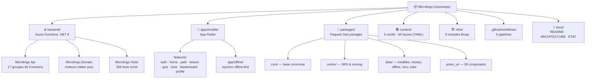
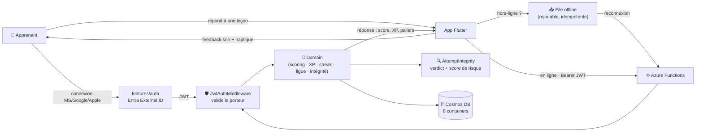
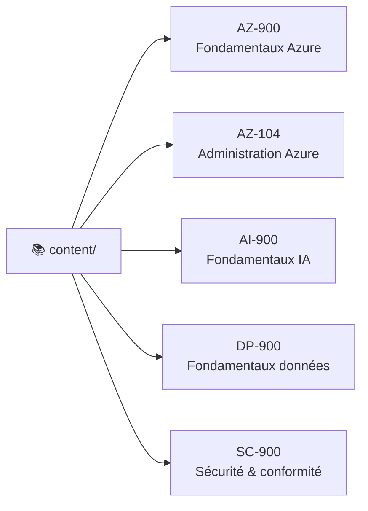
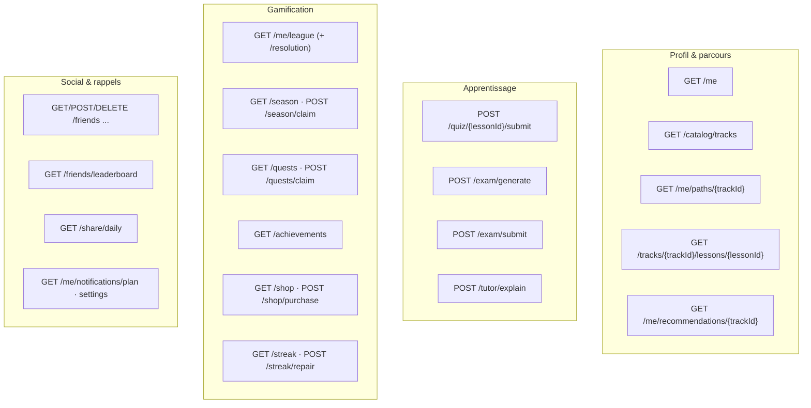
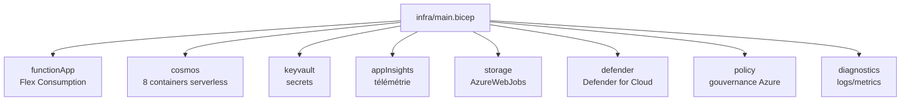

# 🟢 Microlingo — État vivant du projet

**Le « Duolingo des certifications Microsoft » — apprendre Azure / IA / sécurité par micro‑leçons gamifiées.**

`🟢 Backend riche` · `🟢 Contenu 5 certifs` · `🟢 Gamification` · `🟢 Tuteur IA` · `🟢 Offline‑first` · `🟡 Mobile en rattrapage` · `🟡 Infra non déployée`

> [!NOTE]
> **Ce document est le miroir de la réalité du code à l'instant T.** Il est rafraîchi à chaque évolution
> traitée, dans le même changement. Trois documents complémentaires :
> - **`README.md`** → la **vision** et le pitch produit.
> - **`docs/ARCHITECTURE.md`** → le **design de référence / la cible** technique.
> - **`docs/ETAT_DU_PROJET.md`** (ce fichier) → **ce qui existe vraiment** maintenant. En cas de
>   divergence entre les trois, **c'est ce document qui fait foi.**

| Repère | Valeur |
|---|---|
| 📅 Rafraîchi le | **2026‑06‑23** |
| 🔖 Reflète le commit | `527b5c5` (`feat(mobile-android)` config native Entra, #46) |
| 🌿 Branche du doc | `gchambaud-microsoft-living-project-summary` |
| 📈 Activité | **43 commits**, du 2026‑06‑19 au 2026‑06‑23 — rythme très soutenu |
| 🧪 Tests | **418** au total — **256 backend** (xUnit) · **162 Dart** (unit + widget) |
| 🧩 API | **17 groupes de Functions** · **≈ 28 endpoints** HTTP |
| 🗄️ Données | **8 containers Cosmos DB** (serverless) |
| 🏗️ Infra | **8 modules Bicep** — décrite, **pas encore déployée** |
| 🤖 CI/CD | **6 workflows** GitHub Actions (runner self‑hosted Azure) |

---

## 1 · Vue d'ensemble — où en est chaque brique

| Brique | Statut | Où | En clair |
|---|:---:|---|---|
| **API backend** | 🟢 | `backend/src/Microlingo.Api` | Azure Functions .NET 8 isolé, **17 groupes / ≈ 28 endpoints**. |
| **Moteurs métier** | 🟢 | `backend/src/Microlingo.Domain` | Logique **pure & testée** : contenu, progression, gamification, examen, tuteur, reco, notifications, intégrité. |
| **Contenu pédagogique** | 🟢 | `content/` | **5 certifications · 60 leçons** en YAML, validées par schémas JSON. |
| **Gamification** | 🟢 | Domain `Gamification/` | XP, streak (+réparation), ligues hebdo, **saisons**, quêtes, succès, boutique, amis. |
| **Tuteur IA** | 🟢 | Domain `Tutor/` + mobile `features/tutor` | Explications ancrées sur le contenu — **branché côté serveur ET mobile** (`tutor_sheet`). |
| **Recommandation + coach** | 🟢 | Domain `Recommendation/` + `home/coach_section` | Moteur « next best » + coach IA sur l'accueil. |
| **Notifications** | 🟢 | Domain `Notifications/` | Planification **serveur‑autoritaire**, estimation de la meilleure heure d'envoi. |
| **Anti‑triche / intégrité** | 🟢 (shadow) | Domain `Integrity/` | Évaluateur déterministe des tentatives — **mode détection** (signale, ne sanctionne pas encore). |
| **Offline‑first** | 🟢 | `packages/data` (sync) + `app/offline` | File de synchro idempotente, backoff, rejouable — **câblée dans l'app**. |
| **Authentification** | 🟢 | API `Middleware/` + mobile `features/auth` | **Microsoft / Google / Apple** fédérés derrière **Entra External ID**, JWT validé serveur. |
| **Design system (Prism)** | 🟢 | `packages/prism_ui` | **28 composants** + tokens + thèmes (look « néon doux »). |
| **App mobile (Flutter)** | 🟡 | `apps/mobile` | **45 fichiers Dart**, 9 features. Riche, mais plusieurs fonctions backend pas encore exposées en UI. |
| **Cortex (algos partagés)** | 🟢 | `packages/cortex` | SRS, scoring, fil pédagogique — partagé client/serveur. |
| **Infrastructure (Bicep)** | 🟡 | `infra/` | 8 modules (Functions, Cosmos, Key Vault, App Insights, **Defender, Policy, Diagnostics**, Storage). **Non déployée.** |
| **CI / qualité** | 🟢 | `.github/workflows` | 6 workflows : backend, mobile, contenu, infra, **CodeQL**, **security‑scan**. |

**Légende :** 🟢 opérationnel & testé · 🟡 partiel / en cours · 🔴 absent.

---

## 2 · Carte du monorepo

---

## 3 · Architecture — le flux d'un quiz

> L'app fonctionne **hors‑ligne** : les réponses sont mises en file puis **rejouées à la reconnexion**.
> Chaque tentative passe par l'évaluateur d'**intégrité** (anti‑triche) en mode détection.

---

## 4 · Fonctionnalités livrées (inventaire détaillé)

| Domaine | Backend | Mobile | Détail |
|---|:---:|:---:|---|
| **Profil & progression** | 🟢 | 🟢 | `GET /me`, parcours par certif, leçons paginées. |
| **Catalogue de certifs** | 🟢 | 🟢 | `GET /catalog/tracks` + **sélecteur de certification** (`cert_picker_sheet`). |
| **Leçons & exercices** | 🟢 | 🟢 | Leçon paginée façon Duolingo : QCM, multi‑réponses, scénario, texte à trous, **appariement**, **remise en ordre**, spot‑the‑issue. Son + haptique. |
| **Quiz & scoring** | 🟢 | 🟢 | `POST /quiz/{lessonId}/submit` → score, XP, paliers, feedback. |
| **Parcours « skill‑path »** | 🟢 | 🟢 | Écran vivant façon Duolingo, règles de progression pures. |
| **Streak (série)** | 🟢 | 🟡 | `GET /streak` + `POST /streak/repair` (réparation). |
| **Ligues hebdo** | 🟢 | 🟡 | Tournoi XP hebdomadaire serveur‑autoritaire + `GET /me/league/resolution`. |
| **Saisons** | 🟢 | 🔴 | Défi mensuel thématisé : `GET /season`, `POST /season/claim`. |
| **Quêtes & succès** | 🟢 | 🔴 | `GET /quests` + `claim`, `GET /achievements`. |
| **Boutique** | 🟢 | 🔴 | `GET /shop` + `POST /shop/purchase` (économie de gemmes). |
| **Amis & classement** | 🟢 | 🔴 | Ajouter/retirer un ami, `GET /friends/leaderboard`. |
| **Partage quotidien** | 🟢 | 🔴 | `GET /share/daily` (carte de partage encodée). |
| **Examens blancs** | 🟢 | 🔴 | Moteur adaptatif : `POST /exam/generate` + `submit`. |
| **Tuteur IA** | 🟢 | 🟢 | `POST /tutor/explain` — branché dans l'app via `tutor_sheet`. |
| **Recommandation + coach** | 🟢 | 🟢 | `GET /me/recommendations/{trackId}` + coach IA sur l'accueil. |
| **Notifications intelligentes** | 🟢 | 🟡 | `GET /me/notifications/plan` + réglages ; meilleure heure d'envoi estimée. |
| **Anti‑triche / intégrité** | 🟢 | — | Évaluateur déterministe (mode détection, événement `attempt.flagged`). |
| **Offline‑first** | 🟢 | 🟢 | Synchro idempotente rejouable, backoff. |
| **Authentification** | 🟢 | 🟢 | Microsoft / Google / Apple via Entra External ID (Android natif câblé). |

> **Lecture clé :** le **backend est très en avance** sur l'UI. Plusieurs moteurs (saisons, quêtes,
> succès, boutique, amis, examens) sont **prêts côté serveur mais pas encore branchés en écran mobile**.

---

## 5 · Contenu pédagogique

| Certification | Domaines | Leçons | Format |
|---|:---:|:---:|---|
| **AZ‑900** | 3 | 12 | `content/az-900/track.yaml` + `lessons/*.lesson.yaml` |
| **AZ‑104** | 5 | 12 | idem |
| **AI‑900** | 5 | 12 | idem |
| **DP‑900** | 4 | 12 | idem |
| **SC‑900** | 4 | 12 | idem |
| **Total** | — | **60** | Validé par `content/schema/{lesson,track}.schema.json` |

---

## 6 · Surface API (≈ 28 endpoints · 17 groupes)

Pile : **Azure Functions .NET 8 (worker isolé)**, déclencheurs HTTP, middleware JWT global avec liste
d'exemptions (endpoints anonymes), accès Cosmos via le SDK officiel.

---

## 7 · Cortex — les algorithmes partagés

`packages/cortex` héberge la logique pédagogique **réutilisée côté client et serveur** :

- **SRS (répétition espacée)** — planification des révisions.
- **Scoring & maîtrise** — calcul du niveau de maîtrise par compétence.
- **Fil pédagogique** — ordonnancement « quoi montrer ensuite ».

Doublé d'équivalents côté Domain (`Progress/ReviewScheduler`, `Readiness/ReadinessCalculator`) pour
les décisions serveur‑autoritaires.

---

## 8 · Sécurité & intégrité

| Mécanisme | Où | Comportement |
|---|---|---|
| **Auth multi‑fournisseurs** | mobile `features/auth` | Microsoft · Google · Apple, fédérés derrière **Entra External ID** via `flutter_appauth` ; session persistante (`session_store`). |
| **Validation JWT** | `Api/Middleware/JwtAuthMiddleware` | Vérifie le porteur `Bearer` sur chaque requête, sauf endpoints explicitement anonymes. |
| **Config native Android** | `apps/mobile/android` | Schéma de redirection `microlingo://auth` + permission `INTERNET` (#46). |
| **Anti‑triche** | `Domain/Integrity/AttemptIntegrity` | Évaluateur **déterministe & pur** → verdict `Allow / Flag / Reject` + score de risque [0..1] + drapeaux nommés (vitesse surhumaine, soumission avant départ, débit XP excessif…). **Mode détection** d'abord (signale, ne touche pas aux récompenses). |
| **Baseline sécurité CI** | `.github/workflows` | **CodeQL** + **security‑scan** + Bicep `Defender` / `Policy` / `Diagnostics`. |

---

## 9 · Données — Cosmos DB (8 containers)

| Container | Clé de partition | Contenu |
|---|---|---|
| `users` | `/id` | Profils & préférences. |
| `content` | `/trackId` | Certifs & leçons publiées. |
| `progress` | `/userId` | Progression, maîtrise, streak. |
| `attempts` | `/userId` | Tentatives de quiz/examen (+ intégrité). |
| `events` | `/userId` | Journal d'événements (`attempt.flagged`, etc.). |
| `leaderboard` | `/periodLeagueId` | Classements ligues / saisons. |
| `economy` | `/userId` | Gemmes, achats boutique. |
| `friends` | `/userId` | Graphe social. |

> Mode **serverless** : on paie à la requête, idéal tant que la charge est faible.

---

## 10 · Infrastructure (Bicep) — décrite, pas encore déployée

**8 modules** prêts. Le déploiement réel reste à faire (le code d'infra existe mais aucun
environnement n'est provisionné par ce dépôt). Une instance de **dev** a déjà été éprouvée hors‑repo
(cf. incident réseau résolu : réactivation des accès publics Storage/Cosmos/Key Vault).

---

## 11 · Qualité & CI

| Workflow | Rôle |
|---|---|
| `ci-backend.yml` | Build + **256 tests** xUnit (.NET 8). |
| `ci-mobile.yml` | Analyse + **162 tests** Dart (unit + widget). |
| `ci-content.yml` | Validation des leçons/certifs contre les schémas JSON. |
| `ci-infra.yml` | Lint / what‑if Bicep. |
| `codeql.yml` | Analyse statique de sécurité. |
| `security-scan.yml` | Scan sécurité complémentaire. |

> ⚠️ CI exécutée **uniquement sur le runner self‑hosted Azure** (`microlingo-ci`) — les runners
> GitHub‑hébergés sont désactivés par la politique d'entreprise. Egress via NAT Gateway `nat-microlingo`.

---

## 12 · Journal d'évolution

> Du plus récent au plus ancien. Mis à jour à chaque session de travail sur le projet.

| Date | Évolution |
|---|---|
| 2026‑06‑23 | 🔐 **Config Android native** activant la connexion Entra (`microlingo://auth` + INTERNET) — #46 |
| 2026‑06‑23 | 🔍 **Anti‑triche** : moteur d'intégrité de tentative + détection « shadow » (quiz/examen) — #43 |
| 2026‑06‑23 | 🪪 **Auth multi‑fournisseurs** Microsoft / Google / Apple + session persistante — #41 |
| 2026‑06‑23 | 🗓️ **Saisons** : moteur de défi mensuel thématisé serveur‑autoritaire — #42 |
| 2026‑06‑23 | 🔔 **Notifications** : planification intelligente serveur‑autoritaire — #40 |
| 2026‑06‑23 | 🎚️ **Sélecteur de certifs** + bandeau de parcours figé + texte enrichi propre — #38 |
| 2026‑06‑23 | 📥 **Offline‑first** : synchro idempotente + câblage app — #39 |
| 2026‑06‑23 | 🏆 **Ligues** : tournoi XP hebdomadaire serveur‑autoritaire — #27 |
| 2026‑06‑23 | 🛠️ **Infra** : alignement réglages Function App ↔ code, RBAC Cosmos, baseline sécurité CI — #8 |
| 2026‑06‑23 | 🎮 **5 types d'exercices** façon Duolingo + son/haptique (iOS + Android) — #15 |
| 2026‑06‑23 | 🧗 **Skill‑path** : écran de parcours vivant + règles de progression pures — #14 |
| 2026‑06‑23 | 🧭 **Reco « next best »** + coach IA sur l'accueil — #13 |
| 2026‑06‑23 | 🤝 **Tuteur IA branché** dans le client Flutter (iOS + Android) — #12 |
| 2026‑06‑23 | 🧠 **Tuteur IA backend** ancré sur le contenu, apprentissage continu — #11 |
| 2026‑06‑22 | 📝 **Examen blanc adaptatif** (génération + scoring) — #10 |
| 2026‑06‑22 | 🏗️ Bascule sur **runner self‑hosted Azure** + egress NAT — #9 |
| 2026‑06‑23 | 📄 **Ce tableau de bord vivant** créé puis tenu à jour. |

---

## 13 · Prochaines étapes & écarts

**Écarts backend ↔ mobile (à brancher en UI) :**
- 🔴 Saisons, quêtes, succès, boutique, amis, examens blancs : moteurs prêts, **écrans manquants**.
- 🟡 Streak‑repair, ligues, notifications : partiellement exposés.

**Chantiers techniques :**
- 🏗️ **Déployer l'infra** Bicep sur un environnement reproductible (aujourd'hui décrite seulement).
- 🔐 **Valider l'auth de bout en bout** sur un vrai tenant Entra External ID (E2E).
- 🔍 **Faire passer l'anti‑triche** du mode détection au mode application des sanctions (lot suivant).

---

### 🔄 Comment ce document reste à jour

À chaque évolution traitée dans une session de travail sur Microlingo, ce fichier est **rafraîchi dans
le même commit / la même PR** : en‑tête (date + commit reflété), Vue d'ensemble, inventaire des
fonctionnalités, contenu, API, données et **Journal d'évolution**. Pas de workflow autonome —
la mise à jour fait partie du travail.

_Dernier rafraîchissement : 2026‑06‑23 · reflète `527b5c5`._

