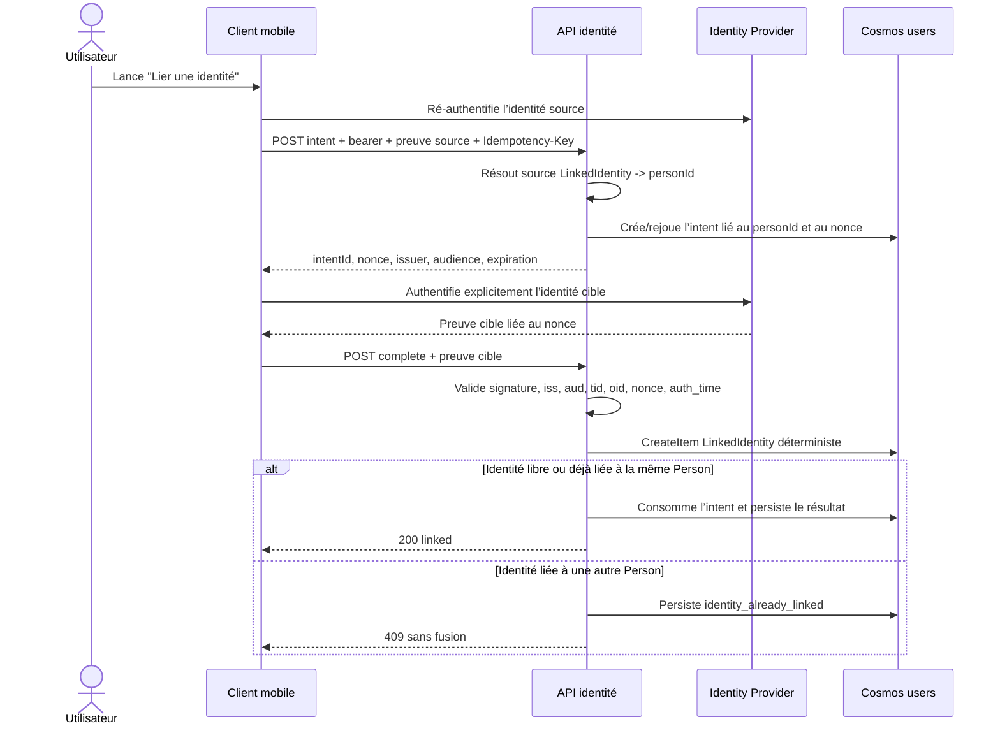

# ADR-014 — Person permanente et LinkedIdentity

| Champ | Valeur |
|---|---|
| **ADR** | 014 |
| **Statut** | Accepté — premier runtime `off|shadow` |
| **Date** | 2026-08-20 |
| **Activation runtime** | `off` par défaut ; `shadow` ajoute uniquement migration et miroir, sans autorité |
| **Contrat** | `docs/contracts/person-linked-identity/v1` |
| **Baseline réconciliée** | `main@034c1dd41e8ce7da0a84f8a6e70d821829a54e61` |
| **Périmètre de cette PR** | Modèles, ports, persistence Cosmos additive, migration/mirror shadow, télémétrie sans PII et nettoyage #296 ; aucun endpoint link, aucune UI, aucun déploiement |

> Cette décision livre uniquement un observateur shadow. Le resolver legacy reste autoritaire :
> aucun endpoint de liaison, aucune UI et aucune mutation utilisateur d'identité ne sont branchés.
> La suppression de compte #296, la certification active owner-scopée #297 et
> l'onboarding/catalogue de #289 restent inchangés.

## Contexte observé

Sur `main`, l’identité authentifiée et l’identité métier sont confondues :

- `FunctionUserContext.UserId` choisit directement `oid`, puis `nameidentifier`, puis `sub` ;
- les JWT locaux écrivent le même `userId` dans `oid` et `sub` ;
- le profil est un `UserProfileDto` dont `id == userId`, stocké dans `users` avec la clé `/id` ;
- un credential local est un autre document de `users`, identifié par une forme d’e-mail ;
- un utilisateur Entra est provisionné à la première lecture de `/me`, sans document de liaison ;
- l’e-mail, le nom et `preferred_username` sont des attributs d’affichage mutables, pas des
  identifiants fiables.

Le même `userId` est déjà la frontière d’isolation de presque toutes les données :

| Surface | Conteneur | Clé de partition / portée actuelle |
|---|---|---|
| Profil, XP, gems, streak, `activeTrackId` | `users` | `/id`, avec `id == userId` |
| Progression et modèle apprenant | `progress` | `/userId` |
| Tentatives et examens | `attempts` | `/userId` |
| Événements | `events` | `/userId` |
| Économie et achats | `economy` | `/userId` |
| Arêtes d’amitié | `friends` | `/userId`, l’autre extrémité est `friendUserId` |
| Classement | `leaderboard` | `/periodLeagueId`, avec `userId` dans le document |
| Credential local | `users` | `/id`, document `credential::*` contenant `userId` |

Changer cet identifiant ou les clés de partition imposerait une copie multi-conteneurs risquée. Les
clés uniques Cosmos ne résolvent pas ce problème : elles sont définies à la création du conteneur,
ne peuvent pas être ajoutées ensuite et ne garantissent l’unicité qu’à l’intérieur d’une partition
logique.

### Baselines fusionnées sur `main`

- #296 (merge `6145f35`) implémente une suppression idempotente par `userId`, désactivée par défaut
  via `ACCOUNT_DELETION_ENABLED`. Son record durable vit dans `attempts`, dans la partition
  `sha256(userId)`, et conserve le `SubjectUserId` jusqu'à la fin. Ses étapes sont
  `social -> learning -> economy -> profile -> reconciliation -> identity`; l'étape identité ne
  connaît encore qu'un choix `Local` ou `External`.
- #297 (merge `576ef60`) écrit `activeTrackId` dans le profil du `IUserContext.UserId`, après
  validation du track par le repository de contenu et compare-and-set `expectedTrackId`.
- #289 (merge `c44ba32`) fournit l'onboarding et le catalogue mobile actuels. L'écran de
  certification ne propose que les entrées dont `isActive && hasLearningContent`, puis appelle le
  même `POST /api/me/active-track`. Le cache `active_track_v2` est owner-scopé par l'id du profil.
- #301, #302, #303, #305 et #308 (baseline finale `01ac865`) ajoutent des garde-fous FinOps, de
  moindre privilège cloud, de tags Azure et d'observabilité ; leur delta ne contient aucun fichier
  backend ou mobile et ne modifie ni le principal métier, ni les routes identité, ni la topologie
  Cosmos décrite ici.

La phase LinkedIdentity ne contourne aucune de ces baselines. Elle étend explicitement leurs
contrats dans des PR ultérieures, toujours derrière un mode désactivé par défaut.

## Décision

### 1. Person est le principal métier permanent

`Person` est l’agrégat propriétaire de la progression, des relations sociales, de l’économie et des
préférences. Son identifiant est `personId`.

Pour tout utilisateur existant :

```text
personId = legacy userId
```

Le champ public historique `userId` reste un alias de compatibilité de `personId`. Aucun document
owner-scopé n’est déplacé et aucune clé de partition n’est modifiée. Le profil actuel devient la
représentation persistée de `Person` par ajout d’un overlay `identityMetadata`; un second document
Person avec le même `id` n’est pas créé.

Un `personId` ne change jamais après création, y compris après ajout, révocation ou remplacement
d’une identité de connexion.

### 2. LinkedIdentity relie une identité vérifiée à une Person

Une `LinkedIdentity` contient un locator canonique :

```text
(provider, tenant, subject, type)
```

- `provider` identifie l’autorité validée, par exemple `certigo-local` ou
  `entra-external-id` ;
- `tenant` est `certigo` pour le local et le `tid` Entra autorisé pour une identité fédérée ;
- `subject` est un identifiant opaque stable : sujet local dérivé sans e-mail, ou `oid` Entra ;
- `type` vaut `localPassword` ou `entraExternalId` en V1 ;
- `verification` décrit la méthode, l’instant, l’issuer et l’audience validés, jamais le jeton ;
- `revocation` conserve l’état, la génération, la raison et le statut d’action fournisseur.

La canonicalisation V1 est fermée : provider et type sont des enums exacts, `tenant` est `certigo`
ou un GUID `tid` normalisé, le subject local est un hex opaque et le subject Entra est un GUID
`oid` normalisé. Les valeurs hors format, les caractères de contrôle et les claims dont le trim
changerait la valeur sont refusés, pas « corrigés ». Le hash encode les champs UTF-8 avec le
séparateur de domaine V1.

L’e-mail, `preferred_username`, le nom, le téléphone et le claim `idp` ne participent jamais à la
clé, à la résolution ou à une décision de fusion. Ils peuvent seulement servir d’indice d’affichage
masqué. Deux comptes portant le même e-mail restent deux identités distinctes.

Pour Entra, V1 exige la validation de la signature, de `iss`, `aud`, `exp`, `nonce`, `tid`, `oid` et
de la fraîcheur d’authentification. Le couple `tid + oid` évite de confondre le même sujet apparent
entre tenants. Un token dépourvu de `tid` ou `oid` reste sur le chemin legacy et n’est pas éligible
à la liaison V1.

Pour le local, le credential existant conserve son `id` pour la compatibilité de login. La migration
génère une fois un sujet aléatoire d’au moins 128 bits et le persiste dans le credential sous ETag :

```text
credential.identitySubject = random(128 bits)
```

Un retry relit ce sujet avant de créer la LinkedIdentity. Il n’est ni dérivé de l’e-mail, ni
calculable par dictionnaire. Ni le document LinkedIdentity, ni son identifiant ne contiennent
l’e-mail en clair.

### 3. Unicité par identifiant déterministe et CreateItem

Le document LinkedIdentity vit dans le conteneur `users` existant :

```text
id = "linked-identity::v1::" +
     sha256("certigo-linked-identity:v1\0" + canonicalLocator)
partitionKey = id
```

Deux writers visant le même locator arrivent dans la même partition avec le même `id`. Le premier
`CreateItem` gagne ; le second relit le document :

- même locator et même `personId` : succès idempotent ;
- même locator et autre `personId` : `409 identity_already_linked` ;
- même hash mais locator différent : arrêt fail-closed `identity_hash_collision`, audit et
  intervention manuelle.

Cette stratégie ne dépend pas d’une nouvelle unique key Cosmos et n’impose aucun changement infra.

### 4. Liaison explicite avec ré-authentification des deux identités

La liaison est un protocole en deux appels :

1. `POST /api/me/identity-link-intents`
   - bearer déjà résolu vers la Person source ;
   - `X-Certigo-Reauthentication` prouve de nouveau l’identité source ;
   - `Idempotency-Key` est obligatoire ;
   - le serveur choisit le tenant, l’issuer, l’audience et génère un nonce à usage unique.
2. `POST /api/me/identity-link-intents/{intentId}/complete`
   - la preuve cible est validée indépendamment ;
   - la preuve est liée à l’intent, au nonce, à l’audience, au tenant et au client ;
   - l’intent non expiré est consommé par ETag ;
   - le document LinkedIdentity est créé par un `CreateItem` idempotent.

L'intent et la LinkedIdentity ont des partitions `/id` distinctes. V1 ne prétend donc pas disposer
d'une transaction Cosmos cross-partition : un retry relit le binding déterministe, vérifie locator
et `personId`, puis termine la consommation ETag de l'intent.

Les deux preuves doivent dater de moins de cinq minutes. Le bearer seul ne compte pas comme
ré-authentification. Les secrets, mots de passe, authorization codes et tokens ne sont jamais
persistés ou journalisés.

Si l’identité cible est déjà liée à une autre Person, la requête échoue. V1 ne fusionne jamais deux
Person, même après contrôle des deux identités. Une éventuelle fusion de données demanderait un ADR
distinct avec règles de conflit pour progression, amis, économie, achats et audit.



### 5. Idempotence et anti-replay

- `Idempotency-Key` est un identifiant aléatoire d’au moins 128 bits.
- Les ids d’intent et d’opération hachent `personId + Idempotency-Key` : deux Person ne partagent
  jamais le même espace d’idempotence.
- Une opération stocke le hash canonique de la requête et son résultat.
- Un replay exact retourne le même résultat.
- La même clé avec un autre payload retourne `409 idempotency_conflict`.
- Un nonce est aléatoire, lié à un seul intent, expire et ne peut être consommé qu’une fois.
- Un intent consommé avec une autre preuve retourne `409 replay_detected`.
- Les documents expirés sont refusés même si un nettoyage différé ne les a pas encore supprimés.

Le conteneur `users` n’a pas de TTL par défaut. V1 repose donc sur `expiresAt` et un nettoyage
explicite ; il ne prétend pas qu’un champ `ttl` serait actif sans modification infra.

### 6. Révocation et unlink

`DELETE /api/me/linked-identities/{linkedIdentityId}` exige :

- `Idempotency-Key` ;
- ré-authentification récente de l’identité courante ;
- au moins une autre identité active et utilisable ;
- absence de suppression de compte en cours.

Le document n’est pas supprimé immédiatement. Il passe à `revocation.state = revoked` avec une
génération et un résultat fournisseur. Ce tombstone empêche un replay ancien de réactiver la
liaison. Une reliaison ultérieure exige un nouvel intent et une nouvelle génération.

### 7. Intégration obligatoire avec la suppression #296 fusionnée

Le mode `link` ne peut pas être activé tant que la baseline #296 ne sait pas supprimer plusieurs
identités. Son endpoint fusionné expose `GET` et `POST /api/account/deletion`; le `POST` est
idempotent par record Person et retourne `202` tant que le workflow est pending, puis `200`. Il
n'exige pas d'`Idempotency-Key` client. Une preuve `X-Certigo-Reauthentication` peut remplacer le
bearer récent, mais le middleware compare encore leurs `userId` bruts.

À la première persistance d’une suppression :

1. `userContext.UserId` est déjà le `personId` ;
2. le workflow bloque création, completion et révocation de liens ;
3. il capture la liste des LinkedIdentity actives et leurs cibles de révocation ;
4. il supprime les données Person avec les étapes idempotentes de #296 ;
5. il révoque chaque identité locale ou Entra avec un sous-état durable ;
6. il refait une réconciliation des LinkedIdentity avant de terminer ;
7. il expurge les subjects du reçu achevé tout en conservant les codes et identifiants opaques
   nécessaires à l’audit.

Après introduction du resolver, cette comparaison doit utiliser le résultat validé :

- liaison : la preuve source doit correspondre à la même `linkedIdentityId` que la session source ;
- suppression Person : bearer et preuve doivent résoudre vers le même `personId`.

Comparer directement deux `oid`/`sub` ne constitue plus le contrat d’autorisation.

Une Person legacy sans LinkedIdentity garde le chemin `Local|External` de #296. Le hash de
suppression est calculé depuis `personId`, jamais depuis un subject fournisseur.

Les logs reprennent la discipline de #296 : `requestId`, `operationId`, provider/type, étape, code,
résultat et timestamp, sans e-mail, subject, token ni mot de passe.

### 8. Intégration obligatoire avec activeTrack, onboarding et catalogue

`activeTrackId` reste une propriété de la Person dans le profil existant. Le endpoint
`POST /api/me/active-track` continue :

- à dériver le propriétaire du JWT ;
- à lire/écrire la partition `personId` ;
- à appliquer `expectedTrackId` et l’ETag ;
- à présenter le même choix depuis toutes les identités liées.

L'onboarding continue à lire `GET /api/catalog/tracks` et à n'afficher que les certifications
`active|active-retiring` dont `learningAvailable == true` et `contentStatus == available`. La
liaison d'identité ne rend jamais un track planifié ou retiré sélectionnable et ne duplique pas le
catalogue.

Le cache owner-scopé mobile et le flag d'onboarding utilisent l’identifiant de profil Person, pas
`oid`, `sub`, e-mail ou provider. Aucun document activeTrack, cache de catalogue ou état onboarding
n’est migré ; seul l'owner résolu devient `personId`.

### 9. Feature mode progressif

Une seule configuration ordonnée évite les combinaisons de flags incohérentes :

| `PERSON_LINKED_IDENTITY_V1` | Effet |
|---|---|
| `off` (défaut) | Comportement legacy strict ; endpoints V1 retournent `404` |
| `shadow` | Backfill/reconciliation seulement ; le resolver legacy reste autoritaire |
| `resolve` | LinkedIdentity est autoritaire ; fallback legacy contrôlé et métriqué pour le JIT |
| `link` | Ajout/révocation utilisateur activés après couverture migration et adaptation multi-identité de #296 |

Le passage est monotone `off -> shadow -> resolve -> link`. Le kill switch opérationnel descend de
`link` à `resolve`, ce qui bloque les mutations sans casser les connexions secondaires. Après la
création de liens secondaires, revenir de `resolve` à `off` n’est pas un rollback sûr.

Le premier runtime implémente exclusivement `off|shadow`. Les valeurs `resolve` et `link`
restent des états contractuels futurs et sont rejetées au démarrage dans ce lot.

### 10. Migration additive, sans perte

1. **Inventaire** : compter profils, credentials locaux, documents owner-scopés et anomalies ; ne
   rien écrire.
2. **Backfill Person** : ajouter `identityMetadata` au profil avec ETag ; conserver strictement
   `personId == profile.id == legacy userId`.
3. **Backfill local** : générer/persister une fois le sujet opaque du credential sous ETag, puis
   créer LinkedIdentity vers son `UserId`.
4. **Backfill externe JIT** : seulement après validation d’un token `tid + oid`; créer la liaison
   vers le profil legacy dont l’id est l’ancien `userId`. Aucun rapprochement par e-mail.
5. **Shadow compare** : comparer `legacy userId` et `resolved personId`; toute divergence bloque le
   cohort rollout.
6. **Resolve par cohortes** : activer progressivement et conserver le fallback observé.
7. **Link** : uniquement après mise à niveau de #296 et validation de #297.

Les écritures sont idempotentes. Une collision ne réassigne jamais une identité et ne déplace aucun
document. Les documents de progression, tentatives, événements, économie, amis et classement ne
sont ni copiés ni réécrits.

### 11. Indexes et requêtes Cosmos

Le contrat V1 utilise exactement la policy actuelle de `infra/modules/cosmos.bicep` :
indexation automatique et cohérente de `/*`, avec exclusion de `/"_etag"/?`.

| Requête | Stratégie | Index additionnel |
|---|---|---|
| Résoudre un locator | point read par id déterministe | aucun |
| Lire Person | point read `id == personId` | aucun |
| Relire intent/opération | point read par id | aucun |
| Lister les identités d’une Person | requête rare `documentType + personId` cross-partition | aucun composite requis |
| Réconciliation suppression | même filtre, après verrou Person | aucun composite requis |

La liste cross-partition est acceptable car le nombre d’identités par Person est borné et la
surface est peu fréquente. Un index composite ne devient justifié qu’avec un `ORDER BY` mesuré. Il
ferait l’objet d’une PR infra séparée, jamais de cette phase.

## Menaces et réponses

| Menace | Contrôle V1 |
|---|---|
| Account takeover par e-mail partagé | e-mail ignoré ; preuves cryptographiques des deux locators |
| Replay d’un lien | nonce court, intent single-use, ETag, journal idempotent et hash du payload |
| Confused deputy | audience/issuer/client/intent/nonce liés et validés ; preuve d’une autre API refusée |
| Cross-tenant | tenant serveur piné ; `tid + oid` ; même `oid` dans un autre tenant = autre identité |
| Identity already linked | CreateItem déterministe puis `409`, aucune fusion/réassignation |
| Course liaison/suppression | tombstone de suppression consulté avant begin/complete et réconciliation finale |
| Révocation du dernier accès | refus tant qu’aucune autre identité active n’est vérifiée |
| Fuite de secrets | aucune preuve persistée ou loggée ; DTO de lecture masque le subject |
| Hash collision | comparaison du locator après lecture puis arrêt fail-closed |

## Rollback

- Avant `resolve`, repasser de `shadow` à `off` laisse seulement des documents additifs ignorés.
- Après `resolve`, repasser de `link` à `resolve` bloque toute nouvelle mutation mais conserve la
  résolution.
- Les credentials locaux, profils et partitions legacy restent intacts pendant toute la V1.
- Un script de rollback ne supprime pas les LinkedIdentity : il marque l’opération et laisse les
  documents pour audit/reprise.
- Toute suppression physique ou fusion de Person est hors V1.

## Plan de PRs courtes

| Ordre | PR | Contenu | Gate |
|---|---|---|---|
| 0 | #300 fusionnée | ADR, contrats V1 et harnais migration/sécurité | aucun runtime |
| 1 | Cette PR runtime | Modèles/ports, repository, lazy migration locale/Entra et comparaison shadow | `off` par défaut, métriques sans PII |
| 2 | Resolver autoritaire | Résolution `LinkedIdentity -> personId`, mode `resolve` | cohortes et fallback métriqué |
| 3 | Liaison API | endpoints begin/complete/list/revoke | tests takeover/replay/deputy/tenant |
| 4 | Suppression multi-identités | actions fournisseur par LinkedIdentity dans #296 | E2E suppression |
| 5 | Mobile | UX explicite, double ré-auth, owner cache Person | onboarding/catalogue inchangés |
| 6 | Activation | `resolve`, puis `link` par cohortes | rollback documenté |

Chaque PR reste indépendante, sans changement de clé de partition ni migration big-bang.

## Conséquences

- Une Person conserve toute sa progression, ses amis, son économie et sa certification active
  lorsqu’elle utilise une autre identité liée.
- Les comptes existants ne perdent pas leur `userId`.
- Le coût est une résolution supplémentaire et des workflows idempotents entre partitions.
- V1 refuse les fusions de Person et privilégie un conflit visible à une fusion dangereuse.
- Les futures créations de compte devront créer Person et LinkedIdentity de façon orchestrée, mais
  ce runtime n’est pas livré ici.

## Références

- [Claims des ID tokens Microsoft identity platform](https://learn.microsoft.com/entra/identity-platform/id-token-claims-reference)
- [OpenID Connect sur Microsoft identity platform](https://learn.microsoft.com/entra/identity-platform/v2-protocols-oidc)
- [Unique key constraints in Azure Cosmos DB](https://learn.microsoft.com/azure/cosmos-db/unique-keys)
- [Partitioning and horizontal scaling in Azure Cosmos DB](https://learn.microsoft.com/azure/cosmos-db/partitioning-overview)
- [NIST SP 800-63B — Authentication and Lifecycle Management](https://pages.nist.gov/800-63-4/sp800-63b.html)
- Code actuel : `FunctionUserContext`, `AuthService`, `CosmosUserRepository`,
  `CosmosUserCredentialRepository`, `CosmosContainers`, repositories progress/friends/economy
- Baseline runtime : `main@034c1dd`, incluant le contrat #300 et les baselines
  #289/#296/#297 ; aucun changement de PK, d'autorité ou de surface mobile
