# Phase 0 — Étape 3 : Inventaire exhaustif des écrans, vues, feuilles, alertes, extensions et routes

> **Branche auditée :** `transform/phase-0-audit` (`HEAD` `778f9c247ceb9c0db29fb931a8573bd328b492ab`)
> **Périmètre :** `apps/apple/CertigoNative/Sources/*.swift`, `apps/apple/CertigoNative/WidgetExtension/*.swift` et contrats de routage/copie associés dans `apps/apple/CertigoKit/Sources/CertigoDomain/*.swift`.
> **Règle Phase 0 :** lecture seule stricte — aucun fichier existant modifié, aucun secret ni identifiant de locataire exposé.

---

## 1. Légende épistémique et table de correspondance des noms de types

### 1.1 Statuts de vérification
- **VÉRIFIÉ :** constat observé directement dans le code source, les fichiers `.plist` / `.entitlements` ou les tests exécutés localement (`python -m unittest discover -s tools/tests -p "test_native_*.py"` : 69 tests exécutés, 67 réussis, 2 ignorés faute de `swift` dans le `PATH` Windows).
- **INFÉRÉ :** comportement déduit de la structure SwiftUI / UIKit / WidgetKit et des contrats `NativeModel` sans exécution sur simulateur iOS.
- **NON VÉRIFIABLE :** rendu visuel effectif, transitions système iOS 17 / iOS 26 et ouverture réelle des liens universels / schémas d'URL sur simulateur ou appareil Apple (nécessite macOS + Xcode).
  - Commande exacte à exécuter sur macOS :
    ```bash
    xcodebuild -project apps/apple/CertigoNative/CertigoNative.xcodeproj \
      -scheme CertigoNative \
      -destination 'platform=iOS Simulator,name=iPhone 16 Pro' \
      build
    ```

### 1.2 Correspondance entre les noms cités dans l'énoncé et les identifiants Swift exacts du dépôt (**VÉRIFIÉ**)

Certains noms mentionnés à titre indicatif dans la consigne d'audit correspondent dans `HEAD` (`778f9c247ceb9c0db29fb931a8573bd328b492ab`) à des types portant un identifiant légèrement différent. Le tableau ci-dessous établit la correspondance exacte :

| Nom cité dans l'énoncé | Identifiant Swift exact dans le dépôt | Emplacement exact (`fichier:ligne`) | Rôle |
|---|---|---|---|
| `CertigoNativeRootView` | `NativeRoot` (enveloppé par `NativeLanguageRoot` et `NativeEntry` / `NativeProductionEntry`) | `apps/apple/CertigoNative/Sources/CertigoNativeApp.swift:5990` (et `:3093`, `:4142`, `:4257`) | Coquille racine connectée à 4 onglets (`TabView`) et `NavigationSplitView` |
| `LearnSurfaceMode` | `NativeLearningNavigation.Learn` (connecté) et `NativeDemoLearnSection` (démo) | `apps/apple/CertigoNative/Sources/CertigoNativeApp.swift:8552` et `:5651` | Sélecteur de sous-surface de l'onglet `Apprendre` (`.myLearning` / `.explore`) |
| `community` (onglet/section) | `NativeResumeState.Tab.social`, `NativeLearningNavigation.Social`, `NativeDemoDestination.social`, `DemoSocialSection` (`.friends` / `.teams`) | `apps/apple/CertigoNative/Sources/NativeModel.swift:103`, `apps/apple/CertigoNative/Sources/CertigoNativeApp.swift:8553`, `:5648`, `:4591`, `:6050`, `:4772` | Onglet `Communauté` (libellé `copy.social` = `"Communauté"` en FR, `"Community"` en EN) |
| `CertigoDailyLearningWidgetView` / `CertigoWidgetCardSurface` | `CertigoWidgetCardView` (vue SwiftUI) + `CertigoDailyWidget` (`Widget`) + `CertigoWidgetBundle` (`@main WidgetBundle`) | `apps/apple/CertigoNative/Sources/CertigoWidgetPresentation.swift:21`, `apps/apple/CertigoNative/WidgetExtension/CertigoWidgetExtension.swift:54`, `:71` | Vue et configuration du widget quotidien WidgetKit |
| `NativeEditorialPilotView` | `NativeEditorialPilotView` + `NativeEditorialPilotLessonView` | `apps/apple/CertigoNative/Sources/NativeEditorialPilotView.swift:5`, `:189` | Feuille du pilote éditorial français et lecteur de leçon éditoriale |
| `NativeWidgetGalleryView` | `NativeWidgetGalleryView` | `apps/apple/CertigoNative/Sources/NativeWidgetGalleryView.swift:9` | Feuille de galerie d'aperçu des widgets et de sélection d'icône dynamique |
| `NativeDeveloperConnector` | `NativeDeveloperConnector` | `apps/apple/CertigoNative/Sources/CertigoNativeApp.swift:4411` | Feuille `#if DEBUG` de connexion développeur (CIAM de test ou URL/jeton manuel) |

---

## 2. Inventaire exhaustif des écrans, vues et sous-vues (`CertigoNative/Sources` & `WidgetExtension`)

### 2.1 Point d'entrée de l'application, racines et authentification (**VÉRIFIÉ**)

| # | Nom exact du type / propriété Swift | `fichier:ligne` | Point d'entrée | Données affichées | Actions utilisateur | États gérés (chargement, vide, erreur, hors ligne, démo) | Chaînes visibles principales (`AppInterfaceCopy` / `NativeLabel`) | Présence en mode Démo |
|---|---|---|---|---|---|---|---|---|
| E-01 | `CertigoNativeApp` (`@main struct : App`) | `apps/apple/CertigoNative/Sources/CertigoNativeApp.swift:3065-3071` | Point d'entrée `@main` (`WindowGroup`) | Aucune directement ; instancie `NativeLanguageRoot()` | — | — | — | Héberge l'arbre qui ouvre le mode Démo |
| E-02 | `NativeLanguageRoot` (`private struct : View`) | `apps/apple/CertigoNative/Sources/CertigoNativeApp.swift:3093-3123` | Racine de `WindowGroup` (`CertigoNativeApp.swift:3068`) | Injecte `\.locale`, `\.nativeInterfaceCopy` et `\.nativeLanguagePreference` + `.tint(NativePrism.tint)` | Changement de langue via `Binding` persisté dans `UserDefaults.standard` ; rechargement au retour en `scenePhase == .active` | — | — | Partagé (fournit la langue au mode Démo) |
| E-03 | `NativeEntry` / `developmentEntry` (`private struct : View`) | `apps/apple/CertigoNative/Sources/CertigoNativeApp.swift:4142-4253` | Racine quand `CERTIGO_PRODUCTION_DISTRIBUTION` n'est **pas** défini (`CertigoNativeApp.swift:4157-4159`) | En-tête `NativeEntryHeading`, bouton d'ouverture de la démo, carrousel horizontal de 4 `NativeShowcaseTile` (`AZ`, `GH`, `DP`, `AWS`), `DisclosureGroup` avec `NativeAppLanguagePicker`, section conditionnelle `#if DEBUG` de lien de leçon partagé (`pendingLessonLink`) et section `#if DEBUG` de connexion développeur | `showDemo = true` (ouvre `NativeDemoRoot`), sélection de langue, `showDeveloper = true` (`#if DEBUG`, ouvre `NativeDeveloperConnector`), `onOpenURL(perform: handleIncomingURL)` | **Démo** : bouton d'entrée vers `NativeDemoRoot`<br>**Erreur URL** : `.alert` si `invalidLessonLink == true`<br>**Chargement/Vide/Hors ligne** : non applicable | `"Certigo"`, `.welcomeTitle`, `.welcomeHint`, `.tryLearning`, `copy.exploreDemo`, `.fictionalBoundary`, `copy.appLanguage`, `.sharedLesson`, `.editorialPilot`, `.openLinkedLesson`, `.development`, `.openConnector`, `.testOnly`, `.lessonLinkUnavailable`, `.lessonLinkInvalid`, `copy[.done]` | Pont d'entrée vers le mode Démo (`fullScreenCover` `$showDemo`) |
| E-04 | `NativeProductionEntry` (`private struct : View`, `#if CERTIGO_PRODUCTION_DISTRIBUTION`) | `apps/apple/CertigoNative/Sources/CertigoNativeApp.swift:4257-4406` | Racine de distribution (`CertigoNativeApp.swift:4153-4156`) | Si non connecté (`model.profile == nil && model.deletionStage == nil`) : `NativeEntryHeading`, `NativeAppLanguagePicker`, bouton de connexion Microsoft (`MSALAuthenticationProvider`), bouton d'exploration de la démo. Si connecté ou suppression en cours : délègue à `NativeRoot` | `Task { await model.connect() }` (MSAL interactif/silencieux), `showDemo = true` (`NativeDemoRoot`), `onOpenURL` (route widget `CertigoWidgetRoute` ou callback MSAL `provider?.handleCallback`), `.task { await model.restoreAccountDeletionIfNeeded() }` | **Erreur config** : `ContentUnavailableView` (`.signInUnconfigured` + `configurationIssue`)<br>**Chargement** : `ProgressView()` si `model.busy`<br>**Erreur auth** : `.alert` (`.signInIncomplete` + `model.errorMessage`)<br>**Démo** : `fullScreenCover` vers `NativeDemoRoot` | `"Certigo"`, `.signInUnconfigured`, `.productionTitle`, `.productionHint`, `.continueLearning`, `copy.signInWithMicrosoft`, `copy.exploreDemo`, `copy.contentLanguageNote`, `.signInIncomplete`, `copy[.done]` | Pont d'entrée vers le mode Démo (`fullScreenCover` `$showDemo` en production) |
| E-05 | `NativeDeveloperConnector` (`private struct : View`, `#if DEBUG`) | `apps/apple/CertigoNative/Sources/CertigoNativeApp.swift:4411-4581` | `.sheet(isPresented: $showDeveloper)` depuis `NativeEntry.developmentEntry` (`CertigoNativeApp.swift:4220-4226`) avec `.interactiveDismissDisabled()` | Trois branches : (1) erreur de configuration CIAM (`ContentUnavailableView`), (2) `ciamSignIn` si `usesCIAM && model.profile == nil`, (3) `NativeRoot` avec bouton de fermeture `closeDeveloper` | Connexion CIAM (`model.connect()`), fermeture explicite via `NativeDeveloperToolbar` (`dismiss()`), réception callback `onOpenURL` (`ciamProvider?.handleCallback`) | **Erreur config** : `ContentUnavailableView` (`ciam-configuration-error`) + bouton `.close`<br>**Chargement** : bouton désactivé si `model.busy`<br>**Erreur auth** : `.alert` (`.ciamIncomplete`) | `"Certigo"`, `.ciamUnavailable`, `.close`, `.testLearning`, `.ciamTestScope`, `.ciamTestSignIn`, `.ciamExplicit`, `.ciamSignIn`, `.ciamIncomplete`, `.developerConnector` | Non (exclusivement `#if DEBUG` hors `NativeDemoRoot`) |
| E-06 | `NativeRoot.connection` (`private var connection: some View`) | `apps/apple/CertigoNative/Sources/CertigoNativeApp.swift:7414-7456` | Affiché par `NativeRoot` quand `model.profile == nil` et `!model.requiresDeletionSurface` (`CertigoNativeApp.swift:6038-6039`) | `Form` avec `NativeEntryHeading`, champ `TextField` (`developer-api-url` lié à `$model.baseURL`), champ `SecureField` (`developer-access-token` lié à `$model.token` avec `.privacySensitive()`), bouton de connexion et note de stockage Keychain (`CredentialVault`) | Saisie URL HTTPS et jeton Bearer de test, `Task { await model.connect() }`, fermeture via `NativeDeveloperToolbar` | **Chargement** : bouton désactivé si `model.busy \|\| model.baseURL.isEmpty \|\| model.token.isEmpty` + `safeAreaInset` global `ProgressView`<br>**Erreur** : `.alert` global `.operationUnconfirmed` sur `NativeRoot` | `"Certigo"`, `.development`, `.connectWorkspace`, `.developmentScope`, `.connectorBoundary`, `.testConnection`, `.apiEndpoint`, `.testToken`, `.connectTest`, `.tokenStorageHint` | Non (connecteur manuel développeur) |

### 2.2 Coquille principale connectée (`NativeRoot`) et onglet `Apprendre` (**VÉRIFIÉ**)

| # | Nom exact du type / propriété Swift | `fichier:ligne` | Point d'entrée | Données affichées | Actions utilisateur | États gérés (chargement, vide, erreur, hors ligne, démo) | Chaînes visibles principales (`AppInterfaceCopy` / `NativeLabel`) | Présence en mode Démo |
|---|---|---|---|---|---|---|---|---|
| E-07 | `NativeRoot` (`private struct : View`) | `apps/apple/CertigoNative/Sources/CertigoNativeApp.swift:5990-6210` | Présenté par `NativeProductionEntry` (`:4348`) ou `NativeDeveloperConnector` (`:4472`) | `TabView(selection: $model.selectedTab)` à 4 onglets (`.learn`, `.coach`, `.social`, `.profile`), ou `NativeAccountDeletionView` si `model.requiresDeletionSurface`, ou `connection` si `model.profile == nil`. Bandeau inférieur `safeAreaInset` de progression quand `model.busy`. Synchronise `NativeWidgetSnapshotController` et `NativeAppIconController` | Changement d'onglet, restauration initiale `.task { await model.restore() }`, traitement de `pendingWidgetRoute` (`certigo://widget/learn`), ouverture des 3 feuilles (`$showEditorialPilot`, `$showingStudyPlan`, `$showingWidgetGallery`) | **Chargement** : `safeAreaInset(edge: .bottom)` avec `ProgressView`<br>**Erreur** : `.alert(copy.native(.operationUnconfirmed))` sur `model.errorMessage`<br>**Hors ligne** : restauration d'activité/pack en cache | `copy.learn`, `copy.coach`, `copy.social`, `copy.profile`, `copy.loading`, `.savingGoal`, `.operationUnconfirmed`, `copy[.done]` | Équivalent démo séparé : `NativeDemoRoot` (`:4596`) |
| E-08 | `NativeRoot.learning` (`private var learning: some View`) | `apps/apple/CertigoNative/Sources/CertigoNativeApp.swift:6422-6647` | Onglet 1 (`NativeResumeState.Tab.learn`) de `NativeRoot` (`:6042-6044`) | `NavigationSplitView(columnVisibility: $columns, preferredCompactColumn: $compactColumn)` : colonne `sidebar` (`List(selection: $selectedTrack)` avec `Picker` `NativeLearningNavigation.Learn` `.myLearning` / `.explore`), colonne `content` (`path`), colonne `detail` (`session`) | Bascule `Mon apprentissage` / `Explorer`, sélection de certification (`$selectedTrack`), reprise d'activité (`resumeCurrentActivity`), restauration hors ligne (`model.restoreDownloadedActivity()`), ouverture du pilote éditorial (`showEditorialPilot = true`), ouverture d'une leçon éditoriale partagée (`pendingLessonLink`) | **Chargement** : liste désactivée si `model.busy \|\| loadingTrackID != nil \|\| loadingLessonID != nil`<br>**Hors ligne** : section `.continueDevice` avec `restoreActivity`<br>**Confirmation** : `.confirmationDialog` de téléchargement de pack hors ligne (`$downloadTrack`) | `copy.learn`, `copy.myLearning`, `copy.explore`, `.continueDevice`, `copy.resume`, `.restoreActivity`, `.chooseGoalHint`, `.guidedReading`, `"Assistants IA responsables"`, `.frenchPilot`, `.sharedLesson`, `.editorialPilot`, `.openLinkedLesson`, `.downloadQuestionPacks`, `.downloadContent`, `.downloadBoundary` | Équivalent démo séparé : `NativeDemoRoot.objective` (`:4846`) et `NativeDemoRoot.catalog` (`:4918`) |
| E-09 | `NativeRoot.confirmedGoal` + `activityStrip` (`private var`) | `apps/apple/CertigoNative/Sources/CertigoNativeApp.swift:6972-7106`, `:7373-7396` | Première section de `NativeRoot.learning` en mode `.myLearning` (`:6434-6436`) | Si objectif actif (`model.profile?.activeTrackId`) : `activityStrip` (XP confirmés + série `streakDays`), `NativeGoalHero` (titre, code, `NativeReadinessRing` si parcours chargé), résumé `studyPlan`, CTA primaire dynamique (`Resume`, `Start session` recommandation, `Start session` prochain nœud disponible, ou ouverture du parcours), bouton `studyPlan`, score de préparation. Sans objectif : `NativeEntryHeading` + bouton vers `.explore` | Tap CTA primaire (ouvre/reprend la séance ou le parcours), tap bouton `studyPlan` (`showingStudyPlan = true`), tap bouton `Explore` (`navigation.learn = .explore`) | **Vide (aucun objectif)** : `NativeEntryHeading(.findGoal, .noGoal)` + bouton `copy.explore`<br>**Parcours non chargé** : texte `.loadGoalHint`<br>**Pratique indisponible** : `NativePracticeBadge(available: false)` + `copy[.practiceUnavailableNote]` | `.confirmedXP`, `.streak`, `copy.confirmed`, `.readiness`, `.nextSession`, `.targetDate`, `.studyPlan`, `copy[.initialLevel]`, `copy[.levelBeginner]`, `copy[.levelIntermediate]`, `copy[.levelAdvanced]`, `copy[.practiceUnavailableNote]`, `copy.resume`, `.savedActivityHint`, `copy.startSession`, `.nextAvailableHint`, `.readinessHint`, `.loadGoalHint`, `.findGoal`, `.noGoal`, `copy.explore` | En démo : carte objectif dans `NativeDemoRoot.objective` (`:4851-4908`) |
| E-10 | `NativeRoot.myLearningPlan` + `unitProgress` + `lessonLabel` (`private var` / `func`) | `apps/apple/CertigoNative/Sources/CertigoNativeApp.swift:6677-6813` | Sections de `NativeRoot.learning` en mode `.myLearning` (`:6468`) et réutilisé dans `NativeRoot.path` (`:7540-7551`) | Couverture `NativePathCoverage` (`remainingActivities / totalActivities`), par unité : `unitProgress` (`NativeSymbolMedallion`, titre, `ProgressView`) et liste de nœuds `lessonLabel` (anneau de maîtrise `masteryPct`, numéro, titre, durée, statut, pilule `MasteryStage`, icône play/lock, connecteur vertical `GeometryReader`). Inclut aussi `reviewPractice` (`smartReview`) et `goalOverview` | Tap sur une leçon déverrouillée (`selectedTrack = path.trackId; selectedLesson = lesson.id; columns = .detailOnly; compactColumn = .detail`), tap `openOverview` | **Parcours non chargé** : `.loadGoalHint`<br>**Leçon verrouillée** : bouton `.disabled(!lesson.canOpen)` + texte `.lockedHint` | `.learningPlan`, `.remainingActivities`, `copy.coverageCount(...)`, `.lockedHint`, `.openPlanHint`, `.loadGoalHint`, `.reviewPractice`, `.readCorrectionHint`, `.goalOverview`, `.openOverview`, `.overviewHint`, `.chooseGoalHint` | Non |
| E-11 | `NativeRoot.smartReview` (`@ViewBuilder private var`) | `apps/apple/CertigoNative/Sources/CertigoNativeApp.swift:6815-6854` | (1) `NavigationLink` depuis la tuile Bento `.reviewPractice` (`:6441-6451`), (2) dans `myLearningPlan` (`:6714-6718`), (3) dans `pathLearningSections` (`:7583-7591`) | Recommandation calculée par `SmartReviewAdvisor.recommend` : titre de l'unité, motif (`lowestScore`, `recurringErrors`, `notYetAttempted`, `nextUnlockedUnit`), bouton de lancement, note sur les preuves confirmées, bouton `refreshHistory` | Tap `startReview` (ouvre la leçon dans `session`), tap `refreshHistory` (`Task { await model.refreshHistory() }`) | **Vide (aucune révision)** : `Text(copy.native(.noReview))`<br>**Chargement** : bouton `refreshHistory` désactivé si `model.historyLoading \|\| model.busy` | `copy[.recommendedReview]`, `copy[.startReview]`, `.noReview`, `.reviewEvidence`, `.refreshHistory`, `.lowestScore`, `.recurringErrors`, `copy[.reviewReasonContinue]`, `.continueReview` | Non |
| E-12 | `NativeRoot.learningInsights` + `recommendationAction` (`@ViewBuilder private var` / `func`) | `apps/apple/CertigoNative/Sources/CertigoNativeApp.swift:6856-6970` | (1) `NavigationLink` depuis la tuile Bento `.focusArea` (`:6452-6460`), (2) section `.readiness` (`:6469-6471`), (3) page `Compétences` (`:7181-7190`), (4) page `progressHistory` (`:7631-7634`) | Score de préparation (`path.readinessScore %`), durée restante (`NativeLearningDuration.total`), scores par domaine (`path.domains` colorés selon `SkillBand`), domaine le plus faible (`focusArea`) avec `recommendationAction`, légende des 5 `MasteryStage`, liste des recommandations serveur `kind == "review"` avec `forgettingRiskPct`, bouton `refreshData` | Tap sur une recommandation (`startSession`), tap `refreshData` (`Task { await model.refreshLearningInsights() }`) | **Chargement** : `ProgressView(copy.loading)` si `model.insightsLoading`<br>**Erreur** : `Label(copy.native(.dataFailure), systemImage: "exclamationmark.triangle")` si `!model.insightFailures.isEmpty` ou durée/score invalide<br>**Vide** : `.loadGoalHint` | `.readiness`, `.readinessHint`, `.remainingLearning`, `.dataFailure`, `.skills`, `.focusArea`, `.domainMasteryUnavailable`, `.review`, `.reviewRecommendations`, `.reviewRisk`, `.reviewTimingUnavailable`, `.refreshData`, `.duration`, `copy.startSession` | Non |
| E-13 | Mode `Explorer` (`NativeRoot.learning` branche `.explore` + `ecosystemShowcase` + `certificationCollection`) | `apps/apple/CertigoNative/Sources/CertigoNativeApp.swift:6394-6420`, `:6480-6542`, `:6649-6675` | Onglet `Apprendre` lorsque `navigation.learn == .explore` (`:6480`) | En-tête `.findGoal`, carrousel `ecosystemShowcase` (`NativeShowcaseUniverse.allCases`), filtres (`Picker` `.codeFamily`, puces `NativeRadarCategory`, `Toggle` `.availableOnly`, compteur `visibleTracks.count / model.tracks.count`, bouton `clearFilters`), `.searchable` (`NativeCatalogSearch`), cartes `NativeCertificationCard` | Sélection d'un univers (`showcaseUniverse`), filtrage par famille / catégorie / disponibilité / recherche, réinitialisation, tap sur une carte (`NavigationLink(value: track.id)`) | **Catalogue vide** : `Text(copy.native(.noCatalog))`<br>**Aucun résultat filtré** : `ContentUnavailableView(copy[.noMatchingTracks])` + bouton `copy[.clearFilters]` | `.findGoal`, `.catalogHint`, `.collection`, `copy[.practiceAvailable]`, `.findCertification`, `.codeFamily`, `.allFamilies`, `copy[.categoryAll]`, `.codeCategory`, `.availableOnly`, `.catalogScope`, `.loadedResults`, `copy[.clearFilters]`, `copy[.searchPlaceholder]`, `.noCatalog`, `copy[.noMatchingTracks]`, `.noMatchesHint` | Équivalent démo : `NativeDemoRoot.catalog` (`:4918-4998`) avec 4 états (`DemoCatalogScenario`) |
| E-14 | `NativeRoot.path` + `pathLearningSections` + `activeGoalSection` + `savedAnswers` | `apps/apple/CertigoNative/Sources/CertigoNativeApp.swift:7458-7626`, `:7857-7896`, `:7910-7945` | Colonne `content` du `NavigationSplitView` de `Apprendre` (`:6599`) | `activeGoalSection` (`NativeCertificationCrest`, statut `NativeActiveGoalPresentation`, CTA `chooseActiveTrack` ou `open-confirmed-learning-goal`), unités et leçons (`unitProgress` + `lessonLabel`), couverture `NativePathCoverage`, lien vers `NativeMockExamView`, `smartReview`, `goalOverview` (`Track`), section `offlinePack`, section `savedAnswers` | Choisir comme objectif actif (`model.chooseActiveTrack(track)`), ouvrir une leçon (`$selectedLesson`), rafraîchir (`model.refreshProgress()`), lancer l'évaluation finale, télécharger le pack hors ligne (`downloadTrack = track`), réessayer une soumission (`model.retry(saved)`) | **Chargement** : `ProgressView(copy.loading)` si `loadingTrackID == track.id`<br>**Erreur** : `ContentUnavailableView(copy.native(.pathUnavailable))` + bouton `.retryPath`<br>**Vide** : `ContentUnavailableView(copy.native(.chooseCertification))`<br>**Hors ligne** : leçons du `offlinePack` + `savedAnswers` | `.activeGoal`, `.goalConfirmed`, `.goalPending`, `.goalViewing`, `copy.myLearning`, `.chooseGoal`, `.savingGoal`, `.unit`, `.learningPlan`, `.activities`, `.remainingActivities`, `.activityCoverageHint`, `.readiness`, `.refreshData`, `.finalAssessment`, `copy[.startFinalAssessment]`, `.reviewPractice`, `.goalOverview`, `.codeGroup`, `.codeCategory`, `.catalogFormats`, `.radarLimits`, `.publicVersion`, `.offlinePack`, `.downloadPack`, `.downloadedBoundary`, `copy[.historySavedAnswers]`, `.pathUnavailable`, `.pathRetryHint`, `.retryPath`, `.chooseCertification`, `.pathServerHint` | En démo : `NativeDemoRoot.goalDetail(_:)` (`:5000-5033`) |
| E-15 | `NativeRoot.session` + `learningCycle` + `questionView` | `apps/apple/CertigoNative/Sources/CertigoNativeApp.swift:7947-8240` | Colonne `detail` du `NavigationSplitView` de `Apprendre` (`:6601`) | Titre, `NativeCertificationCrest(compact: true)`, rail `learningCycle`, `NativeQuestionProgress`, durée, `DisclosureGroup` `NativeLessonAudioControls`, blocs pédagogiques (`title`, `body`, `code`, `check` via `questionView` avec `NativeAnswerLabel` + `NativeChoiceButtonStyle`), résultat de soumission (`.pendingCorrection` ou `.corrected(result)` avec `NativeReadinessRing`, score, XP, prochaine révision, cartes par question avec explication, réponse choisie vs attendue, `masteryDelta`, `tutorContent`), actions (`readAgain`, `practiceAgain`), `safeAreaInset` (`submit-for-correction`) | Sélectionner une option (`model.select`), écouter (`NativeLessonAudioControls`), soumettre (`model.submit()`), demander une explication au Coach (`model.requestTutorExplanation`), relire (`reader.scrollTo`), refaire (`requestLesson(node)`) | **Chargement** : `ProgressView(copy.loading)` si `loadingLessonID == node.id`<br>**Erreur** : `ContentUnavailableView(copy.native(.lessonUnavailable))` + bouton `copy.retry`<br>**Vide** : `ContentUnavailableView(copy.native(.oneSession))`<br>**Pratique indisponible** : `ContentUnavailableView(copy[.practiceUnavailable])`<br>**Hors ligne / en attente** : carte `.pendingCorrection` | `copy.startSession`, `.duration`, `.understandStage`, `.readAloud`, `.answerInstruction`, `.questionType`, `.multipleChoice`, `.selected`, `.notSelected`, `copy.submitAnswer`, `copy[.pendingCorrection]`, `.pendingCorrectionHint`, `.confirmedResult`, `.score`, `copy.confirmed`, `.earned`, `.nextReview`, `.answerCorrect`, `.reviewNeeded`, `.selectedAnswer`, `.correctAnswer`, `.masteryChange`, `copy[.continueLearning]`, `.readAgain`, `copy.practiceAgain`, `.newAttemptHint`, `.practiceAgainHint`, `.lessonUnavailable`, `.lessonLoadFailure`, `.oneSession`, `.chooseActivity` | En démo : `NativeDemoRoot.preparation` (`:5035-5065`) et `NativeDemoRoot.exercise` (`:5067-5241`) |
| E-16 | `NativeMockExamView` (`private struct : View`) | `apps/apple/CertigoNative/Sources/CertigoNativeApp.swift:2846-2991` | `NavigationLink` depuis `NativeRoot.learning` (`:6473-6477`) ou `NativeRoot.path` (`:7576-7580`) | `NativeEntryHeading(.finalAssessment, .assessmentDisclaimer)`. Sans examen : bouton `generateExam`. Avec `examSnapshot` en cours : `NativeCertificationCrest`, `NativeQuestionProgress`, minuteur `TimelineView(.periodic(from: .now, by: 1))`, QCM (`NativeAnswerLabel` + `NativeChoiceButtonStyle`), bouton `submitExam` / `retry`. Avec `result` : `NativeReadinessRing`, score `%`, `correct / total`, `scaledScore / 1000`, scores par domaine, `strongest`, `weakConcepts`, XP confirmés, cartes par item. Bouton destructif `discardExam` | Générer (`model.generateMockExam()`), choisir des réponses (`model.selectExamOption`), soumettre (`model.submitMockExam()`), abandonner (`confirmDiscard = true` → `model.discardMockExam()`) | **Chargement** : `ProgressView(copy.loading)` si `model.examBusy`<br>**Vide** : `Text(copy.native(.emptyExam))`<br>**Erreur / Format non supporté** : `Label(model.examUnsupported ? .unsupportedExam : .dataFailure)`<br>**En attente réseau** : `Text(copy.native(.pendingExam))` | `.finalAssessment`, `.assessmentDisclaimer`, `.emptyExam`, `.assessmentPassed`, `.assessmentReview`, `.score`, `.correctCount`, `.strongest`, `.confirmedXP`, `.masteryChange`, `.timeRemaining`, `.pendingExam`, `.multipleChoice`, `.submitExam`, `copy.retry`, `.generateExam`, `.unsupportedExam`, `.dataFailure`, `.discardExam`, `.discardExamHint` | Non |
### 2.3 Onglets `Coach`, `Communauté` (`Social`) et `Profil` (**VÉRIFIÉ**)

| # | Nom exact du type / propriété Swift | `fichier:ligne` | Point d'entrée | Données affichées | Actions utilisateur | États gérés (chargement, vide, erreur, hors ligne, démo) | Chaînes visibles principales (`AppInterfaceCopy` / `NativeLabel`) | Présence en mode Démo |
|---|---|---|---|---|---|---|---|---|
| E-17 | `NativeRoot.coach` + `tutorContent(for:)` (`private var` / `func`) | `apps/apple/CertigoNative/Sources/CertigoNativeApp.swift:6239-6356` | Onglet 2 (`NativeResumeState.Tab.coach`) de `NativeRoot` (`:6045-6049`) ; `tutorContent(for:)` est aussi intégré dans `NativeRoot.session` après correction (`:8102`) | `NativeGoalHero` (`coachWorkspaceTitle`), note `.coachDisclosure`, et si une séance est corrigée (`.corrected(let result)`) : pour chaque question, l'énoncé, l'explication serveur et `tutorContent(for:)` (`NativeReadingCard` avec `headline`, `points`, `encouragement`, `recommendation`, `personalization` [tentatives, erreurs, précision, tendance, erreurs récurrentes], source `grounded`/`ai`, concepts cités). Section `.currentContext` (objectif actif, leçon, phase, note `.coachPrivacy`, bouton `.chooseContext`) | Demander une explication au Coach (`Task { await model.requestTutorExplanation(itemId: itemID) }`), revenir à `Mon apprentissage` (`showMyLearning()`) | **Vide (aucune correction)** : `ContentUnavailableView(copy[.coachPromptHint], description: coachPhase)`<br>**Chargement IA** : `ProgressView(copy[.coachExplaining])` si `model.isRequestingTutorExplanation`<br>**Erreur IA** : `Label(copy.native(.tutorFailure), systemImage: "exclamationmark.triangle")` | `copy.coach`, `copy[.coachWorkspaceTitle]`, `copy[.coachPromptHint]`, `.coachDisclosure`, `.currentContext`, `.confirmedGoal`, `.noGoal`, `.coachPrivacy`, `.chooseContext`, `copy[.pendingCorrection]`, `copy.confirmed`, `copy[.coachHeadline]`, `copy[.coachKeyPoints]`, `copy[.coachRecommendation]`, `copy[.coachPersonalization]`, `.attempts`, `.errors`, `.accuracy`, `.trend`, `.recurringErrors`, `.yes`, `.no`, `copy[.coachSourceGrounded]`, `.sourceAI`, `.sourceOther`, `copy[.coachExplaining]`, `.tutorFailure`, `copy[.whyWasIWrong]`, `copy[.explainWithCoach]` | En démo : `NativeDemoRoot` onglet `.coach` affiche `unavailableService` (`:4631-4639`) |
| E-18 | Onglet `Communauté` / `Social` (`NativeRoot` tab `.social`) | `apps/apple/CertigoNative/Sources/CertigoNativeApp.swift:6050-6099` | Onglet 3 (`NativeResumeState.Tab.social`) de `NativeRoot` | `Picker` menu `NativeLearningNavigation.Social` (`.friends` / `.teams`), `NativeGoalHero(title: copy.social, subtitle: .socialUnavailableHint)`, `Label(.socialUnavailable)`, section `.privateLearning`, section contextuelle `.friendsInactive` ou `.teamsInactive`, bouton `.returnLearning` | Basculer le menu `Amis` / `Équipes`, tap `.returnLearning` (`model.selectedTab = .learn`) | **Indisponible par conception** : affiche honnêtement l'inactivité du service social et les garanties de confidentialité | `copy.social`, `copy.friends`, `copy.teams`, `.socialUnavailableHint`, `.socialUnavailable`, `.privateLearning`, `.privateProfileHint`, `.privateResultsHint`, `.friendsInactive`, `.teamsInactive`, `.friendsPrivacy`, `.teamsPrivacy`, `.sharingConsent`, `.returnLearning` | En démo : `NativeDemoRoot.social` (`:4772-4798`) |
| E-19 | `NativeRoot.profile` + `activityMetrics` (`private var`) | `apps/apple/CertigoNative/Sources/CertigoNativeApp.swift:7147-7277`, `:7341-7371` | Onglet 4 (`NativeResumeState.Tab.profile`) de `NativeRoot` (`:6100-6104`) | `NativeEntryHeading` (nom d'affichage du profil), section `.confirmedLearning` avec grille Bento `activityMetrics` (`NativeMetricTile` pour XP confirmés, série `streakDays`, niveau `level`, et `NativeReadingCard` avec `NativeReadinessRing` pour `dailyXpEarned / dailyGoalXp`), `NativeCertificationCrest` et titre de l'objectif actif. Section `.yourAccount` avec 4 entrées : bouton `NativeWidgetGalleryView`, `NavigationLink` vers `Compétences & Récompenses`, `NavigationLink` vers `progressHistory`, `NavigationLink` vers `Réglages` | Ouvrir la galerie de widgets/icônes (`showingWidgetGallery = true`), naviguer vers `Compétences`, `Progression et historique`, ou `Réglages` | **Données partielles** : tuiles `streakDays`, `level`, `dailyGoalXp` omises si `nil` (aucun zéro fictif)<br>**Aucun objectif** : `Text(copy.native(.noGoal))` | `copy.profile`, `copy.myLearning`, `.confirmedLearning`, `.confirmedXP`, `.streak`, `.level`, `.dailyGoal`, `.confirmedGoal`, `.noGoal`, `.yourAccount`, `CertigoWidgetCopy.galleryTitle`, `.skills`, `copy.progressAndHistory`, `copy.settings` | En démo : `NativeDemoRoot.followUp` (`:5253-5303`) |
| E-20 | Page `Compétences & Récompenses` (`NativeRoot.rewards` + `questCards`) | `apps/apple/CertigoNative/Sources/CertigoNativeApp.swift:7181-7190`, `:7279-7339` | `NavigationLink` depuis `NativeRoot.profile` (`:7181`) | Combine `learningInsights` et `rewards` : `activityMetrics`, `questBoard` (`questCards` en `NativeMetricGrid` avec `NativeSymbolMedallion`, `current / target`, `ProgressView`), `achievementBoard` (`unlocked / total`, `NativeMetricGrid` de `NativeReadingCard` avec `NativeReadinessRing` ou `NativeSymbolMedallion`, nom, description, `progress / threshold`) | Actions de `learningInsights` (`startSession`, `refreshData`) | **Chargement / Erreur** : via `learningInsights` (`model.insightsLoading`, `model.insightFailures`)<br>**Vide** : sections omises si non chargées | `.skills`, `.rewards`, `.quests`, `.achievements`, `copy.confirmed` | Non |
| E-21 | `NativeRoot.progressHistory` + `coverageSummary` (`private var`) | `apps/apple/CertigoNative/Sources/CertigoNativeApp.swift:7628-7845` | `NavigationLink` depuis `NativeRoot.profile` (`:7191-7196`) | 5 sections dans `NativeReadingPage` : (1) `coverageSummary` (activités/unités terminées, réponses sélectionnées localement), (2) `.skills` (`learningInsights` + `rewards`), (3) `.confirmedSessions` (historique serveur paginé `model.serverHistory`, `historyRefreshedAt`, cartes `presentation.confirmed` avec score, XP, date, et bouton `retrieveCorrection`), (4) `.localDevice` (soumissions `confirmedOnDevice` et `onDevice` via `savedAnswer`, état de la leçon en cours + bouton `resume`), (5) `.readiness` | Rafraîchir (`model.refreshHistory()`), se reconnecter (`model.reconnectHistory()`), charger plus (`model.loadMoreHistory()`), récupérer/réessayer (`model.retry(saved)`), reprendre (`resume`) | **Chargement** : `ProgressView(copy.loading)` si `model.historyLoading`<br>**Erreur / Hors ligne** : `Label(error.resolved(using: copy), systemImage: model.historyOffline ? "wifi.slash" : "exclamationmark.triangle")` (`history-error`)<br>**Vide** : `copy[.noHistory]`, `copy[.historyPageEmpty]`, `.unloadedHistory`, `copy[.historyNoAdditional]` | `copy.progressAndHistory`, `.activityCoverage`, `.completedActivities`, `.completedUnits`, `copy[.historyCoverageSnapshot]`, `copy[.historyCoverageUnknown]`, `.localAnswers`, `copy[.historySelectionNote]`, `copy[.historyGoalUnchanged]`, `.confirmedSessions`, `copy[.historyEvidenceNote]`, `.lastLoaded`, `copy[.noHistory]`, `copy[.historyPageEmpty]`, `.unloadedHistory`, `copy.confirmed`, `copy[.historyCorrectionNote]`, `.retrieveCorrection`, `.refreshHistory`, `.signInAgain`, `.loadMore`, `.localDevice`, `copy[.historyLocalDatesNote]`, `copy[.historyLocalAcknowledgement]`, `copy[.historyNoAdditional]`, `copy[.historyLocalUnverified]`, `copy[.historyCurrentLocal]`, `copy[.historyCurrentSubmitted]`, `.readiness`, `copy[.historyNoBalanceChange]`, `copy[.historyReadinessNote]`, `copy[.historyReadinessUnknown]` | Équivalent démo : `NativeDemoRoot.demoHistory` (`:5305-5338`) |
| E-22 | Page `Réglages` connectée (`Form` dans `NativeRoot.profile`) | `apps/apple/CertigoNative/Sources/CertigoNativeApp.swift:7198-7270` | `NavigationLink` depuis `NativeRoot.profile` (`:7198`) | `Form` : section `copy.appLanguage` (`NativeAppLanguagePicker`), section `.studyPlan` (bouton ouvrant `NativeStudyPlanView`), `NavigationLink` vers `Notifications`, section `.account` (`NavigationLink` vers `NativeAccountDeletionView`, sous-sections `.accessibility` et `.privacy`), section `connectionSectionTitle` (avec bouton `copy[.signOut]`) | Changer la langue, ouvrir `NativeStudyPlanView`, ouvrir `Notifications`, ouvrir `Suppression du compte`, se déconnecter (`model.disconnect()`) | **Action en cours** : boutons désactivés si `model.busy` (ou `activeTrackId == nil` pour `studyPlan`) | `copy.settings`, `copy.appLanguage`, `.studyPlan`, `copy[.notifications]`, `.account`, `copy.accountDeletion`, `.accessibility`, `.accessibilityHint`, `.privacy`, `.privacyHint`, `.coachPrivacy`, `.developmentConnection`, `.microsoftAccount`, `.testConnectorHint`, `.microsoftConnected`, `copy[.signOut]` | Équivalent démo : `Settings` dans `NativeDemoRoot.followUp` (`:5268-5296`) |
| E-23 | Page `Notifications` + `NativeNotificationPreferencesView` | `apps/apple/CertigoNative/Sources/CertigoNativeApp.swift:2993-3062`, `:7207-7243` | `NavigationLink(copy[.notifications])` depuis `Réglages` (`:7207`) | Si `model.notificationSettings` chargé : `NativeNotificationPreferencesView` (`Toggle` activé, `Stepper` fuseau UTC `-840...840`, `Stepper` heures calmes début/fin `0...23`, `Stepper` heure préférée `0...23`, `Stepper` max/jour `0...10`, `Toggle` alertes série/quêtes/ligues, note `.notificationScope`, bouton `.save`). Si `model.notificationPlan` chargé : liste des notifications planifiées. Bouton `.refreshData` | Modifier et enregistrer (`model.saveNotificationSettings`), rafraîchir (`model.refreshLearningInsights()`) | **Non chargé** : `Text(copy.native(.planNotLoaded))`<br>**Chargement** : `ProgressView(copy.loading)` si `model.insightsLoading`<br>**Erreur** : `Label(copy.native(.dataFailure), systemImage: "exclamationmark.triangle")` | `copy[.notifications]`, `copy[.notificationsEnabled]`, `.utcOffset`, `.quietStart`, `.quietEnd`, `copy[.preferredHour]`, `copy[.maxPerDay]`, `copy[.streakAlerts]`, `copy[.questAlerts]`, `copy[.leagueAlerts]`, `.notificationScope`, `.save`, `.planNotLoaded`, `.dataFailure`, `.refreshData` | Non |

### 2.4 Feuilles modales, suppression de compte, audio et mode Démo (**VÉRIFIÉ**)

| # | Nom exact du type / propriété Swift | `fichier:ligne` | Point d'entrée | Données affichées | Actions utilisateur | États gérés (chargement, vide, erreur, hors ligne, démo) | Chaînes visibles principales (`AppInterfaceCopy` / `NativeLabel`) | Présence en mode Démo |
|---|---|---|---|---|---|---|---|---|
| E-24 | `NativeStudyPlanView` (`private struct : View`) | `apps/apple/CertigoNative/Sources/CertigoNativeApp.swift:2774-2844` | `.sheet(isPresented: $showingStudyPlan)` sur `NativeRoot` (`:6196-6200`) | `NavigationStack` + `Form` : `Toggle` date cible, `DatePicker` conditionnel, `Picker` niveau initial (`.beginner`, `.intermediate`, `.advanced`), `Stepper` durée quotidienne (`1...1440` min), note `.localPlanHint` | Activer/choisir une date d'examen, choisir le niveau initial, régler les minutes quotidiennes, annuler (`dismiss()`), enregistrer (`model.saveStudyPlan`) | **Erreur** : `Label(copy.native(.dataFailure), systemImage: "exclamationmark.triangle")` si `issue \|\| model.studyPlanError` | `.studyPlan`, `.targetDate`, `.initialLevel`, `.beginner`, `.intermediate`, `.advanced`, `.duration`, `.localPlanHint`, `.dataFailure`, `copy[.cancel]`, `.save` | Non |
| E-25 | `NativeEditorialPilotView` (`struct : View`) | `apps/apple/CertigoNative/Sources/NativeEditorialPilotView.swift:5-187` | `.sheet(isPresented: $showEditorialPilot)` sur `NativeRoot` (`CertigoNativeApp.swift:6190-6195`) | `NavigationStack(path: $navigationPath)` : `NativeGoalHero`, `DisclosureGroup(.beforeStart)` (badge non-certifiant, `NativeContentLanguageBadges`, durée, date des sources, public, prérequis, périmètre), section optionnelle `copy.resume`, liste des 3 leçons (`NativeReadingCard` avec `NativeSymbolMedallion`, titre, objectif non tronqué, état `markedRead` / `lastOpened`) | Fermer (`copy[.done]`), reprendre la dernière leçon, ouvrir une leçon (`NavigationLink(value: lesson.id)`), réessayer (`copy.retry`) | **Chargement** : `ProgressView(copy.loading)`<br>**Leçon liée introuvable** : `ContentUnavailableView`<br>**Erreur de chargement** : `ContentUnavailableView` + `copy.retry`<br>**Erreur d'historique** : `.alert(copy.native(.historyUnconfirmed))` | `.editorialPilot`, `.unavailable`, `.contentLoadFailure`, `copy.retry`, `copy.loading`, `copy[.done]`, `.historyUnconfirmed`, `.originalFrench`, `.readiness`, `.beforeStart`, `.learningNotCertification`, `.duration`, `.sourcesChecked`, `copy.resume`, `.lessons`, `.markedRead`, `.lastOpened` | Non |
| E-26 | `NativeEditorialPilotLessonView` (`private struct : View`) | `apps/apple/CertigoNative/Sources/NativeEditorialPilotView.swift:189-364` | `.navigationDestination(for: String.self)` dans `NativeEditorialPilotView` (`:145-156`) | Sections `NativeReadingSection` : `.understandSituation` (titre, `.originalFrench`, `NativeContentLanguageBadges(["fr-FR"])`, `DisclosureGroup` `NativeLessonAudioControls`, objectif, `hook`, durée), `.keyIdeas`, `.workedExample`, `.selfCheck`, `.takeaway`, `.sourcesLimits` (`Link` `.openSource`), `.readingHistory` (`NativePrimaryButton` `.markRead` + `retry`), `.revisit` (`readAgain`, `formativePractice`) | Écouter (`NativeLessonAudioControls`), ouvrir une source (`Link`), marquer comme lue (`markRead()`), réessayer l'accès (`recordAccess()`), relire (`scrollTo`), revoir la pratique (`scrollTo`) | **Accès non confirmé** : `markRead` désactivé + bouton `copy.retry` + `issue = .unsynced`<br>**Lecture non confirmée** : `issue = .readNotConfirmed` | `.understandSituation`, `.originalFrench`, `.readAloud`, `.duration`, `.keyIdeas`, `.workedExample`, `.selfCheck`, `.takeaway`, `.sourcesLimits`, `.sourcesChecked`, `.openSource`, `.readingHistory`, `.markedRead`, `.markRead`, `.declarationHint`, `copy.retry`, `.revisit`, `.readAgain`, `.formativePractice`, `.noScoreHint`, `.lessons` | Non |
| E-27 | `NativeWidgetGalleryView` (`struct : View`) | `apps/apple/CertigoNative/Sources/NativeWidgetGalleryView.swift:9-298` | `.sheet(isPresented: $showingWidgetGallery)` sur `NativeRoot` (`CertigoNativeApp.swift:6201-6209`) | `NavigationStack` + `ScrollView` : (1) `appIconSection` (`Picker` Automatique / Manuel, grille 2 colonnes des 4 `CertigoAppIconVariant`, note système iOS, erreur `app-icon-change-error`), (2) `Picker` Simulé / En direct (`$showsSimulation`), (3) grille des 4 `CertigoWidgetPhase`, (4) barre des 4 `WidgetFamily`, (5) `CertigoWidgetCardView(entry: previewEntry, family: selectedFamily)`, (6) note d'erreur `storeError` et note explicative | Basculer le mode d'icône, choisir une icône (`appIconController.selectVariant`), basculer Simulé / En direct, choisir la phase et la famille du widget | **App Group indisponible** : `Label(copy.sharingNotConfigured)`<br>**Erreur store widget** : `Label(errorDescription(storeError))`<br>**Erreur icône** : `Label(iconIssueMessage(issue))` | `CertigoWidgetCopy` + `CertigoAppIconCopy` | Mode simulé intégré (`showsSimulation = true` par défaut) |
| E-28 | `NativeAccountDeletionView` (`private struct : View`) | `apps/apple/CertigoNative/Sources/CertigoNativeApp.swift:5830-5988` | `NavigationLink` depuis `Réglages` (`:7245`) ou surface forcée dans `NativeRoot` (`:6035`) | Machine à états `NativeDeletionStage` dans un `Form` avec `@AccessibilityFocusState` (`.status`, `.error`) : `.explanation`/`.verifying`/`.confirmation`, `.pending`/`.unconfirmed`/`.checking`, `.cleanupFailed`, `.completed` | Vérifier l'identité MSAL (`model.verifyDeletionIdentity()`), confirmer (`model.confirmAccountDeletion()`), annuler (`model.cancelAccountDeletion()`), vérifier le statut (`model.refreshDeletionStatus()`), se reconnecter (`model.recoverDeletionConnection`), réessayer, revenir à l'accueil (`model.acknowledgeAccountDeletion()`) | **Chargement** : `ProgressView` + masquage retour<br>**Confirmation destructive** : `.alert(copy[.deletionConfirmTitle])`<br>**Erreur** : message focalisé automatiquement sous VoiceOver | `copy.accountDeletion`, `copy[.deletionTitle]` … `copy[.deletionConfirmMessage]` | Non |
| E-29 | `NativeLessonAudioControls` (`struct : View`) + `NativeLessonSpeech` | `apps/apple/CertigoNative/Sources/CertigoNativeApp.swift:8244-8445` | `DisclosureGroup(copy.native(.readAloud))` dans `NativeRoot.session` (`:7987`) et `NativeEditorialPilotLessonView` (`:211`) | `Picker` de voix `AVSpeechSynthesisVoice`, `Picker` de vitesse (`0.8x` / `1.0x`), état courant, boutons Lire / Pause / Reprendre / Arrêter (`ViewThatFits`), message `speech.issue` | Choisir voix/vitesse, lire, mettre en pause, reprendre, arrêter | **Aucune voix** : `copy[.audioNoVoices]`<br>**Conflit VoiceOver** : arrêt automatique si `UIAccessibility.isVoiceOverRunning` | `copy[.audioReadAloud]` … `copy[.audioVoiceOverResume]` | Non |
| E-30 | `NativeDemoRoot` (`private struct : View`) et sous-vues (`objective`, `catalog`, `goalDetail`, `preparation`, `exercise`, `unavailableService`, `social`, `followUp`, `demoHistory`) | `apps/apple/CertigoNative/Sources/CertigoNativeApp.swift:4596-5470` | `.fullScreenCover(isPresented: $showDemo)` depuis `NativeEntry` (`:4218`) et `NativeProductionEntry` (`:4334`) | Coquille autonome `TabView` à 4 onglets `NativeDemoDestination`, bandeau `demoNotice`, persistance `@AppStorage("certigo.native-design-demo.v1")`, 2 ateliers fictifs (`Cloud · découverte`, `Cloud · exploitation`), `DemoPracticeTrail`, `DemoResponsibilities`, `DemoTakeaway` | Choisir un atelier, parcourir situation → question → soumission → simulation d'explication, changer les scénarios (`showScenarios`), réinitialiser (`showReset`), fermer (`dismiss()`) | **4 états simulés du catalogue** : `.ready`, `.loading`, `.empty`, `.error`<br>**Hors ligne simulé** : `offline == true`<br>**Erreur persistance** : `.alert(.demoRestorationUnavailable)` | Toutes les clés `.demo*` de `NativeLabel` (`:363-385`) | **Oui (100 % mode Démo)** |

### 2.5 Extension WidgetKit et vues partagées de widget (**VÉRIFIÉ**)

| # | Nom exact du type / propriété Swift | `fichier:ligne` | Point d'entrée | Données affichées | Actions utilisateur | États gérés (chargement, vide, erreur, hors ligne, démo) | Chaînes visibles principales (`CertigoWidgetCopy`) | Présence en mode Démo |
|---|---|---|---|---|---|---|---|---|
| E-31 | `CertigoWidgetBundle` (`@main struct : WidgetBundle`) & `CertigoDailyWidget` (`struct : Widget`) | `apps/apple/CertigoNative/WidgetExtension/CertigoWidgetExtension.swift:54-75` | Extension iOS WidgetKit (`kind = "com.certigo.native.daily-widget"`, familles `.systemSmall`, `.systemMedium`, `.accessoryCircular`, `.accessoryRectangular`) | Enveloppe `CertigoWidgetCardView(entry: entry)` avec `\.locale` résolue depuis `entry.snapshot?.language.locale` | Tap sur le widget : ouvre `.widgetURL(entry.snapshot?.destination.url)` → `certigo://widget/learn` | Gérés par `CertigoWidgetProvider` (`CertigoWidgetEntryStatus` : `.available`, `.empty`, `.stale`, `.sharedContainerUnavailable`, `.unreadable`) | `"Certigo"`, `"A gentle reminder of your learning progress."` | Simulé dans `NativeWidgetGalleryView` |
| E-32 | `CertigoWidgetCardView` (`struct : View`) + `CertigoWidgetRing` + `CertigoWidgetMark` | `apps/apple/CertigoNative/Sources/CertigoWidgetPresentation.swift:21-283` | Rendu par `CertigoDailyWidget` (`CertigoWidgetExtension.swift:59`) et `NativeWidgetGalleryView` (`:97`) | Selon `WidgetFamily` : `.systemSmall` (`:84-121`), `.systemMedium`/`.systemLarge`/`.systemExtraLarge` (`:123-167`), `.accessoryCircular` (`:169-192`), `.accessoryRectangular`/`.accessoryInline` (`:194-213`) | Tap global via `.widgetURL(entry.snapshot?.destination.url)` (`certigo://widget/learn`) | **Disponible (`.available`)** : 4 phases (`CertigoWidgetPhase`)<br>**Indisponible / Vide / Périmé / Corrompu** (`unavailable`, `:215-223`) | `CertigoWidgetCopy` (`title(for:)`, `continueLearning`, `openCertigo`, `sharingNotConfigured`, `noGoal`, `streakLabel`, `dailyGoalAccessibility`) | Simulé dans `NativeWidgetGalleryView.simulatedEntry` (`:255-297`) |
---

## 3. Inventaire exhaustif des feuilles (`.sheet`), couvertures plein écran (`.fullScreenCover`), alertes (`.alert`) et dialogues (`.confirmationDialog`) (**VÉRIFIÉ**)

| Type de présentation | Déclencheur (`@State` / `Binding`) | Vue / Contenu présenté | `fichier:ligne` | Fermeture / Actions |
|---|---|---|---|---|
| `.fullScreenCover` | `$showDemo` dans `NativeEntry.developmentEntry` | `NativeDemoRoot()` | `apps/apple/CertigoNative/Sources/CertigoNativeApp.swift:4218` | Bouton `copy.native(.close)` dans `demoToolbar` (`:5441`) |
| `.fullScreenCover` | `$showDemo` dans `NativeProductionEntry` | `NativeDemoRoot()` | `apps/apple/CertigoNative/Sources/CertigoNativeApp.swift:4334` | Bouton `copy.native(.close)` dans `demoToolbar` (`:5441`) |
| `.sheet` (`#if DEBUG`) | `$showDeveloper` dans `NativeEntry.developmentEntry` | `NativeDeveloperConnector(pendingLessonLink:pendingWidgetRoute:)` avec `.interactiveDismissDisabled()` | `apps/apple/CertigoNative/Sources/CertigoNativeApp.swift:4220-4226` | Bouton `xmark` de `NativeDeveloperToolbar` (`:3770-3777`) ou bouton `.close` si erreur config (`:4483`) |
| `.sheet` | `$showScenarios` dans `NativeDemoRoot` | `NavigationStack` + `Form` (langue + `DemoCatalogScenario` + `Toggle` hors ligne) | `apps/apple/CertigoNative/Sources/CertigoNativeApp.swift:4650-4675` | Bouton `copy[.done]` (`:4671`) ou swipe |
| `.sheet` | `$showEditorialPilot` dans `NativeRoot` | `NativeEditorialPilotView(model:requestedLessonID:)` | `apps/apple/CertigoNative/Sources/CertigoNativeApp.swift:6190-6195` | Bouton `copy[.done]` (`NativeEditorialPilotView.swift:55`) ou swipe |
| `.sheet` | `$showingStudyPlan` dans `NativeRoot` | `NativeStudyPlanView(model:ownerID:trackID:)` | `apps/apple/CertigoNative/Sources/CertigoNativeApp.swift:6196-6200` | Boutons `copy[.cancel]` (`:2816`) et `copy.native(.save)` (`:2819`) |
| `.sheet` | `$showingWidgetGallery` dans `NativeRoot` | `NativeWidgetGalleryView(liveSnapshot:storeLocation:storeError:language:appIconController:)` | `apps/apple/CertigoNative/Sources/CertigoNativeApp.swift:6201-6209` | Swipe natif iOS (aucun bouton de fermeture dans la barre de navigation de `NativeWidgetGalleryView`) |
| `.confirmationDialog` | `$confirmDiscard` dans `NativeMockExamView` | Abandon de l'examen blanc en cours (`copy.native(.discardExam)`) | `apps/apple/CertigoNative/Sources/CertigoNativeApp.swift:2985-2989` | Bouton destructif `model.discardMockExam()` + annulation implicite |
| `.confirmationDialog` | `$showReset` dans `NativeDemoRoot` | Réinitialisation de l'atelier de démonstration (`copy.native(.demoResetConfirmation)`) | `apps/apple/CertigoNative/Sources/CertigoNativeApp.swift:4676-4689` | Bouton destructif `copy.native(.demoReset)` + annulation implicite |
| `.confirmationDialog` | `Binding(get: { downloadTrack != nil }, ...)` dans `NativeRoot.learning` | Téléchargement d'un pack de questions hors ligne (`copy.native(.downloadQuestionPacks)`) | `apps/apple/CertigoNative/Sources/CertigoNativeApp.swift:6630-6646` | Bouton `copy.native(.downloadContent)` (`model.downloadQuestionPack(track)`) + annulation implicite |
| `.alert` | `Binding` `issue != nil && model.editorialPilot != nil` dans `NativeEditorialPilotView` | `copy.native(.historyUnconfirmed)` (échec d'enregistrement d'accès ou de marquage comme lu) | `apps/apple/CertigoNative/Sources/NativeEditorialPilotView.swift:59-69` | Bouton `copy[.done]` (`.cancel`) |
| `.alert` | `$invalidLessonLink` dans `NativeEntry.developmentEntry` | `copy.native(.lessonLinkUnavailable)` (URL universelle du pilote éditorial invalide) | `apps/apple/CertigoNative/Sources/CertigoNativeApp.swift:4230-4234` | Bouton `copy[.done]` (`.cancel`) |
| `.alert` | `Binding` `model.errorMessage != nil` dans `NativeProductionEntry` (non connecté) | `copy.native(.signInIncomplete)` (erreur de connexion Microsoft MSAL/API) | `apps/apple/CertigoNative/Sources/CertigoNativeApp.swift:4335-4345` | Bouton `copy[.done]` (`.cancel`) |
| `.alert` (`#if DEBUG`) | `Binding` `model.errorMessage != nil` dans `NativeDeveloperConnector.ciamSignIn` | `copy.native(.ciamIncomplete)` (erreur de connexion CIAM de test) | `apps/apple/CertigoNative/Sources/CertigoNativeApp.swift:4507-4517` | Bouton `copy[.done]` (`.cancel`) |
| `.alert` | `issuePresented` (`issue != nil`) dans `NativeDemoRoot` | `copy.native(.demoRestorationUnavailable)` (échec de restauration/sauvegarde `@AppStorage` démo) | `apps/apple/CertigoNative/Sources/CertigoNativeApp.swift:4690-4694` | Bouton `copy[.done]` (`.cancel`) |
| `.alert` | `Binding` `model.deletionStage == .confirmation` dans `NativeAccountDeletionView` | `copy[.deletionConfirmTitle]` (confirmation finale irréversible après réauthentification MSAL) | `apps/apple/CertigoNative/Sources/CertigoNativeApp.swift:5947-5961` | Bouton destructif `copy[.deleteAccount]` (`model.confirmAccountDeletion()`) + bouton `.cancel` (`model.discardDeletionProof()`) |
| `.alert` | `Binding` `model.errorMessage != nil` dans `NativeRoot` | `copy.native(.operationUnconfirmed)` (erreur réseau/API/session pendant l'usage connecté) | `apps/apple/CertigoNative/Sources/CertigoNativeApp.swift:6178-6188` | Bouton `copy[.done]` (`.cancel`) |

---

## 4. Deep Links, URL Schemes et Universal Links (**VÉRIFIÉ**)

| Schéma / URL | Déclaration (`Info.plist` / `.entitlements` / contrat) | Récepteur (`onOpenURL` / `handleCallback`) | Comportement exact observé |
|---|---|---|---|
| `msauth.com.certigo.native.dev://auth` | `apps/apple/CertigoNative/DevelopmentInfo.plist:9-13` (`CFBundleURLSchemes`) + `apps/apple/CertigoKit/Sources/CertigoData/CIAMDevelopmentCandidate.swift:10` | `NativeDeveloperConnector` (`CertigoNativeApp.swift:4478-4480`) → `MSALAuthenticationProvider.handleCallback` (`MSALAuthenticationProvider.swift:196-202`) | Vérifie que le schéma et l'hôte correspondent exactement à `configuration.redirectURI`, puis délègue à `MSALPublicClientApplication.handleMSALResponse`. |
| `msauth.com.certigo.mobileapp://auth` | `apps/apple/CertigoNative/DistributionInfo.plist:9-13` (`CFBundleURLSchemes`) + `CIAMConfiguration.swift:60-66` | `NativeProductionEntry` (`CertigoNativeApp.swift:4353-4359`) → `MSALAuthenticationProvider.handleCallback` (`MSALAuthenticationProvider.swift:196-202`) | Callback OAuth/PKCE MSAL de production. Rejeté si le schéma n'est pas déclaré de manière unique dans `Info.plist`. |
| `certigo://auth` et `certigo://auth/` (historique / déprécié pour MSAL) | `apps/apple/CertigoKit/Sources/CertigoData/CIAMDevelopmentCandidate.swift:11-13` (`historicallyRegisteredRedirects`) ; schéma `certigo` déclaré dans `DevelopmentInfo.plist:20` et `DistributionInfo.plist:20` | `CIAMConfiguration.swift:60-66` **rejette** tout redirect ne correspondant pas à `msauth.<bundleIdentifier>://auth` | Conservé uniquement comme constante documentaire dans `CIAMDevelopmentCandidate.historicallyRegisteredRedirects` ; l'authentification MSAL native exige désormais `msauth.<bundleId>://auth`, tandis que le schéma `certigo://` dans `Info.plist` sert aux routes de widget (`certigo://widget/...`). |
| `certigo://widget/learn` (et `certigo://widget/review`) | `apps/apple/CertigoKit/Sources/CertigoDomain/CertigoWidgetSnapshot.swift:10-31` (`CertigoWidgetRoute`) ; émis par `CertigoWidgetCardView` via `.widgetURL(entry.snapshot?.destination.url)` (`CertigoWidgetPresentation.swift:63`) | `NativeEntry.handleIncomingURL` (`CertigoNativeApp.swift:4238-4243`), `NativeProductionEntry.onOpenURL` (`:4354-4356`), puis `NativeRoot.onChange(of: pendingWidgetRoute)` (`:6130-6137`) | Positionne `navigation.learn = .myLearning`, `model.selectedTab = .learn`, `columns = .all`, `compactColumn = .sidebar`, puis consomme `pendingWidgetRoute = nil`. En `#if DEBUG` sur `NativeEntry`, ouvre d'abord `showDeveloper = true` (`:4240-4242`). Note : bien que `CertigoWidgetRoute.review` soit décodé, `CertigoWidgetSnapshot.destination` (`:155-157`) renvoie toujours `.learn` et `NativeRoot` traite `.review` exactement comme `.learn`. |
| `https://www.certigo-app.com/learn/responsible-ai-assistants/<lessonID>[/]` (`verify-claims`, `retrieval-not-training`, `stop-and-escalate`) | `apps/apple/CertigoNative/CertigoNative.entitlements:5-8` (`applinks:www.certigo-app.com`) + `apps/apple/CertigoKit/Sources/CertigoDomain/EditorialPilotLessonLink.swift:3-46` | `NativeEntry.handleIncomingURL` (`CertigoNativeApp.swift:4245-4252`) → `pendingLessonLink` → `NativeRoot` section `.sharedLesson` (`:6572-6585`) → `NativeEditorialPilotView.load()` (`NativeEditorialPilotView.swift:170-183`) | En build de développement (`NativeEntry`) : valide l'URL via `EditorialPilotLessonLink(url:)` ; si invalide, affiche l'alerte `.lessonLinkUnavailable` (`:4230`) ; si valide, affiche une section `.sharedLesson` permettant d'ouvrir `NativeEditorialPilotView` directement sur `navigationPath = [requestedLessonID]`. **Lacune importante (VÉRIFIÉ) :** dans `NativeProductionEntry.onOpenURL` (`CertigoNativeApp.swift:4353-4359`), `EditorialPilotLessonLink(url:)` n'est **pas** appelé (`pendingLessonLink` reste toujours `nil` en build `CERTIGO_PRODUCTION_DISTRIBUTION`). |

---

## 5. Graphe de navigation complet (`flowchart TD`) (**VÉRIFIÉ**)

```mermaid
flowchart TD
    %% Point d'entrée & Racines
    App["@main CertigoNativeApp<br/>(CertigoNativeApp.swift:3065)"] --> LangRoot["NativeLanguageRoot<br/>(CertigoNativeApp.swift:3093)"]
    LangRoot -->|"Debug / Certigo Dev"| DevEntry["NativeEntry.developmentEntry<br/>(CertigoNativeApp.swift:4162)"]
    LangRoot -->|"CERTIGO_PRODUCTION_DISTRIBUTION"| ProdEntry["NativeProductionEntry<br/>(CertigoNativeApp.swift:4257)"]

    %% Deep Links & Extensions entrantes
    WidgetExt["CertigoWidgetBundle / CertigoDailyWidget<br/>CertigoWidgetCardView<br/>(CertigoWidgetExtension.swift:54,71)"] -->|".widgetURL certigo://widget/learn"| DeepLinkWidget["CertigoWidgetRoute<br/>(CertigoWidgetSnapshot.swift:10)"]
    UniversalLink["Universal Link HTTPS<br/>https://www.certigo-app.com/learn/responsible-ai-assistants/:lessonID<br/>(EditorialPilotLessonLink.swift:3)"] --> DevEntry
    MSALCallback["Callback OAuth MSAL<br/>msauth.<bundleId>://auth<br/>(DevelopmentInfo.plist / DistributionInfo.plist)"] --> ProdEntry
    MSALCallback --> DevConn

    DeepLinkWidget --> DevEntry
    DeepLinkWidget --> ProdEntry

    %% Alertes & Modales depuis les entrées
    DevEntry -->|".alert $invalidLessonLink"| AlertBadLink["Alert : lessonLinkUnavailable<br/>(CertigoNativeApp.swift:4230)"]
    DevEntry -->|".fullScreenCover $showDemo"| DemoRoot["NativeDemoRoot (Mode Démo)<br/>(CertigoNativeApp.swift:4596)"]
    DevEntry -->|"#if DEBUG .sheet $showDeveloper"| DevConn["NativeDeveloperConnector<br/>(CertigoNativeApp.swift:4411)"]

    ProdEntry -->|"configurationIssue != nil"| ProdConfigErr["ContentUnavailableView : signInUnconfigured<br/>(CertigoNativeApp.swift:4299)"]
    ProdEntry -->|"profile == nil && deletionStage == nil"| ProdSignIn["Écran d'accueil Production<br/>Connexion Microsoft + Explorer la démo<br/>(CertigoNativeApp.swift:4305)"]
    ProdSignIn -->|".fullScreenCover $showDemo"| DemoRoot
    ProdSignIn -->|".alert model.errorMessage"| AlertProdAuth["Alert : signInIncomplete<br/>(CertigoNativeApp.swift:4335)"]
    ProdEntry -->|"profile != nil || deletionStage != nil"| Root["NativeRoot (Coquille connectée)<br/>(CertigoNativeApp.swift:5990)"]

    %% Connecteur Développeur (#if DEBUG)
    DevConn -->|"configurationIssue != nil"| DevConfigErr["ContentUnavailableView : ciamUnavailable<br/>(CertigoNativeApp.swift:4463)"]
    DevConn -->|"usesCIAM && profile == nil"| DevCIAMSignIn["ciamSignIn<br/>(CertigoNativeApp.swift:4489)"]
    DevCIAMSignIn -->|".alert model.errorMessage"| AlertDevCIAM["Alert : ciamIncomplete<br/>(CertigoNativeApp.swift:4507)"]
    DevConn -->|"!usesCIAM || profile != nil"| Root

    %% Branchement racine dans NativeRoot
    Root -->|"model.requiresDeletionSurface"| AccountDelRoot["NativeAccountDeletionView (forcé)<br/>(CertigoNativeApp.swift:5830, 6035)"]
    Root -->|"model.profile == nil"| ManualConn["NativeRoot.connection<br/>Form URL HTTPS + Jeton de test<br/>(CertigoNativeApp.swift:7414)"]
    Root -->|"model.profile != nil"| MainTabs["TabView ($model.selectedTab)<br/>4 onglets<br/>(CertigoNativeApp.swift:6041)"]
    Root -->|".alert model.errorMessage"| AlertRootErr["Alert : operationUnconfirmed<br/>(CertigoNativeApp.swift:6178)"]

    %% Les 4 onglets de NativeRoot
    MainTabs -->|"Tab 1 : .learn (Apprendre)"| TabLearn["NativeRoot.learning<br/>NavigationSplitView (sidebar / content / detail)<br/>(CertigoNativeApp.swift:6422)"]
    MainTabs -->|"Tab 2 : .coach (Coach)"| TabCoach["NativeRoot.coach + tutorContent<br/>(CertigoNativeApp.swift:6239, 6295)"]
    MainTabs -->|"Tab 3 : .social (Communauté)"| TabSocial["Onglet Communauté<br/>Picker Amis (.friends) / Équipes (.teams)<br/>(CertigoNativeApp.swift:6050)"]
    MainTabs -->|"Tab 4 : .profile (Profil)"| TabProfile["NativeRoot.profile<br/>(CertigoNativeApp.swift:7147)"]

    %% Onglet 1 : Apprendre (Sidebar : Mon apprentissage vs Explorer)
    TabLearn -->|"Picker $navigation.learn == .myLearning"| LearnMy["Sous-surface : Mon apprentissage<br/>confirmedGoal + Bento + myLearningPlan + readiness<br/>(CertigoNativeApp.swift:6433)"]
    TabLearn -->|"Picker $navigation.learn == .explore"| LearnExplore["Sous-surface : Explorer<br/>ecosystemShowcase + NativeCatalogFilter + .searchable<br/>(CertigoNativeApp.swift:6480)"]

    LearnMy -->|"NavigationLink Bento Review"| SmartReviewPage["Page Révision recommandée (smartReview)<br/>(CertigoNativeApp.swift:6441, 6815)"]
    LearnMy -->|"NavigationLink Bento Focus"| InsightsPage["Page Domaine prioritaire (learningInsights)<br/>(CertigoNativeApp.swift:6452, 6856)"]
    LearnMy -->|"NavigationLink Évaluation finale"| MockExam["NativeMockExamView<br/>(CertigoNativeApp.swift:2846)"]
    LearnMy -->|"Bouton Plan d'étude"| SheetStudyPlan["Sheet : NativeStudyPlanView<br/>(CertigoNativeApp.swift:2774, 6196)"]
    LearnMy -->|"Bouton Pilote éditorial / Lien partagé"| SheetEditorial["Sheet : NativeEditorialPilotView<br/>(NativeEditorialPilotView.swift:5)"]

    LearnExplore -->|"Sélection piste ($selectedTrack)"| ColPath["Colonne content : NativeRoot.path<br/>activeGoalSection + Unités + goalOverview + offlinePack<br/>(CertigoNativeApp.swift:7458)"]
    LearnMy -->|"Ouverture aperçu / piste ($selectedTrack)"| ColPath

    ColPath -->|"NavigationLink Évaluation finale"| MockExam
    ColPath -->|".confirmationDialog $downloadTrack"| DialogDownload["ConfirmationDialog : downloadQuestionPacks<br/>(CertigoNativeApp.swift:6630)"]
    ColPath -->|"Sélection leçon ($selectedLesson)"| ColSession["Colonne detail : NativeRoot.session<br/>Lecteur de séance / QCM / Correction / Coach<br/>(CertigoNativeApp.swift:7947)"]
    LearnMy -->|"CTA Reprendre / Commencer séance"| ColSession
    SmartReviewPage -->|"CTA Commencer la révision"| ColSession
    InsightsPage -->|"CTA Commencer la séance"| ColSession

    ColSession -->|"DisclosureGroup Écouter la leçon"| AudioControls["NativeLessonAudioControls<br/>AVSpeechSynthesizer<br/>(CertigoNativeApp.swift:8244)"]
    MockExam -->|".confirmationDialog $confirmDiscard"| DialogDiscardExam["ConfirmationDialog : discardExam<br/>(CertigoNativeApp.swift:2985)"]

    %% Pilote éditorial
    SheetEditorial -->|"NavigationLink(value: lesson.id) / DeepLink"| EditorialLesson["NativeEditorialPilotLessonView<br/>(NativeEditorialPilotView.swift:189)"]
    EditorialLesson -->|"DisclosureGroup Écouter la leçon"| AudioControls
    SheetEditorial -->|".alert issue != nil"| AlertEditorial["Alert : historyUnconfirmed<br/>(NativeEditorialPilotView.swift:59)"]

    %% Onglet 4 : Profil & Sous-écrans
    TabProfile -->|"Bouton Galerie widgets & icônes"| SheetWidgetGallery["Sheet : NativeWidgetGalleryView<br/>Aperçu WidgetKit + NativeAppIconController<br/>(NativeWidgetGalleryView.swift:9)"]
    TabProfile -->|"NavigationLink Compétences"| ProfileSkills["Page Compétences & Récompenses<br/>learningInsights + rewards + questCards + achievements<br/>(CertigoNativeApp.swift:7181, 7279)"]
    TabProfile -->|"NavigationLink Progression et historique"| ProfileHistory["NativeRoot.progressHistory<br/>coverageSummary + confirmedSessions + localDevice<br/>(CertigoNativeApp.swift:7628)"]
    TabProfile -->|"NavigationLink Réglages"| ProfileSettings["Page Réglages (Form)<br/>NativeAppLanguagePicker + Plan d'étude + Compte + Déconnexion<br/>(CertigoNativeApp.swift:7198)"]

    ProfileSettings -->|"Bouton Plan d'étude"| SheetStudyPlan
    ProfileSettings -->|"NavigationLink Notifications"| SettingsNotifs["Page Notifications<br/>NativeNotificationPreferencesView + notificationPlan<br/>(CertigoNativeApp.swift:2993, 7207)"]
    ProfileSettings -->|"NavigationLink Suppression du compte"| AccountDel["NativeAccountDeletionView<br/>(CertigoNativeApp.swift:5830)"]
    AccountDel -->|".alert deletionStage == .confirmation"| AlertDelConfirm["Alert destructive : deletionConfirmTitle<br/>(CertigoNativeApp.swift:5947)"]

    %% Mode Démo (NativeDemoRoot)
    DemoRoot -->|"Tab .learn (Mon apprentissage)"| DemoObj["NativeDemoRoot.objective<br/>(CertigoNativeApp.swift:4846)"]
    DemoRoot -->|"Tab .learn (Explorer)"| DemoCat["NativeDemoRoot.catalog<br/>4 scénarios : ready / loading / empty / error<br/>(CertigoNativeApp.swift:4918)"]
    DemoRoot -->|"Tab .coach"| DemoCoach["NativeDemoRoot.unavailableService (Coach)<br/>(CertigoNativeApp.swift:4631, 4750)"]
    DemoRoot -->|"Tab .social"| DemoSocial["NativeDemoRoot.social<br/>Picker Amis / Équipes<br/>(CertigoNativeApp.swift:4772)"]
    DemoRoot -->|"Tab .profile"| DemoProfile["NativeDemoRoot.followUp<br/>(CertigoNativeApp.swift:5253)"]

    DemoCat -->|"NavigationLink .goalDetail(goal)"| DemoGoalDetail["NativeDemoRoot.goalDetail<br/>(CertigoNativeApp.swift:5000)"]
    DemoObj -->|"NavigationLink .preparation"| DemoPrep["NativeDemoRoot.preparation<br/>(CertigoNativeApp.swift:5035)"]
    DemoPrep -->|"Bouton .exercise"| DemoEx["NativeDemoRoot.exercise<br/>Phases : answering -> pending -> reviewed<br/>(CertigoNativeApp.swift:5067)"]
    DemoObj -->|"NavigationLink .exercise (reprise)"| DemoEx
    DemoProfile -->|"NavigationLink Historique"| DemoHist["NativeDemoRoot.demoHistory<br/>(CertigoNativeApp.swift:5305)"]
    DemoProfile -->|"NavigationLink Réglages démo"| DemoSettings["Réglages Démo (List)<br/>(CertigoNativeApp.swift:5268)"]
    DemoRoot -->|".sheet $showScenarios"| SheetDemoScenarios["Sheet : Réglages de démonstration<br/>(CertigoNativeApp.swift:4650)"]
    DemoRoot -->|".confirmationDialog $showReset"| DialogDemoReset["ConfirmationDialog : demoResetConfirmation<br/>(CertigoNativeApp.swift:4676)"]
    DemoRoot -->|".alert $issuePresented"| AlertDemoRestore["Alert : demoRestorationUnavailable<br/>(CertigoNativeApp.swift:4690)"]
```



---

## 6. Synthèse des écarts d'architecture de navigation vs Master Prompt (§§12–14) (**VÉRIFIÉ**)

1. **Absence de routeur centralisé (`AppRoute` + `Router`) :** la navigation est actuellement répartie dans ~20 propriétés `@State` locales dispersées entre `NativeEntry` (`showDemo`, `showDeveloper`, `pendingLessonLink`, `pendingWidgetRoute`, `invalidLessonLink`), `NativeRoot` (`selectedTrack`, `selectedLesson`, `navigation`, `columns`, `compactColumn`, `showEditorialPilot`, `requestedLessonID`, `downloadTrack`, `showingStudyPlan`, `showingWidgetGallery`), `NativeEditorialPilotView` (`navigationPath`), et `NativeDemoRoot` (`tab`, `learnSection`, `objectivePath`, `catalogPath`, `showScenarios`, `showReset`).
2. **Structure d'onglets actuelle vs cible (§12) :** l'application actuelle expose 4 onglets (`Apprendre`, `Coach`, `Communauté`, `Profil`) où `Apprendre` multiplexe `Mon apprentissage` et `Explorer` via un `Picker` menu (`NativeLearningNavigation.Learn`), tandis que la cible §12 prévoit 5 onglets (`Aujourd'hui`, `Atlas`, `Ensemble`, `Profil`, `Recherche` rôle `.search`) et la suppression de l'onglet `Coach` (remplacé par la feuille contextuelle S-24 `Indice / Expliquer autrement`).
3. **Exposition du mode Démo en production :** `NativeProductionEntry` (`CertigoNativeApp.swift:4324-4334`) expose un bouton `copy.exploreDemo` et un `.fullScreenCover(isPresented: $showDemo) { NativeDemoRoot() }` dans le binaire `CERTIGO_PRODUCTION_DISTRIBUTION`, en contradiction avec le §29 (`MUST NOT : mode Démo en production`) et DR-009.
4. **Universal Link du pilote éditorial non câblé en production :** `NativeEntry.handleIncomingURL` (`CertigoNativeApp.swift:4245-4252`) décode `EditorialPilotLessonLink(url:)`, mais `NativeProductionEntry.onOpenURL` (`CertigoNativeApp.swift:4353-4359`) ne gère que `CertigoWidgetRoute` et le callback MSAL, ignorant les liens universels `https://www.certigo-app.com/learn/responsible-ai-assistants/...`.